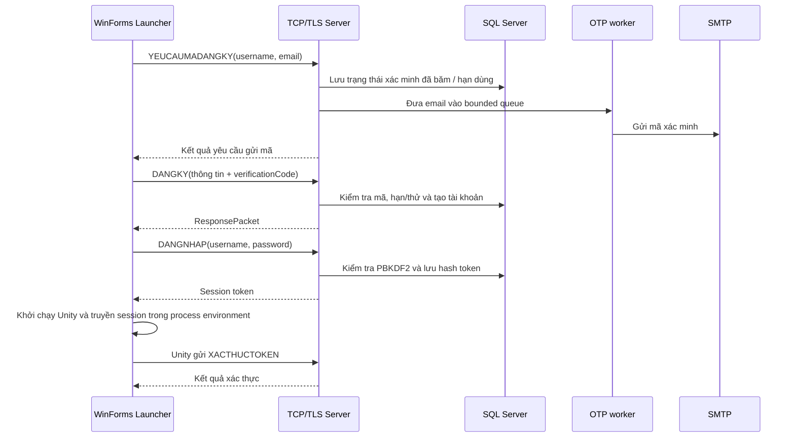

# BÁO CÁO ĐỒ ÁN NHẬP MÔN MẠNG — DÂN TỔ PHÓNG

**Môn học:** Nhập môn mạng  
**Cập nhật local build/smoke và AWS status:** 28/11/2026
**Nhánh:** `feature/own-netcode`  
**Commit nền:** `f7bc209`  
**Trạng thái phát hành:** Gói bạn bè sẵn sàng cho test cuối; chưa chứng nhận demo Internet hai máy vì TC02/GUI còn thiếu.

> Đây là bản báo cáo chính thức, hợp nhất kiến trúc, truy vết yêu cầu, kết quả
> kiểm thử, bằng chứng, runbook và các mục bị chặn. Chỉ tuyên bố PASS theo
> quan sát có log/capture. Endpoint AWS/TLS pin và một email OTP đã được xác minh
> trong lần chạy AWS trước đó; EC2 và RDS hiện đang dừng theo kiểm tra read-only.
> TC02 hai mạng và nhập OTP qua GUI vẫn chưa được kiểm chứng.

## Mục lục

1. [Chương 1 — Tổng quan đề tài](#chương-1-tổng-quan-đề-tài)
2. [Chương 2 — Thiết kế giao thức](#chương-2-thiết-kế-giao-thức-tầng-ứng-dụng)
3. [Chương 3 — DevOps và bảo mật mạng](#chương-3-triển-khai-hạ-tầng-devops-và-bảo-mật-mạng)
4. [Chương 4 — Kiểm thử, đánh giá và hạn chế](#chương-4-kiểm-thử-đánh-giá-và-hạn-chế)
5. [Phụ lục A — Demo local và AWS](#phụ-lục-a-hướng-dẫn-demo-local-và-aws)
6. [Phụ lục B — Thông tin nhóm](#phụ-lục-b-thông-tin-nhóm)

## Chương 1. Tổng quan đề tài

Dân Tổ Phóng là trò chơi đua xe scooter Unity có WinForms Launcher và Server
C# độc lập. Đồ án tập trung vào giao thức client–server do nhóm tự phát triển:
TCP, framing, tuần tự hóa, TLS, quản lý phiên và đồng bộ dữ liệu. SQL Server
lưu tài khoản/dữ liệu bền; SMTP được Server dùng để gửi OTP. Các chức năng
đăng ký, đăng nhập, đặt lại mật khẩu, phòng và multiplayer có phần source;
không đồng nghĩa các luồng đã được kiểm chứng bằng GUI hoặc Internet.

### Phạm vi chức năng

| Nhóm | Hiện trạng |
|---|---|
| WinForms Launcher | Có các Form đăng nhập, đăng ký, khôi phục mật khẩu và màn hình chính; cần kiểm thử tương tác trên bản GUI hiện hành. |
| Tài khoản/OTP | Có TCP commands, kiểm tra đầu vào, lưu hash OTP/email bền vững trong SQL và gửi email qua queue. Login DTO trả lại email đã lưu (integration-tested); nhập mã qua Launcher chưa xác minh. |
| Phòng/multiplayer | Room commands và event/snapshot TCP/TLS; Unity gửi điều khiển qua UDP có HMAC/sequence. Harness loopback xác nhận 4 racer và snapshot; trận GUI/Internet chưa có bằng chứng. |
| Solo | Vật lý xe chạy cục bộ trong Unity; build không thay cho kiểm thử chơi thật. |
| Còn thiếu | UDP broadcast discovery, phục hồi room sau restart, va chạm/loại xe dựa trên mô hình physics authoritative đầy đủ và kiểm thử gameplay qua GUI/Internet. |

### Yêu cầu chức năng và phi chức năng

- Đăng ký/đăng nhập/OTP, khôi phục mật khẩu và hồ sơ dùng TCP tới Server.
- Tài khoản được xác thực trước khi Launcher/Unity sử dụng token.
- Người chơi có thể tạo/tham gia phòng; điều khiển liên tục đi qua UDP có
  sequence/HMAC, còn event/snapshot tin cậy đi qua TCP/TLS.
- Server từ chối input sai định dạng, kiểm soát kích thước frame và giữ thứ tự
  dữ liệu trên từng TCP stream.
- Kết nối Internet phải dùng TLS, xác minh hostname/SAN, thời hạn và pin
  SHA-256 của chứng chỉ; không được tắt kiểm tra chứng chỉ ở bản Release.
- Mục tiêu môn học gồm ít nhất hai client, thông báo mất kết nối, dữ liệu UTF-8
  tiếng Việt, request dưới một giây trong test T4 và không lưu mật khẩu rõ.
  Những mục chưa quan sát được được ghi PARTIAL/BLOCKED, không xem là đạt.

### User stories và tiêu chí nghiệm thu

| Người dùng muốn… | Cho trước | Khi | Thì |
|---|---|---|---|
| Đăng ký bằng email và OTP | Email hợp lệ và code còn hạn | Nhập đúng code rồi gửi form | Server tạo tài khoản; code sai/hết hạn bị từ chối. GUI chưa xác minh. |
| Đăng nhập và mở game | Tài khoản hợp lệ | Gửi credentials qua TLS | Server trả phiên/token; sai tài khoản/mật khẩu nhận lỗi chung. GUI chưa xác minh. |
| Khôi phục mật khẩu | Tài khoản/email đã đăng ký | Nhập OTP hợp lệ và mật khẩu mới | Server cập nhật password hash; code sai/hết hạn bị từ chối. GUI chưa xác minh. |
| Tạo hoặc vào phòng | Hai phiên đã xác thực và phòng còn chỗ | Client A tạo, client B join | Membership cập nhật; mã sai/phòng đầy không thêm thành viên. Runtime chưa xác minh. |
| Chơi trận cùng người khác | Room đang chạy và input hợp lệ | Người chơi điều khiển xe | Server mô phỏng input của caller và gửi snapshot/event; chưa phải physics authoritative đầy đủ. |
| Rời trận hoặc reconnect | Racer đang trong room | Client ngắt rồi reconnect trong 120 giây | Server giữ state trong grace period; chưa có bằng chứng GUI/live match. |
| Spectate | Room đang chạy | Người xem yêu cầu tham gia spectate | Server đăng ký spectator và gửi state; source có nhưng runtime chưa xác minh. |

### Trường đăng ký/đăng nhập đối chiếu source

| Trường | Ràng buộc source | Ghi chú |
|---|---|---|
| Username | Bắt buộc, 3–20 ASCII letters/digits/`_` | UNIQUE phía DB; lỗi login dùng câu chung. |
| Password | Bắt buộc; 8–128 ký tự, có chữ cái và chữ số | PBKDF2 hash + salt; password chỉ gửi qua TLS. |
| Confirm password | Đăng ký/reset; phải khớp password | Kiểm tra client trước submit. |
| Full name | Đăng ký; 2–100 ký tự | Cột dữ liệu người dùng dùng NVARCHAR. |
| Email | Bắt buộc; tối đa 100 ký tự, định dạng email | Giới hạn đồng bộ client/server. |
| Verification code | Đúng 6 chữ số | Server kiểm hash, hạn và số lần thử; chưa kiểm chứng các nhánh GUI. |

## Chương 2. Network stack và thiết kế giao thức tự phát triển

```text
WinForms Launcher ── TCP/TLS :9000 ── DanToPhong.Server ── SQL Server / RDS
        │                                      └── SMTP provider (OTP)
        └── khởi chạy Unity, chuyển endpoint/mode/session token
Unity Multiplayer ── UDP :9000 ── movement input (HMAC + sequence)
Unity Multiplayer ── TCP/TLS :9000 ── room/auth/chat/events/snapshots
Unity Solo: vật lý local
```

Nhóm tự triển khai kênh client–server hybrid. TCP/TLS và
protocol JSON riêng chạy trên TCP/TLS cổng 9000; UDP movement chạy trên UDP cổng 9000.
Stack gồm TCP listener/session, datagram parser/HMAC, JSON DTO/command routing,
TLS validation/pinning và client service tương ứng trong WinForms/Unity.
Không sử dụng transport mạng bên thứ ba trong source hiện hành. TLS
bật mặc định và fail-closed; cấu hình client ghim SHA-256 leaf thumbprint đồng
thời kiểm SAN/hostname và hạn chứng chỉ. TC05 xác nhận pin đúng/sai và
plaintext behavior trên loopback; chưa có bằng chứng handshake Internet hiện
hành.

Client–Server dùng stack TCP/framing/DTO do dự án tự viết, không phụ thuộc thư
viện networking bên thứ ba cho kênh này. MailKit (đang dùng) chỉ phục
vụ Server → SMTP, không thay thế protocol client–server.

### 2.1. TCP framing và JSON

Mỗi message có dạng:

```text
+-------------------------------+---------------------------------------------+
| 4 byte độ dài payload, BE     | đúng N byte UTF-8 JSON                      |
+-------------------------------+---------------------------------------------+
```

- TCP là byte stream, vì vậy receiver đọc đủ header 4 byte rồi đủ body theo độ
  dài; ranh giới `Write`/`Read` không được xem là ranh giới message.
- Header là số nguyên big-endian. Payload là JSON UTF-8; độ dài tính theo byte,
  không dùng `string.Length`.
- Payload hợp lệ từ 1 tới 65.536 byte. Frame rỗng, quá giới hạn hoặc bị cắt
  giữa chừng bị từ chối/đóng kết nối.
- Request/response dùng `RequestPacket`/`ResponsePacket`; lỗi có `success`,
  `code`, `message`. Chưa có thương lượng protocol-version.
- Danh sách commands/DTO chi tiết: [docs/protocol.md](docs/protocol.md).

### 2.2. Cấu trúc gói tin và lệnh chính

| Loại | Trường tiêu biểu | Ý nghĩa |
|---|---|---|
| Request | `command`, `requestId`, `username`, `password`, `email`, `verificationCode`, `token` | `command` định tuyến thao tác; các trường còn lại phụ thuộc lệnh. Không gửi mật khẩu rõ ngoài TLS. |
| Response | `success`, `code`, `command`, `message`, DTO tùy chọn | Kết quả nghiệp vụ; lỗi framing/JSON không hợp lệ sẽ đóng kết nối thay vì trả thành công giả. |
| Room | `roomId`, `mapName`, `maxPlayers`, `playerCount`, `isRacing` | Phòng lưu trong RAM, không khôi phục sau khi Server restart. |
| Game input | `vehicleIndex`, `throttle`, `steer`, `brake`, `clientTick`, `clientTimestampMs` | Server kiểm tra input và dùng spawn/config của Server; client không gửi vị trí authoritative. |
| Snapshot/event | `gamePlayers[]`, `sequence`, `serverTimestampMs`, event ID/type | Dữ liệu trạng thái có thứ tự và timestamp; được gửi trên stream gameplay đã xác thực. |

Commands tài khoản gồm `DANGKY`, `DANGNHAP`, `YEUCAUMADANGKY`,
`YEUCAUMADATLAI`, `DOIMATKHAU`, `XACTHUCTOKEN`, `DANGXUAT` và `PING`.
Nhóm phòng/gameplay gồm `ROOM_CREATE`, `ROOM_JOIN`, `ROOM_LEAVE`,
`ROOM_STATE`, `ROOM_START`, `GAME_INPUT`, `GAME_STREAM`, `GAME_EVENT` và
`GAME_SNAPSHOT`. Danh mục đầy đủ và DTO nằm trong
[docs/protocol.md](docs/protocol.md).

### 2.3. Luồng đăng nhập và OTP



Mail được gửi bất đồng bộ qua queue bounded 64 job; worker retry tối đa ba
lần với lỗi transient/SMTP phù hợp. Mã OTP lưu dạng hash, nhưng queue chỉ ở RAM,
nên job đang chờ có thể mất nếu process crash. Smoke local chứng minh email
tổng hợp tới smtp4dev, không chứng minh đăng ký/OTP đầu-cuối qua GUI.

### 2.4. Phòng chơi và đồng bộ snapshot

Client tạo/join/start phòng qua TCP/TLS. Sau khi xác thực, racer gọi
`GAME_UDP_BIND` qua TCP/TLS để nhận session ID, HMAC key và sequence bắt đầu;
Unity gửi movement datagram UDP 9000 khoảng 20 Hz. Server kiểm HMAC,
sequence/giới hạn input, mô phỏng kinematics đơn giản và đẩy
`GAME_EVENT`/`GAME_SNAPSHOT` theo TCP/TLS. Snapshot có sequence/timestamp;
client giữ tối đa 8 mẫu và nội suy trạng thái remote. Harness DB-backed xác
nhận bốn racer UDP đồng thời và state phản ánh trong TCP snapshots; GUI/Internet
vẫn chưa được kiểm chứng.

Khi nhận EOF/FIN hoặc socket error, Server kết thúc receive loop và dispose
stream/socket. Nếu trận đang chạy, racer được đánh dấu disconnected và giữ
membership trong 120 giây để reconnect/spectate; ngoài trận thì membership
được gỡ. Restart Server làm mất room/match state trong RAM.

### 2.5. TLS, đa kết nối và đồng bộ

TLS bật mặc định trên Server/Launcher. Server fail-closed nếu thiếu chứng chỉ
hợp lệ. Client đọc `host`, `port`, `useTls` và
`certificateThumbprintSha256` từ file `server.json` không commit. Pin là SHA-256
của leaf certificate; client vẫn kiểm hostname/SAN và validity, chỉ chấp nhận
`UntrustedRoot` khi pin khớp. TC05 đã kiểm tra cơ chế này trên loopback, không
phải mạng Internet.

Server accept TCP, nhận UDP datagram và xử lý session bất đồng bộ bằng async I/O; dùng
`ConcurrentDictionary`, `SemaphoreSlim` và writer riêng cho từng stream.
Frame reader đọc đủ byte với cancellation/timeout và giới hạn 64 KiB. Khi EOF,
reset hoặc lỗi I/O, receive loop kết thúc, session/stream/socket được dọn; phòng
giữ racer trong grace period khi phù hợp. Giới hạn đồng thời cấu hình là 128
client; mỗi racer có command connection và stream gameplay TCP/TLS riêng.
Primary TCP/TLS connection xử lý lệnh; gameplay mở thêm stream đã xác thực
để nhận event/snapshot. UDP 9000 chỉ nhận movement input đã HMAC, gắn
sequence, kiểm giới hạn và rate-limit; key gửi qua TLS, lưu RAM và xóa khi
session kết thúc. Snapshot có server sequence/timestamp; event có ID thứ tự.
Unity gửi input mục tiêu 20 Hz, giữ tối đa 8 snapshot rồi loại mẫu cũ nhất khi
đầy. DB-backed loopback harness đã kiểm bốn racer UDP đồng thời; authenticated
gameplay tải kéo dài và mạng Internet vẫn chưa được đo.

Launcher giao dịch có timeout tối đa 12 giây; Unity request/gameplay stream
dùng timeout khoảng 8 giây. TLS handshake phía Server giới hạn khoảng 10 giây,
idle-read timeout 75 giây. Client heartbeat/PING danh nghĩa 20 giây; login
limiter theo username/IP cho tối đa 5 lần trong 15 phút rồi khóa 15 phút.
Các giá trị này được rà từ source; heartbeat/limiter chưa được chứng minh bằng
test runtime end-to-end.

OTP được lưu dưới dạng hash và request chỉ đưa job vào queue bounded 64 phần
tử; worker gửi SMTP nền, retry lỗi SMTP giới hạn tối đa ba lần. MailKit dùng
implicit TLS port 465 hoặc STARTTLS port 587. Queue chỉ ở RAM nên process crash
có thể làm mất job đã nhận; SMTP outage/recovery chưa được kiểm thử.

### 2.6. TCP so với UDP và lý do lựa chọn

| Tiêu chí | TCP/TLS (đang dùng) | UDP (movement input) |
|---|---|---|
| Tin cậy/thứ tự | Có truyền lại/thứ tự; phù hợp auth, OTP, room, chat, event và snapshot. TLS bảo mật nội dung. | Không đảm bảo giao nhận/thứ tự; sequence loại input cũ, input mất không truyền lại. |
| Ranh giới/message | Byte stream cần framing 4-byte big-endian + UTF-8 JSON. | Datagram cố định 74 byte, HMAC-SHA-256; giới hạn chính xác, không dùng broadcast discovery. |
| Độ trễ/bảo mật | Head-of-line blocking có thể trì hoãn snapshot mới sau mất gói; TLS mã hóa. | Phù hợp input liên tục; dữ liệu điều khiển không mã hóa, HMAC chỉ xác thực/toàn vẹn. Key được trao qua TLS. |
| Phân công kênh | TCP/TLS port 9000: auth, OTP, quản lý account, room, chat, event, snapshot. | UDP port 9000: control input liên tục. Không dùng cho kết quả thắng/thua hoặc snapshot. |

Đây là hybrid stack do nhóm tự phát triển. HMAC không thay thế TLS và không
bảo vệ bí mật datagram; TCP and UDP port 9000 ingress need approved `/32` restrictions. The previous
AWS runtime was verified with UDP 9001; this source/config change has not been
deployed to AWS.

### 2.7. Kết quả rà soát luồng đăng nhập và client async

Email đăng ký được lưu ở cột `NguoiDung.Email`; câu truy vấn đăng nhập đọc
email từ SQL và trả trong `UserInfoDto`, Launcher nạp vào màn hình hồ sơ.
Harness mới tạo tài khoản thử với email `.invalid`, đăng nhập qua TCP rồi so
sánh email trả về với giá trị SQL đã lưu. Không gửi hay lưu dữ liệu cá nhân.

Unity lobby/gameplay dùng `async Task` thay vì đọc `Task.Result` trong coroutine.
Request phòng khóa các nút tương ứng trong khi xử lý, monitor có cancellation
khi scene đóng/chuyển và lỗi kết nối được ghi log/hiển thị trạng thái. Các
callback async khác trong Unity/WinForms vẫn cần tương tác GUI để kiểm chứng;
build không chứng minh form/scene runtime hoặc DPI.

Lobby phân biệt Host và Guest: Guest không được gọi Start hoặc đổi map; Host
chọn map và yêu cầu mọi thành viên báo scene Lobby trước khi Start được chấp
nhận. Server trả số người ready/unready và chặn Start nếu chưa đủ điều kiện.
Protocol smoke kiểm tra giới hạn bốn người và readiness gate; việc đếm trạng
thái, quyền điều khiển và chuyển scene đồng bộ giữa các cửa sổ Unity vẫn cần
quan sát GUI.

Launcher login giữ token sau xác thực, mở Main rồi truyền token/host/port/TLS
pin/mode/room cho tiến trình Unity. `single` vào scene chọn track; `multiplayer`
vào lobby; danh sách phòng gửi phòng đang đua tới lối spectate, còn trạng thái
membership/join được xác nhận bởi Server. Lỗi kết nối trong Main hiện hiển thị
trạng thái thay vì bị bỏ qua. Đăng ký khóa nút khi request chạy, dừng/dispose
OTP timer và avatar khi đóng Form; xác thực code dùng đúng 6 chữ số ASCII.
Reset OTP hết hạn tại thời điểm `now >= expiry`. Đây là rà soát mã/build, chưa
thay cho ảnh thao tác GUI TC04/T2–T8.

Form Settings hiện gửi command `CAPNHATCAIDAT` tới Server thay vì báo thành
công cục bộ. Server yêu cầu mật khẩu hiện tại, xác thực dữ liệu, cập nhật email
và/hoặc hash mật khẩu trong SQL; khi đổi mật khẩu, thu hồi token cũ, cấp token
mới cho phiên hiện tại và đóng các phiên khác. Launcher chỉ cập nhật email sau
khi nhận kết quả thành công, thay token sau khi đổi mật khẩu, khóa nút trong
lúc chờ và hiển thị lỗi. Integration test xác minh mật khẩu hiện tại sai bị từ
chối, email/mật khẩu mới được lưu, token cũ bị thu hồi và đăng nhập bằng thông
tin mới thành công. Ảnh GUI thao tác Settings vẫn chưa có.

Rà soát SQL thấy các giá trị dữ liệu dùng `SqlParameter`; phần tạo database
dùng `DB_ID(@db)` và `QUOTENAME(@db)` vì tên database là identifier không thể
parameter hóa trực tiếp. TCP framing dùng header 4-byte big-endian và đọc đủ
header/body, có giới hạn 64 KiB, async I/O và cancellation token. SMTP OTP dùng
bounded queue/background worker; SQL/SMTP không được chạy trong luồng UI.

## Chương 3. Triển khai hạ tầng DevOps và bảo mật mạng

### 3.1. Local

Local test dùng Docker containers được chỉ định `dtp-sql` và `dtp-smtp`.
Database riêng là `DanToPhongDB_Test`; SMTP4dev nhận SMTP tại loopback
`localhost:2525`, giao diện web `http://localhost:5000`. Script
[scripts/run-local.ps1](scripts/run-local.ps1) kiểm tra hai container/cổng,
không tự start/stop container, thiết lập environment process-scoped, tạo chứng
chỉ test ngoài repo và chạy TLS loopback trên cổng 19000. Mật khẩu DB phải
được cấp qua `DANTOPHONG_TEST_SA_PASSWORD`; không ghi vào report/log.

### 3.2. AWS snapshot và chẩn đoán endpoint

Lần triển khai AWS đã được kiểm tra khi người dùng duyệt bật ngày 28/11/2026:
RDS đạt `available`, EC2 chạy và health checks đều `ok`. Sau đó hạ tầng được
dừng theo yêu cầu. Kiểm tra read-only mới nhất ngày 28/11 xác nhận EC2 và RDS
đều `stopped`; dịch vụ systemd/listener không thể được kiểm tra khi EC2 dừng.
Không thay đổi Security Group hoặc EIP của RDS trong lần kiểm tra mới nhất.

| Tài nguyên | Kết quả quan sát | Ý nghĩa/rủi ro |
|---|---|---|
| EC2 | `running`, loại `t3.micro`; health `ok`; systemd `dantophong` active; TCP 9000 và UDP 9001 đang listen. | TLS pin và một luồng Get Code đã được kiểm tra; hai client/mạng khác nhau chưa được thử. |
| RDS | `available`, engine SQL Server; `PubliclyAccessible=True`. | Cờ public-access đang bật dù ingress hạn chế. Không kết luận DB private; owner cần đánh giá chuyển private-only theo quy trình được duyệt. |
| VPC/subnet/routing | Không có quan sát đủ trong snapshot này để kết luận subnet hoặc route table cụ thể. | Không khẳng định DB đang private-only hoặc Server↔RDS routing đã được kiểm chứng. |
| Security Group EC2 | TCP 9000 từ một IPv4 `/32`; SSH 22 từ một IPv4 `/32`. Không thấy `0.0.0.0/0` hoặc `::/0`. | Một `/32` chưa đủ cho hai mạng nếu IP client thứ hai khác; bổ sung chỉ khi được duyệt và xác minh IP hiện hành. |
| Security Group RDS | TCP 1433 từ một IPv4 `/32` và một tham chiếu Security Group; không thấy `0.0.0.0/0` hoặc `::/0`. | Không công khai cổng DB cho mọi IPv4/IPv6; vẫn cần xem lại `PubliclyAccessible=True`. |
| Elastic IP | EIP riêng đã được gắn vào EC2 theo phê duyệt; EIP cũ trên `RDSNetworkInterface` được giữ nguyên. | Endpoint ổn định hơn cho EC2; EIP mới có thể phát sinh phí IPv4. Không đưa địa chỉ IP vào report/log. |

Root cause của `Cannot connect to server` là client từng dùng endpoint cũ trỏ
tới EIP của RDS, trong khi SAN chứng chỉ không khớp DNS EC2; biến môi trường
user-scope cũ còn có thể ghi đè cấu hình trong `server.json`. Client hiện ưu
tiên cấu hình JSON, endpoint EC2 có EIP riêng, chứng chỉ đã được xoay theo SAN
mới và helper `Pin` xác minh TLS live thành công. Gói bạn bè được build lại với
endpoint và pin đã xác minh. Không di chuyển EIP của RDS.

SMTP dùng `smtp.gmail.com:465`; chỉ ghi nhận trạng thái cấu hình, không ghi
credential. Trước khi deploy Server Release mới, một Get Code request qua TLS
được chấp nhận và người dùng xác nhận đã nhận email. Không gửi OTP lặp lại.
Khi AWS hoạt động, Server Linux Release được triển khai với rollback backup;
systemd active, SQL Server/RDS kết nối thành công, TCP 9000 và UDP 9001 listen.
Không sửa Security Group; không tạo hay redeploy RDS. Chi tiết đã khử dữ liệu tại
[aws-mail-connectivity-diagnosis-20261128.log](docs/evidence/aws-mail-connectivity-diagnosis-20261128.log).

Trạng thái hiện tại được xác nhận bằng `.\scripts\aws-test-helper.ps1 -Action
Status`: EC2 và RDS đều `stopped`. Ingress được rà soát không có
`0.0.0.0/0`/`::/0` cho TCP 9000, UDP 9001 hoặc TCP 1433. Dịch vụ AWS được kiểm
chứng trước đó dùng UDP 9001; source và template hiện chuyển sang UDP 9000
cùng số cổng TCP. Chưa deploy thay đổi này và chưa xác minh listener/rule UDP
9000. Không start/stop, không mở rule và không phát sinh thay đổi AWS trong
lượt kiểm thử local này.

Một lần kiểm tra AWS cũ được lưu trong
[TC05-tls-plaintext.log](docs/evidence/TC05-tls-plaintext.log) ghi nhận TLS
handshake thất bại nhưng probe plaintext nhận phản hồi từ một runtime remote.
Không thể xác định binary/config remote tại thời điểm đó; không dùng log cũ này
để kết luận build hiện tại đang chạy TLS trên AWS. TC05 PASS hiện tại chỉ là
loopback pinned TLS.

Không phát hiện ingress `0.0.0.0/0`/`::/0` cho TCP 9000, UDP 9001 hoặc TCP
1433. Tuy nhiên, chỉ có một nguồn giới hạn cho TCP 9000 và không có UDP 9001
ingress. Free Tier API không trả mục sử dụng public IPv4 nên không xác nhận
được chi phí/Free Tier cho EIP mới; không mở rule và không claim TC02.
Snapshot lịch sử 27/11 vẫn lưu tại
[aws-status-readonly-20261127-2005.log](docs/evidence/aws-status-readonly-20261127-2005.log).

### 3.3. Tự khởi động và chứng chỉ trên EC2

Unit [deploy/aws/dantophong.service](deploy/aws/dantophong.service) đã có
`WantedBy=multi-user.target`, `Restart=always`, nạp
`/etc/dantophong/server.env` và chạy `/usr/bin/dotnet
/opt/dantophong/DanToPhong.Server.dll`. Đây mới là unit trong repo; chưa xác
nhận nó đã được cài/enabled trên EC2 đang dừng.

[deploy/aws/setup-ec2.sh](deploy/aws/setup-ec2.sh) là setup một lần cho Ubuntu
EC2, yêu cầu `ubuntu` user/group, systemd, OpenSSL, `/usr/bin/dotnet` và .NET 10
runtime đã được cài. Script kiểm tra binary, DB config, TLS=true, TCP 9000,
UDP 9000,
SAN, PFX/public cert trùng nhau; tạo chứng chỉ tự ký ngoài repo nếu cần; đặt
env mode 0600 và PFX root:ubuntu 0640; cài/bật unit, restart và kiểm tra listener.
Script không cài package và không thay đổi AWS. Thay chứng chỉ cũ cần
`--rotate-certificate` rõ ràng.

### 3.4. Secret và cấu hình

- Không commit DB connection string, password, SMTP App Password, OTP, token,
  PFX/private key hoặc file `server.env` thật.
- `server.env.example` và `server.json.example` chỉ là mẫu; secret vận hành
  phải được cấp bằng secret store/environment ngoài Git.
- Không chụp env file, terminal history, OTP/password/token hoặc IP public.
- AWS RDS SQL port 1433 chỉ nên nhận traffic từ EC2 Security Group/private
  path và nguồn quản trị được duyệt; tuyệt đối không mở `0.0.0.0/0`/`::/0`.
- UDP 9000 mang input điều khiển đã HMAC nhưng không được mã hóa; expose chỉ
  từ IP tester `/32`. Không mở UDP port hoặc TCP 9000 cho toàn Internet.

### 3.5. Quy trình vận hành và tái hiện

#### Local build và smoke

Yêu cầu .NET 10 SDK, Docker containers đã sẵn có, và biến
`DANTOPHONG_TEST_SA_PASSWORD` được đặt ngoài repo. Từ PowerShell tại repo:

```powershell
.\scripts\run-local.ps1
```

Script dùng DB test, TLS loopback `127.0.0.1:19000` và test certificate ngoài
repo. Nó không dùng cổng production 9000 và không tự bật/tắt Docker. Mở
smtp4dev tại `http://localhost:5000` để xem mail test; che mã OTP trước khi
chụp ảnh. Build/smoke hiện có:
[local-build-smoke-20261127-184655.log](docs/evidence/local-build-smoke-20261127-184655.log).

#### Hai client GUI

1. Chạy Server local bằng `run-local.ps1`, bảo đảm hai tài khoản disposable
   riêng.
2. Mở hai Launcher/Unity instance độc lập, cùng endpoint và TLS pin; đăng nhập
   hai tài khoản khác nhau.
3. Tạo/join cùng phòng, bắt đầu trận; quan sát movement/snapshot ở cả hai.
4. Thử thoát bằng nút X, reconnect và spectate; ghi nhận kết quả thật.

Hướng dẫn chi tiết mở hai client ở
[README – Run two GUI clients](README.md#run-two-gui-clients-on-one-machine).
Hai instance từng mở tới main menu; chưa có bằng chứng trận live.

#### AWS first-time setup

Chỉ làm sau khi kiểm tra chi phí/Free Tier, xác nhận account/region/ID và được
duyệt start. Trước tiên cấu hình `/etc/dantophong/server.env` trên EC2 qua
secret store; dùng private RDS endpoint, TLS bật, port 9000 và không thêm
secondary listener. Publish framework-dependent Server `linux-x64`, copy
binary vào `/opt/dantophong`, copy `setup-ec2.sh` cùng service unit lên EC2, rồi
chạy:

```powershell
$publish = Join-Path $env:TEMP 'dtp-server-publish'
dotnet publish .\UI\DanToPhong.Server\DanToPhong.Server.csproj -c Release -r linux-x64 --self-contained false -o $publish
$ec2Host = 'REPLACE_WITH_EC2_PUBLIC_DNS'
$sshKey = 'C:\path\outside\repo\to\ssh-key.pem'
ssh -i $sshKey "ubuntu@$ec2Host" 'mkdir -p /tmp/dtp-deploy'
scp -i $sshKey -r $publish "ubuntu@${ec2Host}:/tmp/"
scp -i $sshKey .\deploy\aws\setup-ec2.sh .\deploy\aws\dantophong.service "ubuntu@${ec2Host}:/tmp/dtp-deploy/"
```

Sau khi cấu hình `/etc/dantophong/server.env` từ secret store được duyệt và
copy publish contents vào `/opt/dantophong`, chạy trên EC2:

```bash
sudo bash /tmp/dtp-deploy/setup-ec2.sh --certificate-host "YOUR_STABLE_DNS_NAME_OR_IP"
```

Không đặt private key hoặc secret vào `/tmp` hoặc repository.

Lệnh này chỉ chạy trên EC2 đã chuẩn bị đúng OS/runtime/config. Nó in SHA-256
thumbprint công khai; dùng hostname/IP giống SAN. Nếu IP EC2 đổi sau stop/start,
dùng DNS ổn định hoặc rotate cert và cập nhật pin; không dùng pin cũ.

#### Bật, kiểm tra TC02 và tắt AWS

Sau khi đã duyệt chi phí, helper có thể thêm tạm TCP 9000 và UDP 9000 từ các
IPv4 `/32` do người vận hành chỉ định. Chỉ áp dụng vào SG gắn EC2, không phải
RDS; không mở `0.0.0.0/0`/`::/0`, không mở 1433 và không thay EIP gắn RDS.

```powershell
.\scripts\aws-test-helper.ps1 -Action Status
.\scripts\aws-test-helper.ps1 -Action Start -RdsInstanceId 'RDS_ID' -Ec2InstanceId 'EC2_ID' -ClientHostName 'DNS_TRONG_SAN' -SshKeyPath 'C:\path\outside\repo\key.pem'
.\scripts\aws-test-helper.ps1 -Action Pin -ClientHostName 'DNS_TRONG_SAN' -ExpectedThumbprint 'PIN_64_HEX_TU_EC2'
```

`Start` hỏi xác nhận chính xác, đợi RDS `available` trước EC2, đợi health
checks, xác minh qua SSH `systemctl is-active/is-enabled` và cổng 9000, rồi
kiểm tra TCP từ client hiện tại. Các lệnh chờ có timeout. `Pin` đối chiếu
certificate live với pin đã đọc trực tiếp từ EC2, xác minh hostname/validity và
chỉ sau đó in JSON client; đặt JSON đó vào file cấu hình client không commit.
TC02 vẫn cần máy thứ hai ở mạng khác và quan sát GUI thật.

Sau test, gỡ các rule 9000 tạm thời bằng quy trình được duyệt, rồi chạy:

```powershell
.\scripts\aws-test-helper.ps1 -Action Stop -RdsInstanceId 'RDS_ID' -Ec2InstanceId 'EC2_ID'
```

Helper dừng EC2, đợi trạng thái `stopped`, gỡ rule game `/32` nếu tùy chọn được
chỉ định, rồi mới dừng RDS để tránh giữ DB chạy khi không dùng. Mỗi lệnh yêu
cầu xác nhận chính xác trước mọi thao tác tốn phí/thay đổi SG; không có lệnh
AWS nào được chạy trong lượt kiểm thử local này. Ảnh Internet còn thiếu gồm
`tc02-client-a-cross-network-room.png`,
`tc02-client-b-cross-network-room.png` và
`tc05-internet-pinned-handshake.png`; không ghi TC02/Internet TLS PASS trước
khi hai mạng độc lập và endpoint AWS được chạy thật.

`Stop` yêu cầu xác nhận, dừng EC2 và chờ `stopped` trước khi yêu cầu dừng RDS.
Chạy `Status` sau đó để xác nhận. Lệnh start/stop có thể phát sinh phí và
không được chạy tự động trong báo cáo này.

## Chương 4. Kiểm thử, đánh giá kết quả và hạn chế

Chỉ mục file đầy đủ và phạm vi từng log/capture:
[docs/evidence/README.md](docs/evidence/README.md). Các log evidence không
chứa password/connection string/token; pcapng chỉ là loopback.

| Test | Trạng thái | Kết quả và bằng chứng |
|---|---|---|
| TC01 | **PASS** | TCP reachability từ một máy; không chứng minh login hay hai mạng. [TC01-tcp-reachability.log](docs/evidence/TC01-tcp-reachability.log) |
| TC02 | **BLOCKED** | Chưa chạy hai client đăng nhập trên hai mạng độc lập, chưa thấy cùng room/state. [TC02-two-client-gui.log](docs/evidence/TC02-two-client-gui.log) |
| TC03 | **PARTIAL** | DB-backed harness kiểm bốn racer tạo/join room, gửi UDP movement HMAC/sequence và nhận đủ vị trí trong TCP snapshots; spectator thêm cũng nhận state. Unity GUI chưa xác minh. [local-protocol-integration-20261128-043514.log](docs/evidence/local-protocol-integration-20261128-043514.log) |
| TC04 | **PARTIAL** | Một request Get Code live qua TLS đã được server chấp nhận và email thử nghiệm được người dùng xác nhận đã nhận; chưa nhập mã đúng/sai/hết hạn/khóa trên Launcher. Harness DB-backed xác minh các nhánh OTP, login limiter, email persistence và từ chối email khôi phục không khớp. [AWS diagnosis](docs/evidence/aws-mail-connectivity-diagnosis-20261128.log), [integration log](docs/evidence/local-protocol-integration-20261128-043514.log) |
| TC05 | **PASS** | Ca pinned TLS valid, secondary listener, pin sai, plaintext reject và plaintext tường minh chạy được trên loopback. Không chứng minh Internet. [TC05-pinned-local-20261127-212014.log](docs/evidence/TC05-pinned-local-20261127-212014.log) |
| TC06 | **PASS** | Loopback capture: plaintext PING đọc được, TLS 1.3 application records được mã hóa. [TC06-TC11-TC12-loopback-capture.log](docs/evidence/TC06-TC11-TC12-loopback-capture.log) |
| TC07 | **PARTIAL** | Harness xác minh TCP reset, reconnect cùng tài khoản trong grace period/snapshot; restart làm mất room RAM và reconnect bị từ chối. GUI chưa xác minh. [local-protocol-integration-20261128-043514.log](docs/evidence/local-protocol-integration-20261128-043514.log) |
| TC08 | **PASS** | Unity Windows x64 build thành công; không chứng minh gameplay/network. [TC08-unity-build.log](docs/evidence/TC08-unity-build.log), [TC08-clean-clone-build.log](docs/evidence/TC08-clean-clone-build.log) |
| TC09 | **PASS** | In-memory framing/mailbox/account-boundary/queue smoke; không phải live gameplay/load. [TC09-framing-smoke.log](docs/evidence/TC09-framing-smoke.log) |
| TC10 | **PARTIAL** | 50 anonymous connections, p95 1.5 ms/max 6.9 ms with incomplete-header slow sender; malformed JSON/oversized header were closed. Authenticated/gameplay sustained load, UDP loss/reordering and Clumsy remain untested. [local-protocol-integration-20261128-043514.log](docs/evidence/local-protocol-integration-20261128-043514.log), [TC10-loopback-framing-test.log](docs/evidence/TC10-loopback-framing-test.log) |
| TC11 | **PASS** | Npcap Loopback quan sát SYN/SYN-ACK và FIN/FIN-ACK. [Capture log](docs/evidence/TC06-TC11-TC12-loopback-capture.log), [pcapng](docs/evidence/TC11-TC12-loopback-test.pcapng) |
| TC12 | **PASS** | TLS 1.3 handshake/cipher và đối chiếu plaintext/TLS trên capture loopback. [Capture log](docs/evidence/TC06-TC11-TC12-loopback-capture.log), [pcapng](docs/evidence/TC11-TC12-loopback-test.pcapng) |
| T1 | **PASS** | Listener loopback `127.0.0.1:9000` được ghi trong log; không phải public reachability. [T1-T8-chapter3-tests.log](docs/evidence/T1-T8-chapter3-tests.log) |
| T2 | **PARTIAL** | Bốn TCP client login; email trả lại từ SQL; recovery mismatch, password reuse rejection, password-protected avatar, cập nhật account và token rotation đã test protocol-level. GUI chưa xác minh. [local-protocol-integration-20261128-043514.log](docs/evidence/local-protocol-integration-20261128-043514.log) |
| T3 | **PARTIAL** | PONG trong 2.1 ms và 0.7 ms; GUI chưa xác minh. Cùng integration log. |
| T4 | **PARTIAL** | Chat hai socket 6.4 ms; GUI chưa xác minh. Cùng integration log. |
| T5 | **PARTIAL** | Đủ 20 tin theo thứ tự ở console; GUI chưa xác minh. Cùng integration log. |
| T6 | **PARTIAL** | Tiếng Việt round-trip đúng ở console; GUI rendering chưa xác minh. Cùng integration log. |
| T7 | **PARTIAL** | TCP reset, disconnect event và reconnect trong grace period đạt ở protocol; nút X GUI chưa thử. Cùng integration log. |
| T8 | **PARTIAL** | Server test dừng khiến command/game-stream mất kết nối; UI notification chưa thử. Cùng integration log. |

### 4.1. Build và kiểm thử tự động chạy ngày 28/11/2026

[Unity player build](docs/evidence/local-unity-hybrid-build-20261127-2200.log),
[smoke mới](docs/evidence/local-protocol-smoke-20261128.log),
[TC05](docs/evidence/TC05-pinned-local-20261127-212014.log) and
[integration mới nhất](docs/evidence/local-protocol-integration-20261128-043514.log) logs:

- Unity Windows x64 player build completed successfully. The generated Unity
  solution required a NuGet restore, then built in Release with 0 errors and
  7 existing Unity-script warnings (`CS8632`/`CS0649`).
  [Player build](docs/evidence/local-unity-hybrid-build-20261127-2200.log),
  [restore](docs/evidence/local-unity-solution-restore-20261127-2210.log),
  [Unity solution Release](docs/evidence/local-unity-solution-release-build-20261127-2210.log).
- Server and WinForms Launcher Release builds completed with 0 warnings and
  0 errors. [Combined build record](docs/evidence/local-hybrid-release-build-20261127-2205.log).
- Protocol smoke: PASS cho framing, malformed/oversized frame, mailbox,
  validation, certificate pinning và retry queue mô phỏng.
  [Smoke log](docs/evidence/local-protocol-smoke-20261127-212006.log).
- TC05 pinned TLS: PASS bốn transport case, gồm pin match/mismatch,
  plaintext rejection/explicit loopback, SAN/hostname checking. Certificate
  temporary outside repo was removed. [Log](docs/evidence/TC05-pinned-local-20261127-212014.log).
- SMTP4dev: email tiếng Việt tổng hợp có attachment được chấp nhận; worker
  gửi nội dung OTP tổng hợp tới smtp4dev. Không dùng SMTP credential hoặc email
  thật; không ghi mã xác minh vào log.
- Integration harness dùng riêng `DanToPhongDB_Test`, tạo/xóa ba tài khoản thử;
  kiểm OTP hash/expiry/attempt, login limiter, email persistence, đổi email và
  mật khẩu có xác thực, token rotation/revocation, room/spectate/input/reconnect,
  restart, 50 anonymous clients và lỗi framing. Không gửi OTP mail mới.
  Lần chạy 27/11 xác nhận bốn UDP racers được xác thực HMAC và bốn vị trí
  server-authoritative xuất hiện trong TCP snapshots; p95 3.4 ms/max 8.0 ms
  cho tải 50 kết nối anonymous. [Integration log](docs/evidence/local-protocol-integration-20261127-214844.log).
- Lần tích hợp mới nhất kiểm tra thêm email khôi phục không khớp, cấm đặt lại
  mật khẩu cũ, avatar bắt buộc xác thực mật khẩu hiện tại và lưu/tải đúng theo
  tài khoản. Bốn racer UDP, spectator, snapshots, reconnect/restart, chat,
  OTP state và framing/load đều pass ở mức protocol. 50 client anonymous:
  p95 1.5 ms, tối đa 6.9 ms. [Integration log](docs/evidence/local-protocol-integration-20261128-043514.log).
- Release build ngày 28/11 cho Unity-generated solution, Server và Launcher
  đều thành công với 0 warning/0 error; protocol smoke cũng pass, bao gồm
  giới hạn bốn người và chặn Start đến khi mọi thành viên báo Lobby ready.
  [Unity solution](docs/evidence/local-unity-solution-release-20261128.log),
  [Server](docs/evidence/local-server-release-20261128.log),
  [Launcher](docs/evidence/local-launcher-release-20261128.log),
  [smoke](docs/evidence/local-protocol-smoke-20261128.log).
- Unity Windows x64 player được build lại từ Build Settings hiện tại; ZIP bạn
  bè được đóng gói lại với Launcher self-contained, Unity player và endpoint
  TLS TCP 9000/UDP 9000. Archive có 496 entries, đủ hai executable và cấu hình
  khớp pin đã xác minh trước đó. AWS đang dừng nên lần đóng gói này không kiểm
  tra live endpoint. Publish phát sinh 6 cảnh báo nullable trong Designer tự
  sinh, 0 lỗi. [Unity build](docs/evidence/local-unity-player-build-20261128.log),
  [package](docs/evidence/local-friends-package-20261128.log).
- Không có GUI hoặc hai mạng độc lập được kiểm tra. Cổng 9000/19000 trống sau
  khi harness kết thúc.
- `dotnet restore .\DanToPhong.slnx` tạo assets cần cho Unity-generated
  projects; sau đó Unity solution, Server và Launcher đều build Release thành
  công. Restore và Unity solution build logs được liên kết ở trên.
Commands:

```powershell
dotnet build .\UI\DanToPhong.Server\DanToPhong.Server.csproj -c Release --no-restore
dotnet build .\UI\UI\UI.csproj -c Release --no-restore
dotnet run --project .\UI\DanToPhong.Protocol.Smoke\DanToPhong.Protocol.Smoke.csproj -c Release --no-restore
dotnet run --project .\UI\DanToPhong.Protocol.Smoke\DanToPhong.Protocol.Smoke.csproj -c Release --no-restore -- --smtp4dev-sample
dotnet run --project .\UI\DanToPhong.Protocol.Smoke\DanToPhong.Protocol.Smoke.csproj -c Release --no-restore -- --smtp4dev-otp-queue
```

TC10 được mở rộng trong integration run: 50 client đồng thời trong khi một
slow sender giữ header chưa hoàn chỉnh; p95 3.4 ms/max 8.0 ms; malformed JSON
và oversized header bị đóng. Đây là test loopback bounded, không phải benchmark
tải xác thực/gameplay kéo dài.

### Email bổ sung

- E2 queue worker đã giao mail OTP tổng hợp vào smtp4dev; outage/recovery chưa
  chạy. [E2-smtp4dev-queue-delivery.log](docs/evidence/E2-smtp4dev-queue-delivery.log).
- E3 sample tiếng Việt/attachment được smtp4dev chấp nhận; ProtocolLogger
  redaction được bật và trace chỉ ở memory. Chưa chứng minh Gmail/TLS/AUTH;
  logger không redacts body. [E3-smtp-sample.log](docs/evidence/E3-smtp-sample.log).

### 4.2. Phần bắt buộc người dùng thao tác tay

Checklist thao tác, khung hình và yêu cầu che dữ liệu chi tiết:
[docs/evidence/screenshot-checklist.md](docs/evidence/screenshot-checklist.md).
Ảnh chưa chụp không được tạo hoặc ghi PASS trước.
TC02 cần hai máy trên hai mạng độc lập và AWS chỉ được bật sau phê duyệt chi
phí; T2–T8/TC03/TC04/TC07 cần Launcher/Unity GUI thật. Local two-client dùng
hướng dẫn [Chạy hai GUI client](README.md#run-two-gui-clients-on-one-machine);
đối chiếu endpoint/TLS pin trong `server.json` trước khi đăng nhập.

| Ca | Tên ảnh cần lưu trong `docs/evidence/` | Nội dung cần quan sát |
|---|---|---|
| TC02 | `tc02-client-a-cross-network-room.png`; `tc02-client-b-cross-network-room.png` | Hai máy/mạng, cùng endpoint và room, trạng thái đồng bộ. |
| TC05 Internet | `tc05-internet-pinned-handshake.png` | Client ngoài AWS kết nối endpoint bằng TLS pin; xác nhận hostname/SAN và chứng chỉ trên build đang chạy. Che public IP, token và dữ liệu cert riêng. |
| TC03 | `tc03-room-create-join.png`; `tc03-snapshot-both-clients.png`; `tc03-spectate-active-room.png` | Xác minh lại trên GUI việc harness đã kiểm tra ở protocol: hai Unity window, cùng room, chuyển động racer/snapshot peer và vào xem trận đang chạy. |
| Lobby / Select | `lobby-host-readiness-gate.png`; `select-host-map-guest-vehicle-only.png`; `select-start-guest-sync.png` | Host thấy số Guest chưa sẵn sàng và Start bị chặn; Guest không có Start, chỉ chọn xe; Host bắt đầu thì Guest nhận thông báo và cùng chuyển vào trận. |
| TC04 | `tc04-otp-smtp4dev-mail.png`; `tc04-otp-valid-success.png`; `tc04-otp-wrong-rejected.png`; `tc04-otp-expired-rejected.png`; `tc04-otp-attempt-lockout.png` | Mail/time và kết quả accepted/rejected/expired/locked trong Launcher; che OTP. |
| TC07 | `tc07-reconnect-within-grace.png`; `tc07-server-restart-outcome.png` | Xác minh lại qua GUI reconnect trong 120 giây và thông báo/state khi restart; protocol harness đã thấy room RAM mất sau restart. |
| TC10 | `tc10-load-summary.png`; `tc10-slow-malformed-disconnect.png` | GUI/console screenshot chỉ bổ sung nếu chạy thêm tải; ghi concurrency/latency thực đo và xử lý slow/malformed/oversized/disconnect. |
| T2–T3 | `t2-t3-two-clients-connected.png` | Hai GUI client đã kết nối và Server log có timestamp. |
| T4 | `t4-message-delivery-time.png` | Cùng message ở sender/receiver và thời gian đo <1s. |
| T5–T6 | `t5-t6-sequence-and-vietnamese.png` | 20 message đủ/thứ tự và tiếng Việt hiển thị đúng. |
| T7 | `t7-peer-close-and-notification.png` | Đóng cửa sổ client A, session cleanup, client B nhận disconnect. |
| T8 | `t8-server-stop-and-client-loss.png` | Server test dừng và cả hai GUI client báo mất kết nối. |

Luôn che email/tên cá nhân, OTP, password, token, connection string, khóa/chứng
chỉ riêng, IP public và nội dung riêng tư. TC06/11/12 có thể chụp thêm
`tc06-11-12-wireshark-loopback.png`, nhưng không thay pcap gốc và không để lộ
payload hoặc địa chỉ ngoài loopback.

### 4.3. Truy vết yêu cầu đồ án

Ma trận đầy đủ theo rubric và vị trí source:
[docs/requirements-traceability.md](docs/requirements-traceability.md);
checklist tổng:
[docs/requirements-checklist.md](docs/requirements-checklist.md).

| Nhóm/mã | Trạng thái | Ghi chú |
|---|---|---|
| R1 – GUI, Server/DB, ít nhất hai client | PARTIAL | Build có; trận GUI hai client chưa chạy. |
| R2 – packet/framing/UTF-8/size/JSON/version | PARTIAL | Framing và giới hạn có test; chưa có protocol-version negotiation. |
| R3a–R3g – accept/session/mailbox/timeout/shutdown/async/dispose | PARTIAL | Nhiều cơ chế có trong source và smoke; slow socket, nhiều kiểu disconnect và GUI shutdown chưa xác minh đầy đủ. |
| R4 – SQL/input/password/hash/auth error | PARTIAL | PBKDF2+salt, tham số hóa và validation có trong source; cần runtime DB/error test theo rubric. |
| R5 – admin role/authorization | NOT IMPLEMENTED | Chưa thấy role admin và server-side authorization tương ứng. |
| R6 – Git hygiene/reproducibility | PARTIAL | Unity-generated solution, Server và Launcher Release builds đã thành công; cần tự kiểm history/tag và clean clone cuối trước nộp. [Build log](docs/evidence/local-release-build-20261127-2115.log). |
| V1–V3 – input/trùng username/login sai | PARTIAL | Validation/UNIQUE/common login error trong source; GUI evidence còn thiếu. |
| V4 – connect failure khác timeout/no response | NOT VERIFIED | Chưa có ảnh GUI chứng minh thông báo khác nhau và mở lại nút. |
| V5 – DB lỗi thân thiện, log server chi tiết | PARTIAL | Có xử lý source; chưa thử database failure runtime. |
| G1 – async/UI không treo/trạng thái nút | PARTIAL | Nhiều handler async; chưa rà toàn bộ GUI trực tiếp. |
| G2 – loading/process/error/success cho mọi màn hình | NOT VERIFIED | Cần xác minh UI thật từng màn hình/trạng thái. |
| G3–G4 – control/tab/validation/copy lỗi | PARTIAL | Giới hạn dùng chung có; chưa đối chiếu toàn bộ form và tiêu chí UI. |
| G5 – Unity chịu mạng chậm/mất kết nối | PARTIAL | Có async/interpolation source; chưa chạy client thật trong mạng suy giảm. |
| GAME1 – client không sửa state người khác | PARTIAL | Smoke giả `UserId`/`TargetId` chỉ làm caller tự-forfeit; integration test từ chối input sai/stale, bỏ tọa độ client và broadcast movement đã clamp từ server. Finish/winner/full physics và trận GUI live chưa xác minh. |
| B1–B7 – báo cáo, stories, forms, diagrams, networking, deployment, tests | PARTIAL | Báo cáo này hợp nhất nội dung; một số diagrams/flows/GUI và test còn cần người dùng kiểm tra. |
| B8 – phân công/liên hệ | OWNER INPUT | Giữ `[ĐIỀN: ...]`; nhóm tự bổ sung sự thật. |
| B9–B10 – hạn chế/công cụ/tái hiện | PARTIAL | Hướng UDP và runbook có; công cụ hỗ trợ/GUI runtime cần xác nhận. |
| E1–E4 – SMTP/queue/logger/OTP | PARTIAL | SMTP4dev/queue smoke có; Gmail/TLS, outage recovery, OTP GUI chưa hoàn tất. |
| P2a–P2c – UDP discovery/state/free tier | NOT IMPLEMENTED / NOT VERIFIED | UDP discovery chưa làm; Free Tier API không trả mục public IPv4, chi phí EIP chưa xác nhận. |

### 4.4. Gameplay và giới hạn kiểm tra phía Server

Prototype giữ trạng thái phòng trong RAM; reconnect grace period trong source
là 120 giây, nhưng restart Server làm mất room state. Server tính chuyển động
bằng kinematics đơn giản, không mô phỏng đầy đủ Rigidbody/va chạm Unity.

Các kiểm tra input được ghi nhận trong source:

- Input gắn với session đã xác thực/người chơi gọi; `UserId`/`TargetId` do
  client gửi không được dùng để tác động trạng thái đối thủ.
- `Throttle` và `Steer` phải hữu hạn và nằm trong `[-1, 1]`.
- `ClientTick` phải tăng nghiêm ngặt; timestamp client chỉ bắt buộc có, không
  kiểm tra độ mới/độ lệch thời gian.
- Client không gửi vị trí được tin cậy; Server mô phỏng vị trí/yaw, bước
  danh nghĩa 0,05 giây, clamp speed `[-5, 25]`, input timeout khoảng 0,5 giây
  để phanh và bù tối đa 4 bước mỗi lần.
- Checkpoint chỉ tăng theo thứ tự khi đoạn chuyển động cắt gate kế tiếp;
  finish chỉ được ghi sau đủ checkpoint và cắt finish gate.
- `ELIMINATE` là yêu cầu tự-forfeit của caller, không phải quyết định va chạm
  do Server phát hiện. Nó không tuyên bố người khác thắng và không cấp thưởng
  cho người khác. Winner chỉ được ghi khi Server kiểm tra finish gate.

Chưa có server-owned timer hoàn thành, kiểm chiều chạy, phát hiện va chạm,
văng/rơi khỏi đường, detector dịch chuyển bất thường độc lập, hay luật loại xe
do physics phía Server. Vì client không gửi vị trí được chấp nhận, không khẳng
định đã kiểm tra teleport bằng cách so sánh vị trí client. Chưa có trận live
để xác minh các guard này end-to-end.

### 4.5. Hạn chế và hướng phát triển

1. Hoàn tất OTP GUI đúng/sai/hết hạn/attempt lockout, limiter, heartbeat và
   lỗi CSDL với dữ liệu test.
2. Chạy hai client GUI thật, tạo phòng, chơi trận, quan sát snapshot, thử nút
   X, reconnect/spectate và server restart.
3. Đo tải authenticated/gameplay, slow sender và impairment có kiểm soát;
   không dùng Clumsy nếu cần quyền hệ thống chưa được duyệt.
4. Đánh giá việc chuyển RDS sang private-only; không di chuyển EIP đang gắn
   RDS-managed ENI hoặc thay đổi SG khi chưa phê duyệt.
5. Bổ sung protocol versioning, server-owned timer/elimination và physics
   checks theo phạm vi đồ án.
6. UDP broadcast discovery (nhập host thủ công làm fallback) chỉ là hướng
   phát triển. Không làm UDP state sync trong bản này.
7. Kiểm tra sơ đồ Draw.io/PNG với GUI thật; hoàn thành phần phân công, liên
   lạc và công cụ hỗ trợ bằng thông tin do nhóm cung cấp.
8. Một số certificate PFX test từ lượt trước còn ngoài repository. Chưa xóa
   file ngoài repo; chủ dự án cần đối chiếu từng artifact và dọn thủ công nếu
   không còn cần. Không import vào Windows certificate store.

## Phụ lục A. Hướng dẫn demo local và AWS

### A.1. Demo local

Từ PowerShell tại repo, yêu cầu Docker containers đã chạy sẵn:

```powershell
.\scripts\run-local.ps1
```

Script dùng `DanToPhongDB_Test`, container `dtp-sql`/`dtp-smtp`, chứng chỉ test
ngoài repo và listener loopback TLS ở cổng 19000. Biến
`DANTOPHONG_TEST_SA_PASSWORD` phải được cấp bên ngoài repo; không chép vào log.
Đọc email test tại `http://localhost:5000`. Script không tự start/stop Docker.

### A.2. AWS — chỉ khi đã duyệt chi phí và thao tác

Trạng thái hiện tại theo read-only check ngày 28/11: EC2 và RDS đều `stopped`;
RDS có `PubliclyAccessible=True`. Free Tier API không có mục public IPv4 phù hợp;
chi phí EIP mới chưa xác nhận. Không chuyển EIP đang gắn RDS. Giữ nguyên ingress
hạn chế; không mở `0.0.0.0/0`/`::/0`.

```powershell
.\scripts\aws-test-helper.ps1 -Action Status
# Chỉ sau khi được duyệt: Start (RDS trước EC2), rồi Pin để đối chiếu SHA-256/SAN.
.\scripts\aws-test-helper.ps1 -Action Start -RdsInstanceId 'RDS_ID' -Ec2InstanceId 'EC2_ID' -ClientHostName 'DNS_TRONG_SAN' -SshKeyPath 'C:\path\outside\repo\key.pem' -TemporaryGameIngress -SecurityGroupId 'EC2_SG_ID' -SourceIPv4 @('TESTER_A_PUBLIC_IPV4','TESTER_B_PUBLIC_IPV4')
.\scripts\aws-test-helper.ps1 -Action Pin -ClientHostName 'DNS_TRONG_SAN' -ExpectedThumbprint 'PIN_64_HEX_TU_EC2'
# Sau test, EC2 dừng trước RDS; helper gỡ chính xác các rule /32 đã thêm.
.\scripts\aws-test-helper.ps1 -Action Stop -RdsInstanceId 'RDS_ID' -Ec2InstanceId 'EC2_ID' -TemporaryGameIngress -SecurityGroupId 'EC2_SG_ID' -SourceIPv4 @('TESTER_A_PUBLIC_IPV4','TESTER_B_PUBLIC_IPV4')
```

Lệnh AWS có thể phát sinh phí. Sau khi hoàn tất phần người dùng đã duyệt, dùng
[docs/demo-runbook.md](docs/demo-runbook.md) cho bước chi tiết.

## Phụ lục B. Thông tin nhóm

Không có thông tin xác thực về thành viên trong repository; không tự điền tên,
MSSV hay liên lạc.

| Thành viên | MSSV | Phần việc thực tế | Tỷ lệ/xác nhận |
|---|---|---|---|
| `[ĐIỀN: nhóm trưởng]` | `[ĐIỀN: MSSV]` | `[ĐIỀN: việc đã làm]` | `[ĐIỀN]` |
| `[ĐIỀN: thành viên]` | `[ĐIỀN: MSSV]` | `[ĐIỀN: việc đã làm]` | `[ĐIỀN]` |
| `[ĐIỀN: thành viên]` | `[ĐIỀN: MSSV]` | `[ĐIỀN: việc đã làm]` | `[ĐIỀN]` |

**Liên lạc nhóm trưởng:** `[ĐIỀN: tên/email/điện thoại theo ý muốn và sự đồng ý]`  
**Công cụ hỗ trợ:** `[ĐIỀN: công cụ và phạm vi sử dụng thực tế]`

### Tài liệu/bằng chứng gốc đã hợp nhất

- [Evidence index](docs/evidence/README.md) và từng file trong `docs/evidence/`.
- [Ma trận truy vết](docs/requirements-traceability.md) và
  [requirements checklist](docs/requirements-checklist.md).
- [Demo runbook](docs/demo-runbook.md), [blocked/manual items](docs/blocked.md),
  [protocol](docs/protocol.md) và [architecture](docs/architecture.md).
- Sơ đồ: [architecture](docs/diagrams/architecture.png),
  [application flow](docs/diagrams/application-flow.png),
  [GUI wireframe](docs/diagrams/gui-wireframe.png),
  [user stories](docs/diagrams/user-stories.png).

**Kết luận:** TCP/TLS tự phát triển và các test cục bộ nêu trên có bằng chứng
theo phạm vi hẹp. AWS endpoint/pin đã được sửa và xác minh trong lần chạy trước;
EC2 và RDS hiện dừng, RDS không bị tạo lại hay redeploy. Chưa khẳng định hoàn
thành TC02, nhập OTP GUI, TC03/TC07 GUI,
hoặc “server authority hoàn chỉnh”. Người dùng cần kiểm tra gói bạn bè và hoàn
thiếu các bước GUI/đa mạng trước khi tuyên bố các ca tương ứng PASS.
