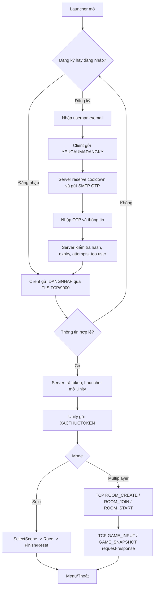
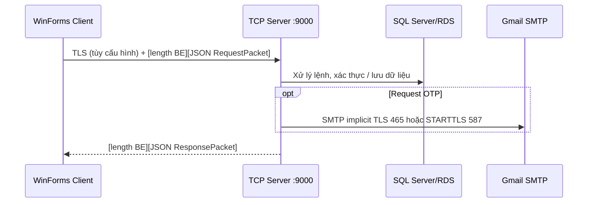

# BÁO CÁO RÀ SOÁT VÀ HOÀN THIỆN DÂN TỔ PHÓNG

**Ngày rà soát:** 27/11/2026
**Phạm vi:** WinForms Launcher, TCP Server cổng 9000, cấu hình SMTP/DB, Unity scripts/scenes, build settings, AWS EC2/RDS và hướng dẫn phát hành.
**Cách đánh giá:** đọc mã nguồn/cấu hình và build tĩnh; không giả định kết quả test end-to-end khi không chạy được dịch vụ thực.

## MỤC LỤC

1. [Tổng quan hệ thống](#1-tổng-quan-hệ-thống)
   1.1. [Kiến trúc](#11-kiến-trúc)
   1.2. [Kết quả tổng hợp](#12-kết-quả-tổng-hợp)
2. [Network stack tự phát triển và đặc tả giao thức](#2-network-stack-tự-phát-triển-và-đặc-tả-giao-thức)
   2.1. [Kết nối, frame và JSON](#21-kết-nối-frame-và-json)
   2.2. [Cấu trúc bản tin và lệnh](#22-cấu-trúc-bản-tin-và-lệnh)
   2.3. [Đa kết nối, timeout và giới hạn](#23-đa-kết-nối-timeout-và-giới-hạn)
3. [Kiến trúc và triển khai AWS](#3-kiến-trúc-và-triển-khai-aws)
   3.1. [EC2, Elastic IP và RDS](#31-ec2-elastic-ip-và-rds)
   3.2. [Tự khởi động Server](#32-tự-khởi-động-server)
4. [Client GUI, các Form và phiên đăng nhập](#4-client-gui-các-form-và-phiên-đăng-nhập)
5. [Xác thực OTP và gửi email](#5-xác-thực-otp-và-gửi-email)
6. [Gameplay và đồng bộ xe](#6-gameplay-và-đồng-bộ-xe)
7. [Scene và luồng chơi](#7-scene-và-luồng-chơi)
8. [Bảo mật và quản lý cấu hình](#8-bảo-mật-và-quản-lý-cấu-hình)
9. [Kịch bản, kết quả và ảnh minh chứng](#9-kịch-bản-kết-quả-và-ảnh-minh-chứng)
10. [Hướng dẫn clone, build và sử dụng](#10-hướng-dẫn-clone-build-và-sử-dụng)
11. [User story và sơ đồ luồng](#11-user-story-và-sơ-đồ-luồng)
12. [Phân công công việc và liên lạc](#12-phân-công-công-việc-và-liên-lạc)
13. [Runbook bật/tắt AWS, test Internet và Git](#13-runbook-bậttắt-aws-test-internet-và-git)
14. [Hạn chế và kết luận phát hành](#14-hạn-chế-và-kết-luận-phát-hành)

## 1. Tổng quan hệ thống

### 1.1. Kiến trúc

```text
WinForms Launcher ── TCP/9000 ── DanToPhong.Server ── SQL Server / RDS
        │                                   └── Gmail SMTP (OTP)
        └── mở Unity, chuyển tài khoản/token/endpoint/mode

Unity Solo: vật lý local
Unity multiplayer prototype ── TCP/9000 request/response ── Server
```

Launcher/server dùng frame TCP 4-byte big-endian và JSON. TCP Server quản lý
tài khoản, OTP, inventory và một prototype phòng/game. Prototype trả snapshot
trong response của từng request; chưa có server push/broadcast tới cả phòng.
Room/game state vẫn đặt trong RAM và simulation chưa thay thế physics/va chạm
đường đua của Unity.

### 1.2. Kết quả tổng hợp

| Hạng mục | Trạng thái | Kết quả |
|---|---|---|
| WinForms đăng ký/đăng nhập/khôi phục | **Đã rà soát** | Có kiểm tra input, gọi Server và giữ trạng thái phiên; cần kiểm thử UI thật. |
| SMTP/OTP | **Đã sửa** | Hỗ trợ Gmail implicit TLS 465 và STARTTLS 587; lỗi gửi không còn khóa gửi lại bằng cooldown giả. Server build thành công. |
| Cấu hình Launcher/Server | **Đã sửa** | JSON host/port/TLS đọc không phân biệt hoa-thường; TLS được chuyển tiếp từ Launcher sang Unity; env port sai giờ báo lỗi thay vì âm thầm fallback. |
| Điều khiển/va chạm xe | **Đã rà soát** | Có ga, phanh/lùi, rẽ, nhảy, chống kẹt, bám đường và hồi sinh; chưa test vật lý bằng build chạy. |
| Multiplayer state | **Một phần** | Unity gửi input qua TCP; server trả snapshot theo request và client nội suy. Không có broadcast, track-aware authoritative physics hay kiểm thử hai máy. |
| Scene mặc định `game` | **Đã sửa** | Scene có dùng làm fallback nhưng thiếu Build Settings; đã thêm vào danh sách build. |
| Git hygiene | **Đã sửa** | Cho phép các project .NET và scene thuộc `Assets/scene` được version; tiếp tục loại build/cache/demo scenes. |
| AWS Internet-ready | **Chưa sẵn sàng** | Sau lần smoke test được chủ tài khoản duyệt, EC2 và RDS đã dừng lại. EIP hiện hữu vẫn gắn ENI mô tả `RDSNetworkInterface`, không phải EC2; không allocate/associate EIP hay sửa Security Group. TCP 9000 và phản hồi giao thức đã được kiểm tra từ một máy; chưa test hai client/gameplay. |
| Production readiness | **Chưa xác nhận** | Chưa xác minh TLS/SMTP/DB runtime, hai client Internet, hoặc tải thực tế. |

## 2. Network stack tự phát triển và đặc tả giao thức

Ứng dụng C# tự triển khai transport trên `TcpClient`/`TcpListener`, bộ đóng
gói `MessageFramer` và packet DTO dùng chung trong `DanToPhong.Protocol`;
không dùng HTTP/REST hoặc thư viện mạng bên thứ ba cho luồng client-server.
Multiplayer hiện dùng một prototype TCP request/response chưa hoàn chỉnh.

### 2.1. Kết nối, frame và JSON

| Thuộc tính | Đặc tả hiện thực |
|---|---|
| Vận chuyển | TCP stream; client kết nối tới hostname/IP cấu hình và cổng mặc định `9000` (`DANTOPHONG_PORT` có thể override; giá trị sai bị từ chối). |
| TLS | Tùy chọn ở cả hai đầu; khi bật, TLS 1.2/1.3 bọc toàn bộ stream TCP trước khi đọc frame. Cấu hình phải bật đồng thời; client xác thực certificate theo hostname được kết nối. |
| Frame | 4 byte đầu là số nguyên độ dài **big-endian**, theo sau là đúng số byte payload. TCP không giữ ranh giới bản tin nên reader phải đọc đủ header/body. |
| Payload | UTF-8 JSON, tên thuộc tính camelCase; deserialize không phân biệt hoa/thường. |
| Kích thước | `1..65,536` byte cho mỗi payload; frame rỗng, quá giới hạn hoặc bị cắt giữa chừng bị từ chối/đóng kết nối. |
| Request/response | Mỗi kết nối xử lý tuần tự từng request frame và gửi một response frame tương ứng; client dùng semaphore để không trộn request/response trên cùng stream. |
| Timeout | Client kết nối/giao dịch tối đa 12 giây; server bắt tay TLS tối đa 10 giây và đóng kết nối không có frame trong 2 phút. |

Khung truyền:

```text
+------------------------------+-----------------------------------------------+
| 4 byte: payload length (BE)  | payload length byte: UTF-8 JSON               |
+------------------------------+-----------------------------------------------+
```

### 2.2. Cấu trúc bản tin và lệnh

Các trường `RequestPacket` là tùy chọn trừ `command`; từng lệnh chỉ sử dụng nhóm trường liên quan. `ResponsePacket` luôn có `success`, `code`, `message`, các DTO/token/danh sách khác có thể vắng mặt.

| Trường request | Kiểu JSON | Ý nghĩa |
|---|---|---|
| `command` | string | Lệnh nghiệp vụ, ví dụ `DANGNHAP`, `DANGKY`, `YEUCAUMADANGKY`, `YEUCAUMADATLAI`, `XACTHUCTOKEN`, `LAYTHONGTIN`, `DANGXUAT`. |
| `username`, `password`, `email`, `verificationCode` | string/null | Đăng nhập/đăng ký/OTP/đặt lại mật khẩu. Gửi password chỉ qua TLS khi đi qua Internet. |
| `token` | string/null | Bearer token cho xác thực phiên Unity/Launcher. Token sống 6 giờ; DB lưu hash token. |
| `requestId` | string GUID/null | Idempotency key cho giao dịch mua vật phẩm/cập nhật xu được hỗ trợ. |
| `fullName`, `birthday`, `gender`, `racerId` | string/date/null | Thông tin hồ sơ đăng ký. |
| `category`, `itemIndex`, `price`, `coinsDelta` | string/int/null | Giao dịch inventory; giá sản phẩm do Server quyết định, không tin giá client. |
| `roomId`, `mode`, `mapName`, `playerCount`, `maxPlayers`, `isRacing`, `targetId` | string/int/bool/null | Trạng thái phòng/lời mời và lựa chọn chế độ/map. |
| `avatarBase64`, `stars`, `comment` | string/int/null | Avatar PNG/JPEG giới hạn 40 KiB trước Base64; đánh giá. |

Các lệnh còn lại được định nghĩa trong `DanToPhong.Protocol.Commands`: `CAPNHATXU`, `VAOPHONG`, `DOIAVATAR`, `LAYKHO`, `MUAHANG`, `TRANGBI`, `CHONMAP`, `TAIAVATAR`, `LAYAVATAR`, `GUIDANHGIA`, `LAYDANHGIA`, `BANGXEPHANG`, `CAPNHATPHONG`, `XOAPHONG`, `DSPHONG`, `MOIBAN`, `LAYLOIMOI`, `LAYTRANGTHAI`. Mã phản hồi chính: `OK`, `ERR_INVALID_INPUT`, `ERR_AUTH_FAILED`, `ERR_UNAUTHORIZED`, `ERR_INSUFFICIENT_COINS`, `ERR_SERVER_ERROR`.

Ví dụ minh họa, không chứa thông tin xác thực thật:

```json
{"command":"DANGNHAP","username":"<username>","password":"<password>"}
{"success":true,"code":"OK","message":"Login successful.","token":"<token>","user":{"username":"<username>"}}
```

### 2.3. Đa kết nối, timeout và giới hạn

Server accept TCP liên tục; mỗi socket tạo `ClientSession` và tác vụ xử lý độc lập. `ConcurrentDictionary` quản lý session đang hoạt động, mỗi session giữ danh tính/token của phiên, `SemaphoreSlim` bảo vệ thao tác ghi. DB SQL Server/RDS lưu tài khoản, token hash, OTP hash và idempotency; schema được khởi tạo khi Server start. Room/invite registry có phần lưu RAM và instance đơn; không tự đồng bộ giữa nhiều EC2.

**Giới hạn cần ghi nhận:** có giới hạn session cấu hình ở accept layer nhưng chưa có
load test 10–50 client. Không tuyên bố chịu tải lớn/production scale trước khi có
kiểm thử tải, quota và giám sát tài nguyên.

## 3. Kiến trúc và triển khai AWS

### 3.1. EC2, Elastic IP và RDS

Truy vấn read-only ban đầu lúc **2026-11-27 (+07)** bằng profile `dantophong`, vùng `us-east-1`; sau đó đã có một đợt smoke test ngắn được chủ tài khoản xác nhận chi phí:

- Trạng thái cuối sau smoke test: EC2 `i-05bff5cbf44d8f35d` và RDS `dantophong-db` đều **stopped**.
- Trong thời gian test, RDS chuyển sang `available`; EC2 chuyển sang `running`, qua health checks và nhận public IPv4 tạm thời từ subnet. Địa chỉ tạm thời không phải EIP và không được ghi làm endpoint cố định.
- Có một Elastic IP hiện tồn tại, nhưng không gắn EC2; nó đang associated với network interface có mô tả `RDSNetworkInterface`, không có tag nhận diện `dantophong-server`. **Không tự associate/disassociate EIP này hoặc cấp thêm EIP** khi chưa xác minh quyền sở hữu/mục đích; thao tác đó có thể ảnh hưởng network của RDS hoặc phát sinh phí.
- RDS `dantophong-db` thuộc tính `PubliclyAccessible=true`. Security Group inbound có TCP/1433 từ một địa chỉ quản trị `/32` và từ Security Group EC2; không thấy rule `0.0.0.0/0` hoặc IPv6 mở rộng. Nên cân nhắc chuyển RDS sang private-only trong một thay đổi AWS được phê duyệt; không đổi cấu hình mạng trong đợt test.

Elastic IP/public IPv4 là tài nguyên có thể phát sinh phí. Trong đợt test chỉ start RDS rồi EC2, test cổng/protocol, sau đó stop EC2 trước RDS. Không chuyển/gỡ EIP hiện hữu, không allocate EIP mới, không sửa Security Group. Runbook Chương 13.1 yêu cầu xác nhận riêng trước khi allocate thêm EIP nếu có EIP cũ chưa được nhận diện. Xem thêm [README](README.md#elastic-ip-cho-ec2).

Sau khi chạy lệnh và xác nhận `PublicIp`, cập nhật `host` trong `server.json`, publish lại Launcher và phân phối cùng cấu hình đó. Khi dùng DNS, trỏ A record tới Elastic IP và dùng hostname nhất quán cho TLS.

Luồng mạng cần thiết:

- Client → EC2: TCP 9000; bật TLS trước khi dùng credential/token thật qua Internet.
- EC2 security group → RDS security group: SQL Server TCP 1433.
- RDS hiện `PubliclyAccessible=true`; giữ inbound SQL 1433 giới hạn theo nguồn cần thiết, không mở Internet-wide, và ưu tiên chuyển sang private-only sau khi được duyệt.
- Security Group/NACL phải đồng nhất với port server và chính sách truy cập của nhóm.

### 3.2. Tự khởi động Server

Unit mẫu [dantophong.service](deploy/aws/dantophong.service) dùng `systemd`, `enable` theo boot, `Restart=always`, nghỉ 5 giây trước khi chạy lại. Mẫu biến môi trường [server.env.example](deploy/aws/server.env.example) chỉ có placeholder, không có DB password, App Password hay certificate password.

Khi triển khai: publish `linux-x64`, cài .NET 10 runtime, chép app vào `/opt/dantophong`, tạo `/etc/dantophong/server.env` từ mẫu bằng secret store, đặt quyền chỉ root đọc, chép unit vào `/etc/systemd/system/`, rồi chạy `systemctl daemon-reload`, `enable --now`, kiểm tra `systemctl status` và `journalctl`. Service không thể chạy đúng cho tới khi DB/SMTP/TLS env được điền hợp lệ.

## 4. Client GUI, các Form và phiên đăng nhập

- **Đăng ký:** client kiểm tra username/email/password/confirm và yêu cầu OTP trước khi gửi registration request. OTP gắn với email/username và được kiểm tra tại Server.
- **Đăng nhập:** gửi username/password qua TCP, nhận token và mở form chính. Token không được ghi vào file nhớ tài khoản.
- **Quên mật khẩu:** xác nhận username/email, nhận OTP, đặt password mới và xử lý cooldown gửi lại.
- **Form chính/phòng:** gọi Server để đọc user/room/invite và thao tác nghiệp vụ; GameLauncher kiểm tra exe/token/endpoint trước khi chạy Unity.
- **Truyền phiên:** Launcher truyền username, token, host, port, TLS flag, mode và room ID tới Unity bằng process arguments. Unity `Boot` xác thực token, tải thông tin user rồi chuyển tới menu/select/lobby. Token không phải password nhưng vẫn là bearer credential; cần bảo vệ máy client và thời hạn/thu hồi token.
- **Sửa cấu hình:** `NetworkClientService` trước đây chỉ tìm `host`/`port` phân biệt hoa-thường trong JSON nên không đọc được file Release dùng `Host`/`Port`; nay đọc không phân biệt hoa-thường và lấy cả `useTls`. TLS flag từ cấu hình hiện được truyền tiếp sang game.
- **Fail-fast cấu hình:** Server mặc định TLS off nếu env không khai báo; giá trị `DANTOPHONG_USE_TLS` khác true/false hoặc port server/client không hợp lệ sẽ báo lỗi cấu hình, không âm thầm chạy port/plaintext khác dự kiến.
- **Điểm chưa xác nhận:** không chạy tương tác trực tiếp trên Desktop, DPI scaling, client-server thật hoặc kiểm thử crash/thoát game end-to-end trong lượt này. Cần xác nhận các thao tác tạo/join/rời phòng và quay về Launcher trên Windows.

### Kiến trúc GUI và yêu cầu tối thiểu hai client

Client desktop là WinForms C# chạy độc lập trên Windows; các Form gồm Login, Register, Forgot/Reset Password và màn hình chính có chức năng tài khoản/phòng. Có thể chạy hai tiến trình/client độc lập trên hai máy Windows khác mạng, cùng trỏ tới endpoint public; không dùng chung token giữa client. Một máy có thể dùng để smoke test hai instance, nhưng kiểm thử Internet cần ít nhất hai máy/mạng ngoài EC2 (ví dụ hai kết nối Internet độc lập hoặc một máy qua hotspot).

**Ảnh GUI chưa được chụp trong lượt này.** Chỗ gắn ảnh cho Login/Register/OTP, hai client và gameplay được tạo trong Chương 9.

## 5. Xác thực OTP và gửi email

### Nguyên nhân và bản sửa

Server trước đây dùng `System.Net.Mail.SmtpClient` cố định `smtp.gmail.com:587` với STARTTLS. Mở được TCP tới port 465 không chứng minh kết nối STARTTLS port 587 hoạt động; hơn nữa API này không làm TLS implicit-on-connect cho port 465. Vì vậy kiểm tra port 465 thành công vẫn có thể đi kèm lỗi “Cannot connect to server.”

Đã chuyển gửi email sang MailKit:

- `DANTOPHONG_SMTP_PORT=465`: TLS implicit ngay khi mở kết nối.
- `DANTOPHONG_SMTP_PORT=587`: STARTTLS bắt buộc.
- Mặc định port 465, timeout 15 giây; `DANTOPHONG_SMTP_HOST` có thể override.
- Credential chỉ lấy từ `DANTOPHONG_SMTP_USER` và `DANTOPHONG_SMTP_PASSWORD`.
- SMTP failure được log phía server nhưng phản hồi client không lộ chi tiết SMTP.
- Khi gửi lỗi, Server giải phóng reservation OTP chưa có hash code; lần thử sau không nhận phản hồi “đã gửi” nhưng thực tế chưa có email.
- Form đăng ký đặt cooldown hiển thị 60 giây khớp cooldown server (OTP vẫn có hiệu lực 10 phút).

### Cấu hình gửi Gmail

Đặt địa chỉ sender và App Password trong secret store/service environment. Không ghi giá trị vào `.env.example`, source, `server.json`, Unity, tài liệu hay log. Sau khi cập nhật, restart service và xác nhận mail thực tế đến đúng inbox.

**Trạng thái kiểm thử:** code path đã được build tĩnh; chưa có credential được sử dụng và chưa gửi email thật. Vì vậy không thể đánh dấu Gmail/OTP end-to-end là OK cho tới khi cấu hình secret hợp lệ.

## 6. Gameplay và đồng bộ xe

### Điều khiển và vật lý

`scooter.cs` dùng Rigidbody, chỉ nhận input ở xe local, đọc ga/phanh/lùi và rẽ, áp vận tốc/đổi hướng trong `FixedUpdate`, hỗ trợ nhảy và drift qua trạng thái điều khiển. Các biện pháp chống lỗi có trong code gồm dò mặt đường, giữ bám qua khe nối ngắn, giới hạn vận tốc bay lên, xử lý va chạm vật cứng, chặn mép đường, giảm tốc khi bị chặn, và hồi sinh sau khi rơi nước/vượt ngưỡng độ cao.

`xuLyVaCham.cs` chỉ để xe local kích hoạt checkpoint/đích và xử lý va chạm; xe remote không tiêu thụ checkpoint cục bộ. Hồi sinh đưa Rigidbody về vị trí/hướng đã lưu, xóa vận tốc và reset một số trạng thái vật lý. Log chẩn đoán xe có thể bật trong Inspector; tránh bật log dày khi đo hiệu năng.

### Multiplayer

`TcpGameplaySync` gửi input qua TCP khoảng 15–20 request/giây và nhận snapshot
trong response; server dùng kinematics đơn giản, còn client buffer tối đa 8
sample và nội suy với độ trễ mục tiêu khoảng 100 ms. Đây chưa phải broadcast:
mỗi client nhận snapshot riêng sau request của mình. Server chưa mô phỏng
collision/đường đua, chưa kiểm tra checkpoint theo vị trí, không có outbound
coalescing queue hoặc reconnect/resume. Vì vậy không xem đây là gameplay
authoritative hoàn chỉnh.

**Đánh giá:** logic có guard cho xe owner/remote, timeout room, missing scene và respawn. Không thể kết luận chống kẹt/văng/bay lạ hoặc đồng bộ Internet đạt ngưỡng chất lượng nếu chưa chạy build thật trên đường đua và hai client có latency/jitter. Cần kiểm tra phanh khi rẽ gấp, va tường, qua khe nối, rơi nước, respawn gần xe khác và rời mạng giữa trận.

## 7. Scene và luồng chơi

Build Settings giữ `boot` đầu tiên. Scene được kiểm tra theo `EditorBuildSettings.asset`:

| Scene | Chức năng/đường đi | Trạng thái tĩnh |
|---|---|---|
| `boot` | Xác thực token khi mở từ Launcher; chọn mode | Có trong build, index 0 |
| `menu` | Màn hình trung tâm và lối quay về | Có trong build |
| `SelectScene` | Chọn map/xe; đi vào Solo hoặc lobby | Có trong build |
| `LobbyScene` | Tạo/tham gia phòng TCP prototype; bắt đầu trận | Có trong build; runtime chưa xác minh |
| `ShopScene` | Shop | Có trong build |
| `game` | Đường đua mặc định/fallback được `PlayerInventory` và `GameNetworkManager` tham chiếu | **Đã thêm vào Build Settings** vì trước đó thiếu |
| `game 1`, `game 2`, `game 3` | Các đường đua chọn trong game | Có trong build |

Khi chạy không qua Launcher, `Boot` chuyển về menu/offline; khi qua Launcher,
nó yêu cầu token hợp lệ rồi định tuyến `single` đến SelectScene và multiplayer
đến LobbyScene. Chuyển cảnh dùng Unity `SceneManager`; Solo dùng vật lý local.
Multiplayer room/start path đã nối TCP ở mức prototype, nhưng runtime và toàn
bộ chuyển cảnh chưa được xác minh.

**Cần kiểm tra bằng Unity:** scene asset serialize được, reference prefab/camera/input còn hợp lệ, `game` xuất hiện trong build mới, và chuyển scene liên tục không giữ `Time.timeScale` bằng 0. Chưa chạy Unity Editor/build end-to-end trên cây TCP hiện tại.

## 8. Bảo mật và quản lý cấu hình

- Không ghi DB, SMTP, certificate secret hoặc private key thật trong repo. File env mẫu chỉ chứa placeholder; file vận hành phải ở SSM/secret store hoặc path hạn chế quyền.
- Client server config không nên chứa credential bí mật. Host/port/TLS là cấu hình public; sau khi có EIP thật cần cập nhật config release.
- TLS đã có tùy chọn hai đầu nhưng phải bật đồng bộ và dùng chứng chỉ hợp lệ cho host client kết nối. Không dùng TLS `false` cho tài khoản thật qua Internet: TCP plaintext có thể lộ mật khẩu/token.
- RDS hiện `PubliclyAccessible=true` dù Security Group giới hạn inbound; ưu tiên chuyển sang private-only khi được duyệt. DB account nên có quyền tối thiểu cần thiết. SMTP sender cần App Password riêng và rotation nếu từng bị commit/ghi log.
- `.gitignore` trước đây bỏ qua toàn bộ `.unity` nên scene chính không xuất hiện trong clone; đồng thời bỏ qua `.csproj` Launcher/Server. Nay chỉ mở lại scene `Assets/scene/*.unity` và project `.csproj` bên `UI`, còn scene demo package/cache/build vẫn bỏ qua.
- Cần `git status --short` trước khi push và kiểm tra history nếu secret từng commit. `.gitignore` không xóa secret đã nằm trong commit cũ.
- Kiểm tra mới phát hiện 268 file trong `bin/obj` và hai solution Unity `.slnx` đã bị track từ trước. Đã bỏ chúng khỏi index (file local được giữ), thêm ignore `*.slnx`; trước push cần xác minh index diff chỉ là xóa artifacts và các source/tài liệu dự kiến.

## 9. Kịch bản, kết quả và ảnh minh chứng

### Bằng chứng lịch sử đang có trong repo

Các mục dưới đây phản ánh lần kiểm tra trước được ghi nhận trong repo, không
phải thao tác AWS/build đã thực hiện ở lượt cập nhật tài liệu này. Lượt này
không bật/tắt AWS, đổi EIP/Security Group, hoặc push Git.

| Kiểm tra | Kết quả |
|---|---|
| Đọc profile AWS `dantophong` / EC2 / RDS | Ban đầu cả hai `stopped`; theo xác nhận của chủ tài khoản đã start RDS rồi EC2; cuối cùng đã stop EC2 trước RDS và xác nhận cả hai `stopped`. |
| Elastic IP và ingress | EIP `eipalloc-025f80fc38d372273` vẫn gắn ENI mô tả `RDSNetworkInterface`, không phải EC2. Không associate/disassociate/allocate EIP. Security Group EC2 TCP/9000 chỉ cho một IPv4 `/32`; không mở rộng rule. |
| Smoke test một máy | EC2 health checks `ok`; `Test-NetConnection` tới TCP 9000 thành công; probe frame JSON nhận `ERR_INVALID_INPUT` như phản hồi ứng dụng. EIP không đổi. |
| Hai client và gameplay | Chưa thực hiện được trong phiên này: chỉ kiểm tra từ một máy; chưa có ảnh UI/gameplay hoặc bằng chứng hai máy. Không coi TCP probe là test đăng nhập, lobby hay trận đua. |
| Tắt AWS sau test | Đã dừng EC2 trước RDS; AWS xác nhận cuối cùng cả hai `stopped`. AWS CLI không có waiter `rds db-instance-stopped`; dùng vòng lặp truy vấn trạng thái trong Chương 13.3. |
| Kiểm tra IP cũ trong Release config | AWS trả `InvalidAddress.NotFound`; endpoint cũ không phải EIP có thể xác nhận. |
| Source OTP/config | Luồng 465/587 dùng chế độ TLS đúng; lỗi gửi có cleanup reservation; cooldown 60 giây tách với hạn OTP 10 phút; cấu hình port/TLS fail-fast. |
| Build Server | Lượt này: `dotnet build .\UI\DanToPhong.Server\DanToPhong.Server.csproj -c Release --no-restore` thành công, 0 warning, 0 error. |
| Build/Publish Launcher | Lượt này: `dotnet publish .\UI\UI\UI.csproj -c Release -r win-x64 --self-contained false --no-restore -o D:\DanToPhong\LauncherRelease` thành công; còn 6 cảnh báo nullable (`CS8669`) trong file Designer sinh tự động. |
| Build Unity | Lượt này: Unity Editor 6000.3.28f1 build Windows x64 thành công sau khi gỡ plugin và dọn state chỉ ghi; không còn cảnh báo C# ở lần build cuối. Unity có log lỗi không fatal về licensing/package HTTPS. Chưa launch player hoặc test gameplay. |
| Tài liệu lệnh | PowerShell parser xác nhận cả 4 code blocks trong báo cáo không có lỗi cú pháp. Runbook AWS đã được thực thi một lần sau khi người dùng duyệt start; resource cuối cùng đã dừng, không đổi EIP/Security Group. |
| Unity Build Settings | `boot` đứng đầu; các scene gameplay có trong build list; `game` fallback có trong build. Windows x64 player vừa được build; scene/runtime flow chưa được chơi thử. |
| Git hygiene | `.gitignore` bỏ qua output; 268 file `bin/obj` và hai `.slnx` đã được gỡ khỏi index. Các thay đổi đã commit cục bộ; chưa push. |
| Secret scan | Quét signature AWS key/private key và mẫu password cụ thể trong source/config/doc không có kết quả; không thay thế quét Git history/rotation. |

### Kịch bản cần chạy và chỗ chèn ảnh minh chứng

| ID | Thao tác và tiêu chí đạt | Trạng thái | Ảnh minh chứng (chưa chụp) |
|---|---|---|---|
| TC01 | Reachability TCP/9000 từ một máy. | PASS lịch sử — chỉ xác nhận cổng, không xác nhận nghiệp vụ | [TC01-tcp-reachability.log](docs/evidence/TC01-tcp-reachability.log) |
| TC02 | Hai máy khác mạng đăng nhập, vào phòng, đồng bộ. | BLOCKED — chưa có bằng chứng hai máy | Chưa có |
| TC03 | Hai client dùng TCP tạo/vào phòng và nhận snapshot. | BLOCKED — chưa chạy Unity client/hai máy | Chưa có |
| TC04 | OTP SMTP gửi/nhận, mã đúng/sai/hết hạn. | BLOCKED — runtime SMTP chưa cấu hình | Chưa có |
| TC05 | TLS handshake và plaintext fail-closed. | BLOCKED — log deployment cũ FAIL; source hiện tại chưa retest | [TC05-tls-plaintext.log](docs/evidence/TC05-tls-plaintext.log) |
| TC06 | DPI so sánh plaintext/TLS bằng capture. | BLOCKED — chưa capture | Chưa có |
| TC07 | Mất mạng, reconnect và restart Server. | BLOCKED — chưa chạy runtime | Chưa có |
| TC08 | Unity Windows x64 build và launch. | PASS — build hiện tại; launch và gameplay chưa test | [TC08-unity-build.log](docs/evidence/TC08-unity-build.log) |
| TC09 | TCP framing: split/coalesced, EOF, length sai, truncated. | PASS lịch sử — smoke test in-memory | [TC09-framing-smoke.log](docs/evidence/TC09-framing-smoke.log) |
| TC10 | 10–50 client, slow sender, abort, malformed/oversized frames. | BLOCKED — chưa chạy server thực | Chưa có |
| TC11 | TCP 3-way handshake và FIN tới cổng 9000. | BLOCKED — chưa capture | Chưa có |
| TC12 | TLS handshake/cipher và so sánh payload. | BLOCKED — chưa có TLS capture | Chưa có |

Ảnh phải tránh hiển thị password, OTP, token, connection string, App Password, private key và dữ liệu cá nhân. Ghi thêm ngày/commit, Windows/Unity build, endpoint test, network condition và pass/fail; giữ log đã redact cùng ảnh. Không đánh dấu “Đạt” khi chỉ có ảnh UI tĩnh.

## 10. Hướng dẫn clone, build và sử dụng

1. Clone repo, cài .NET 10 SDK/Desktop Runtime; cài Unity đúng `ProjectVersion.txt` nếu cần build game.
2. Quản trị viên điền secret server trong AWS SSM/service environment, hoàn tất EIP và TLS; không yêu cầu bạn bè cài DB.
3. Dùng bản publish đã tạo tại `D:\DanToPhong\LauncherRelease`, hoặc build lại Launcher:

   ```powershell
   dotnet publish .\UI\UI\UI.csproj -c Release -r win-x64 --self-contained false -o D:\DanToPhong\LauncherRelease
   Copy-Item .\deploy\client\server.json.example D:\DanToPhong\LauncherRelease\server.json
   ```

4. Đặt `host` của file `server.json` thành EIP/DNS đã provision; giữ `port: 9000`; chỉ để `useTls: true` khi Server có cùng TLS certificate/config.
5. Đưa Unity build cạnh Launcher trong `Game\` (hoặc theo đường dẫn `BuildGame36` được Launcher dò); đăng nhập rồi chọn Solo/Multiplayer.
6. Người chơi khác tải cùng bản Launcher + Unity build, không cần sửa code; cấu hình endpoint public chỉ cần thay một lần khi EIP được provision và đóng gói cùng release.

Chi tiết lệnh AWS/systemd và biến môi trường có trong [README](README.md#aws-deployment-notes).

## 11. User story và sơ đồ luồng

| Actor | User story | Tiêu chí nghiệm thu |
|---|---|---|
| Người chơi mới | Là người chơi, tôi muốn đăng ký bằng email và OTP để tạo tài khoản. | OTP đúng, chưa hết hạn, dùng một lần; code sai/expired bị từ chối. |
| Người chơi | Là người chơi, tôi muốn đăng nhập và mở game bằng phiên an toàn. | Login phát token; Unity xác thực token; logout/expiry thu hồi quyền. |
| Người chơi | Là người chơi, tôi muốn vào Solo hoặc tạo/join phòng với bạn. | Solo chuyển đúng scene; hai client Internet cùng vào room và đồng bộ scene. |
| Người chơi | Là người chơi, tôi muốn điều khiển xe và nhìn thấy đối thủ. | Input được gửi qua TCP; snapshot được nội suy ở client. Việc đồng bộ hiện một phần, chưa có room-wide push hay track-authoritative physics. |
| Quản trị viên | Là quản trị viên, tôi muốn Server tự lên sau reboot và lưu dữ liệu trong DB. | systemd active, SQL Server/RDS reachable, log không lộ secret. |

### Flow đăng ký/login và vào game



### Flow một lượt request client-server



## 12. Phân công công việc và liên lạc

Thông tin nhóm chưa có trong repository/session; các ô sau **cố ý để trống**, cần nhóm điền trước khi nộp. Không suy đoán danh tính hoặc tỷ lệ đóng góp.

| Thành viên | MSSV | Vai trò/phần việc thực hiện | Tỷ lệ đóng góp | Xác nhận |
|---|---|---|---:|---|
| `[Nhóm trưởng - điền họ tên]` | `[MSSV]` | Tích hợp, kiến trúc, AWS/release, tổng hợp báo cáo (điều chỉnh theo thực tế) | `[__%]` | `[Ký/xác nhận]` |
| `[Thành viên 2]` | `[MSSV]` | WinForms/đăng ký-đăng nhập/OTP (điền theo phân công thực tế) | `[__%]` | `[Ký/xác nhận]` |
| `[Thành viên 3]` | `[MSSV]` | Server/CSDL/network protocol (điền theo phân công thực tế) | `[__%]` | `[Ký/xác nhận]` |
| `[Thành viên 4]` | `[MSSV]` | Unity gameplay/scene/TCP game prototype (điền theo phân công thực tế) | `[__%]` | `[Ký/xác nhận]` |

**Liên lạc nhóm trưởng:** Họ tên `[điền]`; email `[điền email học tập]`; điện thoại `[điền nếu cần]`. Không đặt thông tin liên lạc cá nhân lên Git public nếu chưa được đồng ý; có thể điền trong bản nộp riêng.

## 13. Runbook bật/tắt AWS, test Internet và Git

### 13.1. Bật EIP, RDS và EC2

Các lệnh sau là runbook cho lần vận hành kế tiếp. Trong phiên này, sau khi người dùng xác nhận chi phí, chỉ start RDS rồi EC2; không chạy script cấp/gắn EIP và không sửa Security Group. Public IPv4/EIP, EC2 và RDS có thể tính phí. AWS CLI dùng profile `dantophong`, region `us-east-1`. Script xem toàn bộ EIP hiện có; dùng EIP trực tiếp gắn target EC2, hoặc EIP chưa associate có tag `Name=dantophong-server`. Không chuyển EIP đang gắn ENI/resource khác. Nếu chỉ thấy EIP chưa được nhận diện, script yêu cầu xác nhận riêng `ALLOCATE-ADDITIONAL-EIP` trước khi cấp thêm; không gõ xác nhận này cho đến khi đã xác minh EIP cũ thuộc resource khác và chấp thuận chi phí.

```powershell
$ErrorActionPreference = 'Stop'
$profile = 'dantophong'
$region = 'us-east-1'
$instance = 'i-05bff5cbf44d8f35d'

$ec2Preflight = aws ec2 describe-instances --profile $profile --region $region --instance-ids $instance --query 'Reservations[0].Instances[0].State.Name' --output text
if ($LASTEXITCODE -ne 0 -or $ec2Preflight -notin @('stopped','running','pending','stopping')) { throw 'EC2 không tồn tại hoặc đang ở trạng thái không hỗ trợ.' }
$dbRaw = aws rds describe-db-instances --profile $profile --region $region --db-instance-identifier dantophong-db --query 'DBInstances[0].{Status:DBInstanceStatus,PubliclyAccessible:PubliclyAccessible,VpcSecurityGroups:VpcSecurityGroups[].VpcSecurityGroupId}' --output json
if ($LASTEXITCODE -ne 0) { throw 'Không truy vấn được RDS dantophong-db.' }
$db = $dbRaw | ConvertFrom-Json
if ($db.Status -notin @('stopped','available','starting','backing-up','modifying')) { throw "RDS đang ở trạng thái không hỗ trợ: $($db.Status)" }
if ($db.PubliclyAccessible) {
    Write-Warning "RDS PubliclyAccessible=true. Review ingress of security groups: $($db.VpcSecurityGroups -join ', '); do not broaden port 1433."
    if ((Read-Host "Type REVIEWED-RDS-SG only after reviewing the inbound rules") -cne 'REVIEWED-RDS-SG') { throw 'Stopped before changing AWS resources.' }
}
if ((Read-Host "EC2/RDS start may incur charges. Type START-EC2-AND-RDS to continue") -cne 'START-EC2-AND-RDS') { throw 'Stopped before changing AWS resources.' }

$addressRaw = aws ec2 describe-addresses --profile $profile --region $region --query 'Addresses[]' --output json
if ($LASTEXITCODE -ne 0) { throw 'Không truy vấn được danh sách EIP.' }
$addresses = @()
$parsedAddresses = $addressRaw | ConvertFrom-Json
if ($null -ne $parsedAddresses) { $addresses = @($parsedAddresses) }
$instanceEips = @($addresses | Where-Object { $_.InstanceId -eq $instance })
if ($instanceEips.Count -gt 1) { throw 'Có nhiều EIP gắn với EC2; kiểm tra thủ công trước khi tiếp tục.' }

if ($instanceEips.Count -eq 1) {
    $eip = $instanceEips[0]
} else {
    $taggedEips = @()
    foreach ($candidate in $addresses) {
        if (@($candidate.Tags | Where-Object { $_.Key -eq 'Name' -and $_.Value -eq 'dantophong-server' }).Count -gt 0) {
            $taggedEips += $candidate
        }
    }
    if ($taggedEips.Count -gt 1) { throw 'Có nhiều EIP tag dantophong-server; kiểm tra thủ công.' }
    if ($taggedEips.Count -eq 1) {
        $eip = $taggedEips[0]
        $otherEips = @($addresses | Where-Object { $_.AllocationId -ne $eip.AllocationId })
        if ($otherEips.Count -gt 0) {
            Write-Warning "Có $($otherEips.Count) EIP khác; xác minh chúng thuộc resource khác trước."
            if ((Read-Host 'Type REVIEWED-OTHER-EIPS only after verifying all other addresses') -cne 'REVIEWED-OTHER-EIPS') {
                throw 'Stopped before associating the project EIP.'
            }
        }
        if ($eip.InstanceId -or $eip.NetworkInterfaceId -or $eip.AssociationId) {
            throw "EIP $($eip.AllocationId) đang gắn tài nguyên khác; không tự ý chuyển/disassociate."
        }
    } else {
        if ($addresses.Count -eq 0) {
            $approval = Read-Host 'No EIP exists. Type ALLOCATE-EIP to allocate a potentially billable IPv4'
            if ($approval -cne 'ALLOCATE-EIP') { throw 'Stopped before Elastic IP allocation.' }
        } else {
            Write-Warning "Có $($addresses.Count) EIP hiện hữu nhưng không có tag dantophong-server."
            $approval = Read-Host 'After verifying existing EIPs belong to other resources, type ALLOCATE-ADDITIONAL-EIP to incur the new address charge'
            if ($approval -cne 'ALLOCATE-ADDITIONAL-EIP') { throw 'Stopped before allocating another Elastic IP.' }
        }
        $raw = aws ec2 allocate-address --profile $profile --region $region --domain vpc --output json
        if ($LASTEXITCODE -ne 0) { throw 'Cấp Elastic IP thất bại.' }
        $eip = $raw | ConvertFrom-Json
        if (-not $eip.AllocationId) { throw 'AWS không trả AllocationId.' }
        aws ec2 create-tags --profile $profile --region $region --resources $eip.AllocationId --tags Key=Name,Value=dantophong-server
        if ($LASTEXITCODE -ne 0) { throw "EIP $($eip.AllocationId) đã cấp nhưng chưa tag; kiểm tra/tag thủ công trước khi chạy lại." }
    }
}
if ($eip.InstanceId -ne $instance) {
    if ($eip.NetworkInterfaceId -or $eip.AssociationId) { throw "EIP $($eip.AllocationId) đang associate với ENI/tài nguyên khác." }
    if ((Read-Host "Type ASSOCIATE-EIP to associate $($eip.PublicIp) with $instance") -cne 'ASSOCIATE-EIP') {
        throw 'Stopped before Elastic IP association.'
    }
    aws ec2 associate-address --profile $profile --region $region --instance-id $instance --allocation-id $eip.AllocationId
    if ($LASTEXITCODE -ne 0) { throw "Associate EIP thất bại; kiểm tra allocation $($eip.AllocationId)." }
}

$dbState = $db.Status
if ($dbState -eq 'stopped') {
    aws rds start-db-instance --profile $profile --region $region --db-instance-identifier dantophong-db | Out-Null
    if ($LASTEXITCODE -ne 0) { throw 'Không khởi động được RDS.' }
} elseif ($dbState -notin @('available','starting','backing-up','modifying')) {
    throw "RDS đang ở trạng thái $dbState; không tự chuyển trạng thái."
}
aws rds wait db-instance-available --profile $profile --region $region --db-instance-identifier dantophong-db
if ($LASTEXITCODE -ne 0) { throw 'RDS chưa chuyển sang available.' }

$ec2State = aws ec2 describe-instances --profile $profile --region $region --instance-ids $instance --query 'Reservations[0].Instances[0].State.Name' --output text
if ($LASTEXITCODE -ne 0) { throw 'Không truy vấn được EC2.' }
if ($ec2State -eq 'stopped') {
    aws ec2 start-instances --profile $profile --region $region --instance-ids $instance | Out-Null
    if ($LASTEXITCODE -ne 0) { throw 'Không khởi động được EC2.' }
} elseif ($ec2State -notin @('running','pending')) {
    throw "EC2 đang ở trạng thái $ec2State; không tự chuyển trạng thái."
}
aws ec2 wait instance-running --profile $profile --region $region --instance-ids $instance
if ($LASTEXITCODE -ne 0) { throw 'EC2 chưa chuyển sang running.' }
Write-Host "EC2=$instance; EIP=$($eip.PublicIp); RDS=dantophong-db available"
```

Với trạng thái AWS vừa đọc, script nhận diện EIP không tag đang associated với ENI mô tả `RDSNetworkInterface`; script không chuyển hay disassociate EIP đó. Nó chỉ tiếp tục cấp một **EIP thứ hai** nếu operator đã xác minh mục đích của EIP hiện hữu và nhập rõ `ALLOCATE-ADDITIONAL-EIP`; nếu không, script dừng trước khi thay đổi AWS. RDS đang `PubliclyAccessible=true`, dù ingress được giới hạn; không mở rộng cổng 1433. Sau khi xác minh/gắn EIP riêng cho EC2 và start thành công, cập nhật `host` trong `LauncherRelease\server.json`; bật TLS/certificate trước khi nhập password thật.

### 13.2. Kiểm thử hai client qua Internet và bằng chứng

1. Chờ EC2 `running`, RDS `available`, `systemctl status dantophong` là `active (running)`; ghi commit/build id, không chụp env file.
2. Từ hai máy Windows ngoài AWS (ưu tiên hai mạng Internet độc lập), kiểm tra `Test-NetConnection <EIP-hoặc-DNS> -Port 9000`; xác nhận Launcher có TLS đúng hostname/certificate. Không hiển thị password/OTP/token trong ảnh/log.
3. Trên cả hai máy dùng cùng `server.json`/bản Launcher; client A đăng nhập, tạo room; client B đăng nhập tài khoản khác, refresh/join bằng mã; chụp hai UI cho thấy cùng room.
4. Bắt đầu trận đồng thời, xác nhận cùng scene, xe hai người hiển thị và cập nhật; kiểm tra checkpoint/finish; thử client disconnect/reconnect và jitter.
5. Test riêng đăng ký/OTP, Solo, reset password, logout, restart service và reboot EC2. Với SMTP xác nhận inbox và log service đã redact.
6. Ghi PASS/FAIL, thời gian, OS, build, network/latency, ảnh theo `docs/evidence/TCxx-*.png` trong Chương 9. Che PII; giữ log đã redact. Không sửa ảnh làm sai lệch kết quả.

### 13.3. Tắt sau khi test để giới hạn chi phí

Chỉ chạy sau khi người chơi đã thoát và chấp nhận downtime. Dừng EC2 trước, rồi mới dừng RDS; không release EIP nếu muốn giữ địa chỉ cố định, nhưng public IPv4/EIP có thể vẫn tính phí. RDS stopped có thể tự khởi động lại theo giới hạn AWS (thường tối đa 7 ngày); kiểm tra chính sách hiện hành và billing.

```powershell
$ErrorActionPreference = 'Stop'
$profile = 'dantophong'
$region = 'us-east-1'
$instance = 'i-05bff5cbf44d8f35d'
$ec2State = aws ec2 describe-instances --profile $profile --region $region --instance-ids $instance --query 'Reservations[0].Instances[0].State.Name' --output text
if ($LASTEXITCODE -ne 0) { throw 'Không truy vấn được EC2.' }
if ($ec2State -eq 'running') {
    aws ec2 stop-instances --profile $profile --region $region --instance-ids $instance | Out-Null
    if ($LASTEXITCODE -ne 0) { throw 'EC2 stop request thất bại.' }
}
aws ec2 wait instance-stopped --profile $profile --region $region --instance-ids $instance
if ($LASTEXITCODE -ne 0) { throw 'EC2 chưa dừng.' }

$dbState = aws rds describe-db-instances --profile $profile --region $region --db-instance-identifier dantophong-db --query 'DBInstances[0].DBInstanceStatus' --output text
if ($LASTEXITCODE -ne 0) { throw 'Không truy vấn được RDS.' }
if ($dbState -eq 'available') {
    aws rds stop-db-instance --profile $profile --region $region --db-instance-identifier dantophong-db | Out-Null
    if ($LASTEXITCODE -ne 0) { throw 'Không dừng được RDS; xác minh trạng thái/engine hỗ trợ stop.' }
}
$rdsTimer = [Diagnostics.Stopwatch]::StartNew()
do {
    $dbState = aws rds describe-db-instances --profile $profile --region $region --db-instance-identifier dantophong-db --query 'DBInstances[0].DBInstanceStatus' --output text
    if ($LASTEXITCODE -ne 0) { throw 'Không truy vấn được trạng thái RDS khi chờ dừng.' }
    if ($dbState -eq 'stopped') { break }
    if ($dbState -notin @('stopping','starting','modifying','backing-up','available')) { throw "RDS đang ở trạng thái không mong đợi: $dbState" }
    if ($rdsTimer.Elapsed.TotalMinutes -ge 20) { throw 'Hết thời gian chờ RDS dừng.' }
    Start-Sleep -Seconds 30
} while ($true)
Write-Host 'Đã yêu cầu dừng EC2/RDS; kiểm tra lại trạng thái và billing trong AWS Console.'
```

### 13.4. Kiểm tra và commit/push

Từ `D:\DanToPhong\DanToPhong`:

```powershell
git status --short
git diff --check
git diff --cached --stat
git diff --stat
git ls-files | Select-String '(^|/)(bin|obj|Library|Temp|Build|Builds|Logs)(/|$)|\.slnx$|LauncherRelease'
git add -A
git status --short
# Chỉ tiếp tục nếu danh sách staged đúng dự kiến và không có secret:
git diff --cached --check
git commit -m "Complete DanToPhong release preparation"
git push
```

`git add -A` đưa mọi thay đổi trong worktree vào stage; bỏ dòng này nếu còn thay đổi cá nhân không thuộc dự án, thay bằng stage tường minh các file đã kiểm tra. Không đưa `LauncherRelease`, `bin/obj`, Unity `Library/Temp`, file `.env` vận hành, certificate hay log vào commit.

## 14. Hạn chế và kết luận phát hành

**Chưa thể xác nhận “clone về dùng ngay”:** smoke test một máy đã xác nhận listener TCP/9000 và phản hồi giao thức; EC2/RDS sau đó đã được dừng. EIP hiện có vẫn gắn ENI `RDSNetworkInterface`, EC2 hiện không có EIP và public IP tự cấp chỉ tạm thời. Security Group TCP/9000 chỉ cho một IPv4 `/32`; RDS vẫn `PubliclyAccessible=true`; TLS chưa được xác minh/bật. Chưa test hai client, đăng nhập, OTP thật, Unity gameplay hoặc lưu ảnh minh chứng. Trước khi phát hành, cần xác nhận endpoint ổn định, giới hạn ingress phù hợp, bật TLS, kiểm thử end-to-end và chỉ ghi kết quả có bằng chứng thực tế.

Ngoài ra cần chạy gameplay thật và test hai client. TCP game prototype còn
request/response, mô phỏng kinematics đơn giản, không có room-wide push, track
collision authority, verified checkpoint crossing hoặc reconnect/resume.
Phần thưởng/điểm đua chưa được xác nhận phía Server. Báo cáo không chứng nhận
độ ổn định hoặc khả năng chịu tải production.
