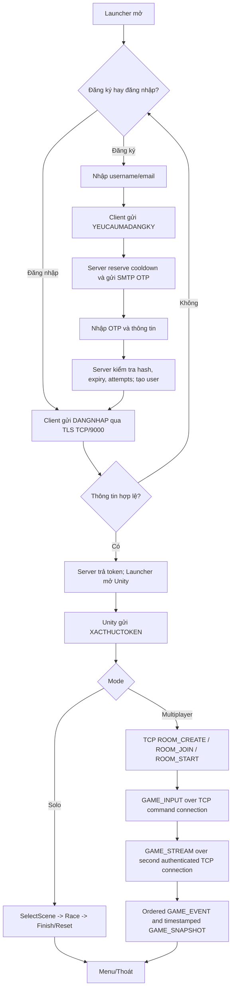
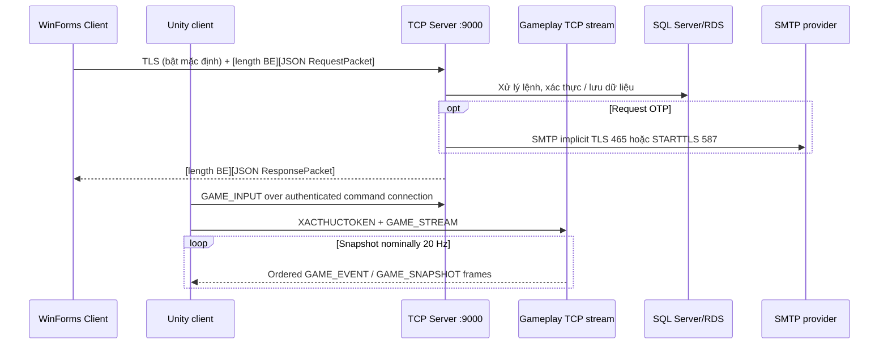

# BÁO CÁO RÀ SOÁT VÀ HOÀN THIỆN DÂN TỔ PHÓNG

**Ngày rà soát:** 27/11/2026
**Phạm vi:** WinForms Launcher, TCP Server cổng 9000, cấu hình SMTP/DB, Unity scripts/scenes, build settings, AWS EC2/RDS và hướng dẫn phát hành.
**Cách đánh giá:** rà mã nguồn, build và kiểm thử runtime local theo bằng chứng ghi tại Chương 9; không suy rộng từ smoke test sang gameplay Internet/load. AWS không được truy vấn hoặc thay đổi trong lượt kiểm tra này.

## MỤC LỤC

1. [Tổng quan hệ thống](#1-tổng-quan-hệ-thống)
   1.1. [Kiến trúc](#11-kiến-trúc)
   1.2. [Kết quả tổng hợp](#12-kết-quả-tổng-hợp)
2. [Network stack tự phát triển và đặc tả giao thức](#2-network-stack-tự-phát-triển-và-đặc-tả-giao-thức)
   2.1. [Kết nối, frame và JSON](#21-kết-nối-frame-và-json)
   2.2. [Cấu trúc bản tin và lệnh](#22-cấu-trúc-bản-tin-và-lệnh)
   2.3. [Đa kết nối, timeout và giới hạn](#23-đa-kết-nối-timeout-và-giới-hạn)
3. [Kiến trúc và triển khai AWS](#3-kiến-trúc-và-triển-khai-aws)
   3.1. [EC2, Elastic IP và RDS](#31-ec2-elastic-ip-và-rds)
   3.2. [Tự khởi động Server](#32-tự-khởi-động-server)
   3.3. [Chi phí và free tier](#33-chi-phí-và-free-tier)
4. [Client GUI, các Form và phiên đăng nhập](#4-client-gui-các-form-và-phiên-đăng-nhập)
5. [Xác thực OTP và gửi email](#5-xác-thực-otp-và-gửi-email)
6. [Gameplay và đồng bộ xe](#6-gameplay-và-đồng-bộ-xe)
7. [Scene và luồng chơi](#7-scene-và-luồng-chơi)
8. [Bảo mật và quản lý cấu hình](#8-bảo-mật-và-quản-lý-cấu-hình)
9. [Kịch bản, kết quả và ảnh minh chứng](#9-kịch-bản-kết-quả-và-ảnh-minh-chứng)
10. [Hướng dẫn clone, build và sử dụng](#10-hướng-dẫn-clone-build-và-sử-dụng)
11. [User story và sơ đồ luồng](#11-user-story-và-sơ-đồ-luồng)
12. [Phân công công việc và liên lạc](#12-phân-công-công-việc-và-liên-lạc)
13. [Runbook bật/tắt AWS, test Internet và Git](#13-runbook-bậttắt-aws-test-internet-và-git)
14. [Hạn chế và kết luận phát hành](#14-hạn-chế-và-kết-luận-phát-hành)
15. [Đối chiếu đề bài](#15-đối-chiếu-đề-bài)
16. [Phụ lục](#16-phụ-lục)

## 1. Tổng quan hệ thống

### 1.1. Kiến trúc

```text
WinForms Launcher ── TCP/TLS/9000 ── DanToPhong.Server ── SQL Server / RDS
        │                                   └── Gmail SMTP (OTP)
        └── mở Unity, chuyển tài khoản/token/endpoint/mode

Unity Solo: vật lý local
Unity multiplayer: TCP/TLS input requests + authenticated event/snapshot stream
```

Launcher/server dùng frame TCP 4-byte big-endian và JSON, TLS bật mặc định và
fail-closed; cả input game lẫn stream event/snapshot đều dùng TCP/TLS. Server
quản lý tài khoản, OTP, inventory và room/game state in-memory. Simulation
server dùng kinematics đơn giản, spawn từ track catalog và kiểm tra checkpoint/
finish theo gate cấu hình; đây chưa phải physics/va chạm đầy đủ của Unity.

**Phạm vi có làm:** đăng ký/đăng nhập, OTP/đặt lại mật khẩu, hồ sơ/kho hàng,
phòng và prototype multiplayer qua TCP/TLS. **Chưa làm hoặc loại trừ:** UDP,
server discovery, đăng nhập mạng xã hội, physics/collision authoritative đầy
đủ, server-owned multiplayer timer, vai trò quản trị hoàn chỉnh và phục hồi
trận sau restart. Yêu cầu phi chức năng gồm tối thiểu hai client, phản hồi
client-server dưới một giây cho bước kiểm thử T4, không lưu mật khẩu rõ,
không treo khi mất kết nối và hiển thị tiếng Việt đúng dấu. Chỉ tiêu/ca chưa
đo được ghi là chưa xác minh, không xem là đã đạt.

### 1.2. Kết quả tổng hợp

| Hạng mục | Trạng thái | Kết quả |
|---|---|---|
| WinForms đăng ký/đăng nhập/khôi phục | **Đã rà soát** | Có kiểm tra input, gọi Server và giữ trạng thái phiên; cần kiểm thử UI thật. |
| SMTP/OTP | **Đã sửa; runtime một phần** | MailKit hỗ trợ implicit TLS 465 và STARTTLS 587; request OTP ghi hash rồi đưa mail vào Channel bounded (64 jobs), worker retry SMTP 4xx/5xx tối đa ba lần. Queue/retry smoke PASS; chưa kiểm tra delivery/failure bằng SMTP thật sau thay đổi. |
| Cấu hình Launcher/Server | **Đã sửa** | JSON host/port/TLS đọc không phân biệt hoa-thường; TLS được chuyển tiếp từ Launcher sang Unity; env port sai giờ báo lỗi thay vì âm thầm fallback. |
| Điều khiển/va chạm xe | **Đã rà soát** | Có ga, phanh/lùi, rẽ, nhảy, chống kẹt, bám đường và hồi sinh; chưa test vật lý bằng build chạy. |
| Multiplayer state | **Prototype; live test BLOCKED** | Server mô phỏng kinematics, kiểm tra checkpoint/finish gate, push snapshot/event; có code spectate/reconnect 120 giây và thưởng winner phía server. Client có thể xin tự loại nhưng không thể làm đối thủ thắng/nhận thưởng; server chỉ ghi winner khi qua finish gate. Physics loại xe vẫn chưa authoritative; chưa kiểm chứng trận live. |
| Scene mặc định `game` | **Đã sửa** | Scene có dùng làm fallback nhưng thiếu Build Settings; đã thêm vào danh sách build. |
| Git hygiene | **Đã sửa** | Cho phép các project .NET và scene thuộc `Assets/scene` được version; tiếp tục loại build/cache/demo scenes. |
| AWS Internet-ready | **Chưa sẵn sàng** | Lần đọc/truy vấn AWS được ghi trước đây báo EC2 và RDS đã dừng sau smoke test. EIP khi đó gắn ENI mô tả `RDSNetworkInterface`, không phải EC2; lượt hiện tại không đọc lại trạng thái AWS và không allocate/associate EIP hay sửa Security Group. TCP 9000 và phản hồi giao thức đã được kiểm tra từ một máy; chưa test hai client/gameplay. |
| Production readiness | **Chưa xác nhận** | TC05 TLS fail-closed và capture local TC06/11/12 đã PASS; OTP chưa được xác minh end-to-end qua GUI/DB, và worker SMTP mới chưa được kiểm tra delivery thật. Chưa xác minh gameplay hai client, reconnect runtime, load, hay hai mạng Internet. |

## 2. Network stack tự phát triển và đặc tả giao thức

Ứng dụng C# tự triển khai transport trên `TcpClient`/`TcpListener`, bộ đóng
gói `MessageFramer` và packet DTO dùng chung trong `DanToPhong.Protocol`;
không dùng HTTP/REST hoặc thư viện mạng bên thứ ba cho luồng client-server.
Gameplay dùng TCP request/response cho input và một kết nối TCP riêng cho
snapshot/event push; đây vẫn là prototype chưa hoàn chỉnh.

### 2.1. Kết nối, frame và JSON

| Thuộc tính | Đặc tả hiện thực |
|---|---|
| Vận chuyển | TCP stream; client kết nối tới hostname/IP cấu hình và cổng mặc định `9000` (`DANTOPHONG_PORT` có thể override; giá trị sai bị từ chối). |
| TLS | Bật mặc định ở Server/Launcher/Unity; Server từ chối khởi động nếu không có certificate hợp lệ. TLS 1.2/1.3 bọc từng stream TCP; client xác thực chain và hostname theo cấu hình. Plaintext chỉ dành cho thử nghiệm cô lập có chủ đích. |
| Frame | 4 byte đầu là số nguyên độ dài **big-endian**, theo sau là đúng số byte payload. TCP không giữ ranh giới bản tin nên reader phải đọc đủ header/body. |
| Payload | UTF-8 JSON, tên thuộc tính camelCase; deserialize không phân biệt hoa/thường. |
| Phiên bản | Chưa có trường/thoả thuận protocol version trong `RequestPacket`/`ResponsePacket`; đây là thiếu sót cần xử lý trước khi cần tương thích client-server khác phiên bản. |
| Kích thước | `1..65,536` byte cho mỗi payload; frame rỗng, quá giới hạn hoặc bị cắt giữa chừng bị từ chối/đóng kết nối. |
| Request/response và gameplay push | Kết nối lệnh xử lý tuần tự một request/response. Gameplay mở thêm kết nối đã xác thực bằng `GAME_STREAM`; server gửi từng `GAME_EVENT` riêng và snapshot timestamped danh nghĩa mỗi 50 ms. |
| Timeout | Launcher giao dịch tối đa 12 giây; Unity dùng timeout 8 giây cho request/gameplay stream; Server bắt tay TLS tối đa 10 giây và idle-read timeout 75 giây. |

Khung truyền:

```text
+------------------------------+-----------------------------------------------+
| 4 byte: payload length (BE)  | payload length byte: UTF-8 JSON               |
+------------------------------+-----------------------------------------------+
```

### 2.2. Cấu trúc bản tin và lệnh

Các trường `RequestPacket` là tùy chọn trừ `command`; từng lệnh chỉ sử dụng nhóm trường liên quan. `ResponsePacket` luôn có `success`, `code`, `message`, các DTO/token/danh sách khác có thể vắng mặt.

| Trường request | Kiểu JSON | Ý nghĩa |
|---|---|---|
| `command` | string | Lệnh nghiệp vụ, ví dụ `DANGNHAP`, `DANGKY`, `YEUCAUMADANGKY`, `YEUCAUMADATLAI`, `XACTHUCTOKEN`, `LAYTHONGTIN`, `DANGXUAT`. |
| `username`, `password`, `email`, `verificationCode` | string/null | Đăng nhập/đăng ký/OTP/đặt lại mật khẩu. Gửi password chỉ qua TLS khi đi qua Internet. |
| `token` | string/null | Bearer token cho xác thực phiên Unity/Launcher. Token sống 6 giờ; DB lưu hash token. |
| `requestId` | string GUID/null | Idempotency key cho giao dịch mua vật phẩm/cập nhật xu được hỗ trợ. |
| `fullName`, `birthday`, `gender`, `racerId` | string/date/null | Thông tin hồ sơ đăng ký. |
| `category`, `itemIndex`, `price`, `coinsDelta` | string/int/null | Giao dịch inventory; giá sản phẩm do Server quyết định, không tin giá client. |
| `roomId`, `mode`, `mapName`, `playerCount`, `maxPlayers`, `isRacing`, `targetId` | string/int/bool/null | Trạng thái phòng/lời mời và lựa chọn chế độ/map. |
| `avatarBase64`, `stars`, `comment` | string/int/null | Avatar PNG/JPEG giới hạn 40 KiB trước Base64; đánh giá. |

Các lệnh còn lại được định nghĩa trong `DanToPhong.Protocol.Commands`: `CAPNHATXU`, `VAOPHONG`, `DOIAVATAR`, `LAYKHO`, `MUAHANG`, `TRANGBI`, `CHONMAP`, `TAIAVATAR`, `LAYAVATAR`, `GUIDANHGIA`, `LAYDANHGIA`, `BANGXEPHANG`, `CAPNHATPHONG`, `XOAPHONG`, `DSPHONG`, `MOIBAN`, `LAYLOIMOI`, `LAYTRANGTHAI`. Mã phản hồi chính: `OK`, `ERR_INVALID_INPUT`, `ERR_AUTH_FAILED`, `ERR_UNAUTHORIZED`, `ERR_INSUFFICIENT_COINS`, `ERR_SERVER_ERROR`.

Giới hạn tài khoản dùng chung ở client/server: email tối đa 100 ký tự (khớp
cột `NVARCHAR(100)`), mật khẩu 8–128 ký tự, phải có ít nhất một chữ cái ASCII
và một chữ số. Mật khẩu không được lưu thô; server lưu PBKDF2 hash và salt.
Gói JSON tự serialize trực tiếp thành UTF-8 bytes; không tính frame length từ
`string.Length`.

Lệnh gameplay gồm `ROOM_CREATE`, `ROOM_JOIN`, `ROOM_START`, `GAME_INPUT`,
`GAME_STREAM`, `GAME_SNAPSHOT` và `GAME_EVENT`. Snapshot có sequence và
`serverTimestampMs`; event riêng có `eventId` tăng dần trong room, type, user
và timestamp. Unity giữ tối đa 8 snapshot, bỏ snapshot cũ nhất khi queue đầy.

Ví dụ minh họa, không chứa thông tin xác thực thật:

```json
{"command":"DANGNHAP","username":"<username>","password":"<password>"}
{"success":true,"code":"OK","message":"Login successful.","token":"<token>","user":{"username":"<username>"}}
```

### 2.3. Đa kết nối, timeout và giới hạn

Server accept TCP liên tục; mỗi socket tạo `ClientSession` và tác vụ xử lý độc lập. `ConcurrentDictionary` quản lý session đang hoạt động, mỗi session giữ danh tính/token của phiên, `SemaphoreSlim` bảo vệ thao tác ghi. Luồng gameplay có mailbox bounded riêng cho từng client: queue sự kiện quan trọng chờ capacity, snapshot một slot bỏ trạng thái cũ; một writer gửi tuần tự trên stream đó. DB SQL Server/RDS lưu tài khoản, token hash, OTP hash và idempotency; schema được khởi tạo khi Server start. Room/invite registry có phần lưu RAM và instance đơn; không tự đồng bộ giữa nhiều EC2.

**Giới hạn cần ghi nhận:** có giới hạn session cấu hình ở accept layer nhưng chưa có
load test 10–50 client. Không tuyên bố chịu tải lớn/production scale trước khi có
kiểm thử tải, quota và giám sát tài nguyên.

Launcher và Unity phát `PING` mỗi 20 giây khi có phiên đăng nhập; client/server
cũng bật TCP keep-alive. Server idle-read timeout là 75 giây. Login limiter
dùng cặp username/IP, tối đa 5 lần trong cửa sổ 15 phút rồi khóa 15 phút; key
được hash trước khi lưu SQL. Code đã có nhưng heartbeat/limiter chưa được
kiểm thử với DB/server runtime trong lượt này.

| Nhóm việc | Cách chạy |
|---|---|
| TCP/TLS, SQL, file và SMTP I/O | `async/await` trên các đường đã rà; form không dùng `.Result`/`.Wait()` |
| Password hashing | Server gọi trực tiếp PBKDF2 đồng bộ; không bọc `Task.Run` phía server |
| CPU-bound phía WinForms | Hiện chưa có bước băm mật khẩu ở client; không có `Task.Run` băm password phía client |

## 3. Kiến trúc và triển khai AWS

### 3.1. EC2, Elastic IP và RDS

Truy vấn read-only ban đầu lúc **2026-11-27 (+07)** bằng profile `dantophong`, vùng `us-east-1`; sau đó đã có một đợt smoke test ngắn được chủ tài khoản xác nhận chi phí:

- Trạng thái cuối sau smoke test: EC2 `i-05bff5cbf44d8f35d` và RDS `dantophong-db` đều **stopped**.
- Trong thời gian test, RDS chuyển sang `available`; EC2 chuyển sang `running`, qua health checks và nhận public IPv4 tạm thời từ subnet. Địa chỉ tạm thời không phải EIP và không được ghi làm endpoint cố định.
- Có một Elastic IP hiện tồn tại, nhưng không gắn EC2; nó đang associated với network interface có mô tả `RDSNetworkInterface`, không có tag nhận diện `dantophong-server`. **Không tự associate/disassociate EIP này hoặc cấp thêm EIP** khi chưa xác minh quyền sở hữu/mục đích; thao tác đó có thể ảnh hưởng network của RDS hoặc phát sinh phí.
- RDS `dantophong-db` thuộc tính `PubliclyAccessible=true`. Security Group inbound có TCP/1433 từ một địa chỉ quản trị `/32` và từ Security Group EC2; không thấy rule `0.0.0.0/0` hoặc IPv6 mở rộng. Nên cân nhắc chuyển RDS sang private-only trong một thay đổi AWS được phê duyệt; không đổi cấu hình mạng trong đợt test.

Elastic IP/public IPv4 là tài nguyên có thể phát sinh phí. Trong đợt test chỉ start RDS rồi EC2, test cổng/protocol, sau đó stop EC2 trước RDS. Không chuyển/gỡ EIP hiện hữu, không allocate EIP mới, không sửa Security Group. Runbook Chương 13.1 yêu cầu xác nhận riêng trước khi allocate thêm EIP nếu có EIP cũ chưa được nhận diện. Xem thêm [README](README.md#elastic-ip-cho-ec2).

Sau khi chạy lệnh và xác nhận `PublicIp`, cập nhật `host` trong `server.json`, publish lại Launcher và phân phối cùng cấu hình đó. Khi dùng DNS, trỏ A record tới Elastic IP và dùng hostname nhất quán cho TLS.

Luồng mạng cần thiết:

- Client → EC2: TCP 9000; bật TLS trước khi dùng credential/token thật qua Internet.
- EC2 security group → RDS security group: SQL Server TCP 1433.
- RDS hiện `PubliclyAccessible=true`; giữ inbound SQL 1433 giới hạn theo nguồn cần thiết, không mở Internet-wide, và ưu tiên chuyển sang private-only sau khi được duyệt.
- Security Group/NACL phải đồng nhất với port server và chính sách truy cập của nhóm.

### 3.2. Tự khởi động Server

Unit mẫu [dantophong.service](deploy/aws/dantophong.service) dùng `systemd`, `enable` theo boot, `Restart=always`, nghỉ 5 giây trước khi chạy lại. Mẫu biến môi trường [server.env.example](deploy/aws/server.env.example) chỉ có placeholder, không có DB password, App Password hay certificate password.

Khi triển khai: publish `linux-x64`, cài .NET 10 runtime, chép app vào `/opt/dantophong`, tạo `/etc/dantophong/server.env` từ mẫu bằng secret store, đặt quyền chỉ root đọc, chép unit vào `/etc/systemd/system/`, rồi chạy `systemctl daemon-reload`, `enable --now`, kiểm tra `systemctl status` và `journalctl`. Service không thể chạy đúng cho tới khi DB/SMTP/TLS env được điền hợp lệ.

### 3.3. Chi phí và free tier

| Hạng mục | Kết quả hiện có | Ghi chú |
|---|---|---|
| EC2/RDS | Lần đọc AWS được ghi trước đây báo cả hai đã dừng sau test; lượt hiện tại không truy vấn AWS. | Không khẳng định trạng thái hiện tại hoặc chi phí thực tế nếu chưa làm Bước 0 read-only. |
| Free tier | Chưa xác minh hạn mức/tài khoản và usage trong Billing. | Không coi dịch vụ là miễn phí chỉ vì workload ngắn; cần owner kiểm tra Billing/Free Tier. |
| EIP/public IPv4 | EIP lịch sử vẫn gắn ENI RDS. | Có thể phát sinh phí; không release, chuyển hoặc associate trong đợt này. |
| Chi phí kiểm thử | Không có số liệu Billing/Cost Explorer trong bằng chứng. | `[ĐIỀN: chi phí thực tế sau khi kiểm tra Billing]`; không tự ước lượng. |

## 4. Client GUI, các Form và phiên đăng nhập

- **Đăng ký:** client kiểm tra username/email/password/confirm và yêu cầu OTP trước khi gửi registration request. OTP gắn với email/username và được kiểm tra tại Server.
- **Đăng nhập:** gửi username/password qua TCP, nhận token và mở form chính. Token không được ghi vào file nhớ tài khoản.
- **Quên mật khẩu:** xác nhận username/email, nhận OTP, đặt password mới và xử lý cooldown gửi lại.
- **Form chính/phòng:** gọi Server để đọc user/room/invite và thao tác nghiệp vụ; GameLauncher kiểm tra exe/token/endpoint trước khi chạy Unity.
- **Truyền phiên:** Launcher truyền username, host, port, TLS flag, mode và room ID bằng process arguments; token chuyển qua environment của tiến trình Unity, không nằm trong command line. Unity `Boot` xác thực token, tải thông tin user rồi chuyển tới menu/select/lobby.
- **Sửa cấu hình:** `NetworkClientService` trước đây chỉ tìm `host`/`port` phân biệt hoa-thường trong JSON nên không đọc được file Release dùng `Host`/`Port`; nay đọc không phân biệt hoa-thường và lấy cả `useTls`. TLS flag từ cấu hình hiện được truyền tiếp sang game.
- **Fail-fast cấu hình:** TLS mặc định bật; thiếu certificate hợp lệ làm Server dừng trước khi mở listener. Giá trị `DANTOPHONG_USE_TLS` khác true/false hoặc port không hợp lệ sẽ báo lỗi, không âm thầm fallback.
- **Điểm chưa xác nhận:** hai Unity GUI đã mở đồng thời tới main menu; chưa login, tạo/join phòng hay chạy trận. Docker SQL/SMTP hiện chạy và listener được quan sát trên loopback, nhưng Launcher window không có trong giao diện tương tác của phiên này. DPI, crash/thoát game và client-server end-to-end còn cần test.

### Kiến trúc GUI và yêu cầu tối thiểu hai client

Client desktop là WinForms C# chạy độc lập trên Windows; các Form gồm Login, Register, Forgot/Reset Password và màn hình chính có chức năng tài khoản/phòng. Có thể chạy hai tiến trình/client độc lập trên hai máy Windows khác mạng, cùng trỏ tới endpoint public; không dùng chung token giữa client. Một máy có thể dùng để smoke test hai instance, nhưng kiểm thử Internet cần ít nhất hai máy/mạng ngoài EC2 (ví dụ hai kết nối Internet độc lập hoặc một máy qua hotspot).

Đã ghi nhận hai cửa sổ Unity cùng hiển thị main menu trong
[TC02-two-client-gui.log](docs/evidence/TC02-two-client-gui.log). Đây chỉ là
kiểm tra GUI launch; TC02 đầy đủ vẫn BLOCKED vì chưa login/đồng bộ qua server.

Hiện Docker `dtp-sql`/`dtp-smtp` đang chạy và `netstat` thấy server listener
loopback `127.0.0.1:9000`; tuy nhiên Launcher window không có trong giao diện
tương tác của phiên này. Vì vậy không suy ra login hoặc gameplay từ listener.

### Bảng trường form Đăng ký/Đăng nhập

| Trường | Kiểu / bắt buộc | Ràng buộc | Control / thời điểm | Thông báo lỗi |
|---|---|---|---|---|
| Username | Chuỗi, bắt buộc | 3–20 ký tự ASCII: chữ, số hoặc `_` | `txtUsername`; khi nhập và khi submit | Ví dụ: `Username must be 3-20 chars (letters, numbers, _).` |
| Password | Chuỗi, bắt buộc | 8–128 ký tự; có chữ cái và chữ số | `txtPassword`; khi submit, giới hạn thêm tại server | Tối thiểu/tối đa hoặc `Password must include both letters and numbers.` |
| Confirm password | Chuỗi, chỉ đăng ký/đặt lại | Phải bằng password | `txtConfirmPassword`; khi nhập/submit | `Passwords do not match.` |
| Full name | Chuỗi, đăng ký bắt buộc | 2–100 ký tự | `txtFullName`; khi submit | `Full name must be 2-100 characters.` |
| Email | Chuỗi, đăng ký bắt buộc | 1–100 ký tự, dạng `name@example.com` | `txtEmail`; khi nhập, xin OTP và submit | Lỗi rỗng, quá độ dài hoặc ví dụ địa chỉ hợp lệ |
| Verification code | Chuỗi, đăng ký bắt buộc | Đúng 6 chữ số; server kiểm hạn và số lần thử | `txtVerificationCode`; khi submit | `Please enter the 6-digit verification code.` |

Validation email/password được dùng chung giữa client và server. Kiểm tra GUI
hiện chưa chứng minh mọi thông báo/đường lỗi; xem [ma trận truy vết](docs/requirements-traceability.md).

## 5. Xác thực OTP và gửi email

### Nguyên nhân và bản sửa

Server trước đây dùng `System.Net.Mail.SmtpClient` cố định `smtp.gmail.com:587` với STARTTLS. Mở được TCP tới port 465 không chứng minh kết nối STARTTLS port 587 hoạt động; hơn nữa API này không làm TLS implicit-on-connect cho port 465. Vì vậy kiểm tra port 465 thành công vẫn có thể đi kèm lỗi “Cannot connect to server.”

Đã chuyển gửi email sang MailKit:

- `DANTOPHONG_SMTP_PORT=465`: TLS implicit ngay khi mở kết nối.
- `DANTOPHONG_SMTP_PORT=587`: STARTTLS bắt buộc.
- Mặc định port 465, timeout 15 giây; `DANTOPHONG_SMTP_HOST` có thể override.
- Credential chỉ lấy từ `DANTOPHONG_SMTP_USER` và `DANTOPHONG_SMTP_PASSWORD`.
- MailKit chỉ dùng cho luồng server → SMTP; client ↔ server vẫn là TCP/TLS và framing tự phát triển.
- SMTP failure được worker log bằng job ID, status/type, không ghi địa chỉ email, OTP hoặc chi tiết có thể chứa PII.
- Request chỉ chờ lưu hash OTP và nhận chỗ trong queue; SMTP outage không chờ trong đường request. Queue đầy trả lỗi bận chung trước khi kiểm tra tài khoản.
- Form đăng ký đặt cooldown hiển thị 60 giây khớp cooldown server (OTP vẫn có hiệu lực 10 phút).

### Cấu hình gửi Gmail

Đặt địa chỉ sender và App Password trong secret store/service environment. Không ghi giá trị vào `.env.example`, source, `server.json`, Unity, tài liệu hay log. Sau khi cập nhật, restart service và xác nhận mail thực tế đến đúng inbox.

**Trạng thái kiểm thử:** TC09 smoke in-memory xác nhận queue bounded và retry khi giả lập SMTP 451/550, sau đó gửi thành công. E3 sample mới được smtp4dev loopback chấp nhận kèm attachment; ProtocolLogger.RedactSecrets bật nhưng chỉ dùng với dữ liệu tổng hợp và trace memory-only. Chưa xác minh worker OTP mới hoặc outage recovery với SMTP thật. Queue chỉ tồn tại trong bộ nhớ; crash/restart có thể làm mất job đã nhận. Khi dừng sạch, server drain tối đa 20 giây rồi log nếu còn job chưa giao. ProtocolLogger không redacts email/body và không được bật cho OTP production.

## 6. Gameplay và đồng bộ xe

### Điều khiển và vật lý

`scooter.cs` dùng Rigidbody, chỉ nhận input ở xe local, đọc ga/phanh/lùi và rẽ, áp vận tốc/đổi hướng trong `FixedUpdate`, hỗ trợ nhảy và drift qua trạng thái điều khiển. Các biện pháp chống lỗi có trong code gồm dò mặt đường, giữ bám qua khe nối ngắn, giới hạn vận tốc bay lên, xử lý va chạm vật cứng, chặn mép đường, giảm tốc khi bị chặn, và hồi sinh sau khi rơi nước/vượt ngưỡng độ cao.

`xuLyVaCham.cs` chỉ để xe local kích hoạt checkpoint/đích và xử lý va chạm; xe remote không tiêu thụ checkpoint cục bộ. Hồi sinh đưa Rigidbody về vị trí/hướng đã lưu, xóa vận tốc và reset một số trạng thái vật lý. Log chẩn đoán xe có thể bật trong Inspector; tránh bật log dày khi đo hiệu năng.

### Multiplayer

`TcpGameplaySync` gửi input qua TCP khoảng 15–20 request/giây. Một kết nối TCP
riêng xác thực session token bằng `XACTHUCTOKEN`, đăng ký `GAME_STREAM`, rồi
nhận snapshot server-push danh nghĩa 20 Hz. Event quan trọng được gửi thành
frame riêng có `eventId`; TCP giữ thứ tự event/snapshot trên stream. Unity giữ
tối đa 8 snapshot, bỏ mẫu cũ nhất khi đầy, loại sequence cũ và nội suy với độ
trễ mục tiêu khoảng 100 ms. Stream có thử kết nối lại khi primary session còn
sống; mất mọi session hoặc restart Server không phục hồi membership.

Server mô phỏng kinematics đơn giản, dùng spawn/gate trong track catalog và
kiểm tra checkpoint/finish dựa trên giao cắt gate server-side; chưa mô phỏng
đầy đủ vật lý/collision của Unity. Spectate và reconnect trong grace period
120 giây có trong source, nhưng chưa được xác minh bằng trận live. Server
chưa sở hữu timer multiplayer; client có thể xin tự loại (forfeit), nhưng yêu
cầu này không tuyên bố winner hay phát thưởng. Winner chỉ được ghi khi server
phát hiện qua finish gate. Tình trạng loại do va chạm/rơi chưa được server
xác định bằng physics. Room state không bền sau restart.

**Đánh giá:** logic có guard cho xe owner/remote, timeout room, missing scene và respawn. Không thể kết luận chống kẹt/văng/bay lạ hoặc đồng bộ Internet đạt ngưỡng chất lượng nếu chưa chạy build thật trên đường đua và hai client có latency/jitter. Cần kiểm tra phanh khi rẽ gấp, va tường, qua khe nối, rơi nước, respawn gần xe khác và rời mạng giữa trận.

## 7. Scene và luồng chơi

Build Settings giữ `boot` đầu tiên. Scene được kiểm tra theo `EditorBuildSettings.asset`:

| Scene | Chức năng/đường đi | Trạng thái tĩnh |
|---|---|---|
| `boot` | Xác thực token khi mở từ Launcher; chọn mode | Có trong build, index 0 |
| `menu` | Màn hình trung tâm và lối quay về | Có trong build |
| `SelectScene` | Chọn map/xe; đi vào Solo hoặc lobby | Có trong build |
| `LobbyScene` | Tạo/tham gia phòng TCP prototype; bắt đầu trận | Có trong build; runtime chưa xác minh |
| `ShopScene` | Shop | Có trong build |
| `game` | Đường đua mặc định/fallback được `PlayerInventory` và `GameNetworkManager` tham chiếu | **Đã thêm vào Build Settings** vì trước đó thiếu |
| `game 1`, `game 2`, `game 3` | Các đường đua chọn trong game | Có trong build |

Khi chạy không qua Launcher, `Boot` chuyển về menu/offline; khi qua Launcher,
nó yêu cầu token hợp lệ rồi định tuyến `single` đến SelectScene và multiplayer
đến LobbyScene. Chuyển cảnh dùng Unity `SceneManager`; Solo dùng vật lý local.
Multiplayer room/start path đã nối TCP ở mức prototype, nhưng runtime và toàn
bộ chuyển cảnh chưa được xác minh.

**Cần kiểm tra bằng Unity:** scene asset serialize được, reference prefab/camera/input còn hợp lệ, `game` xuất hiện trong build mới, và chuyển scene liên tục không giữ `Time.timeScale` bằng 0. Windows x64 player đã build thành công trên cây TCP hiện tại; chưa chơi scene hoặc xác minh kết nối server.

## 8. Bảo mật và quản lý cấu hình

- Không ghi DB, SMTP, certificate secret hoặc private key thật trong repo. File env mẫu chỉ chứa placeholder; file vận hành phải ở SSM/secret store hoặc path hạn chế quyền.
- Client server config không nên chứa credential bí mật. Host/port/TLS là cấu hình public; sau khi có EIP thật cần cập nhật config release.
- TLS bật mặc định ở cả hai đầu và Server fail-closed nếu certificate không hợp lệ; client kiểm tra chain/hostname. Không dùng TLS `false` cho tài khoản thật qua Internet: TCP plaintext có thể lộ mật khẩu/token.
- Snapshot AWS được ghi trong lần kiểm tra trước báo RDS `PubliclyAccessible=true` dù Security Group giới hạn inbound; ưu tiên chuyển sang private-only khi được duyệt. Trạng thái chưa được đọc lại trong lượt này. DB account nên có quyền tối thiểu cần thiết. SMTP sender cần App Password riêng và rotation nếu từng bị commit/ghi log.
- `.gitignore` trước đây bỏ qua toàn bộ `.unity` nên scene chính không xuất hiện trong clone; đồng thời bỏ qua `.csproj` Launcher/Server. Nay chỉ mở lại scene `Assets/scene/*.unity` và project `.csproj` bên `UI`, còn scene demo package/cache/build vẫn bỏ qua.
- Cần `git status --short` trước khi push và kiểm tra history nếu secret từng commit. `.gitignore` không xóa secret đã nằm trong commit cũ.
- Cleanup lịch sử đã gỡ artifacts `bin/obj` và Unity `.slnx` khỏi index; các file local được giữ và có ignore tương ứng. Kiểm tra lại diff trước khi phát hành.

## 9. Kịch bản, kết quả và ảnh minh chứng

### Bằng chứng lịch sử và lượt kiểm tra hiện tại

Các dòng AWS mô tả kết quả lịch sử đã có trong repo, không phải trạng thái AWS
được đọc lại trong lượt này. Lượt hiện tại không chạy AWS CLI, không đổi
EIP/Security Group và không push Git.

| Kiểm tra | Kết quả |
|---|---|
| Đọc profile AWS `dantophong` / EC2 / RDS | Ban đầu cả hai `stopped`; theo xác nhận của chủ tài khoản đã start RDS rồi EC2; cuối cùng đã stop EC2 trước RDS và xác nhận cả hai `stopped`. |
| Elastic IP và ingress | EIP `eipalloc-025f80fc38d372273` vẫn gắn ENI mô tả `RDSNetworkInterface`, không phải EC2. Không associate/disassociate/allocate EIP. Security Group EC2 TCP/9000 chỉ cho một IPv4 `/32`; không mở rộng rule. |
| Smoke test một máy | EC2 health checks `ok`; `Test-NetConnection` tới TCP 9000 thành công; probe frame JSON nhận `ERR_INVALID_INPUT` như phản hồi ứng dụng. EIP không đổi. |
| Hai client và gameplay | Hai Unity GUI mở đồng thời tới main menu; log [TC02-two-client-gui.log](docs/evidence/TC02-two-client-gui.log). Chưa login, tạo/join phòng hay chạy trận; không coi đây là test đồng bộ. |
| Tắt AWS sau test | Đã dừng EC2 trước RDS; AWS xác nhận cuối cùng cả hai `stopped`. AWS CLI không có waiter `rds db-instance-stopped`; dùng vòng lặp truy vấn trạng thái trong Chương 13.3. |
| Kiểm tra IP cũ trong Release config | AWS trả `InvalidAddress.NotFound`; endpoint cũ không phải EIP có thể xác nhận. |
| Source OTP/config | Luồng 465/587 dùng chế độ TLS đúng; lỗi gửi có cleanup reservation; cooldown 60 giây tách với hạn OTP 10 phút; cấu hình port/TLS fail-fast. |
| Build Server | Lượt này: `dotnet build .\UI\DanToPhong.Server\DanToPhong.Server.csproj -c Release --no-restore` thành công, 0 warning, 0 error. |
| Build/Publish Launcher | Lượt này: `dotnet publish .\UI\UI\UI.csproj -c Release -r win-x64 --self-contained false --no-restore` thành công; còn 6 cảnh báo nullable (`CS8669`) trong file Designer sinh tự động. |
| Build Unity | Unity Editor 6000.3.28f1 báo `Build Successful` cả ở cây làm việc và clone sạch commit `82b1f5f`; player và `Assembly-CSharp.dll` có mặt. Hai GUI main menu đã mở; chưa thử kết nối/match. [Clean-clone log](docs/evidence/TC08-clean-clone-build.log) |
| Gameplay wire/mailbox smoke | `GAME_EVENT` và `GAME_SNAPSHOT` serialize đúng wire order; mailbox kiểm tra event chờ capacity và snapshot bỏ trạng thái cũ. Chỉ in-memory, không phải live stream. |
| Local runtime prerequisites | Docker `dtp-sql`/`dtp-smtp` chạy; server dùng riêng `DanToPhongDB_Test`. TC05 TLS test, capture TC06/11/12 và TC10 bounded loopback probes đã chạy. OTP entry, limiter, gameplay live, sustained load và impairment chưa chạy đầy đủ. |
| Draw.io | Draw.io Desktop 32.7.4.0 xuất thành công 4 PNG trong `docs/diagrams/`; không cài thêm phần mềm. |
| Tài liệu lệnh | PowerShell parser xác nhận cả 4 code blocks trong báo cáo không có lỗi cú pháp. Runbook AWS đã được thực thi một lần sau khi người dùng duyệt start; resource cuối cùng đã dừng, không đổi EIP/Security Group. |
| Unity Build Settings | `boot` đứng đầu; các scene gameplay có trong build list; `game` fallback có trong build. Windows x64 player vừa được build; scene/runtime flow chưa được chơi thử. |
| Git hygiene | TCP stream đã commit tại `82b1f5f`; clean-clone evidence/report/work-log được ghi trong commit local kế tiếp. Không push. |
| Secret scan | Quét signature AWS key/private key và mẫu password cụ thể trong source/config/doc không có kết quả; không thay thế quét Git history/rotation. |

### Kịch bản cần chạy và chỗ chèn ảnh minh chứng

| ID | Thao tác và tiêu chí đạt | Trạng thái | Ảnh/log chứng cứ |
|---|---|---|---|
| TC01 | Reachability TCP/9000 từ một máy. | PASS lịch sử — chỉ xác nhận cổng, không xác nhận nghiệp vụ | [TC01-tcp-reachability.log](docs/evidence/TC01-tcp-reachability.log) |
| TC02 | Hai máy khác mạng đăng nhập, vào phòng, đồng bộ. | BLOCKED — chỉ có hai GUI main menu, chưa có login/server hay máy mạng thứ hai | [TC02-two-client-gui.log](docs/evidence/TC02-two-client-gui.log) |
| TC03 | Hai client dùng TCP tạo/vào phòng và nhận snapshot. | BLOCKED — chưa quan sát trận hai client; Launcher process không có cửa sổ UI truy cập được trong lần tiếp tục này | Chưa có |
| TC04 | OTP SMTP gửi/nhận, mã đúng/sai/hết hạn. | PARTIAL — mail registration được smtp4dev nhận; chưa nhập mã đúng/sai/hết hạn hay kiểm tra khóa do thử sai | [TC04-prior-otp-delivery.log](docs/evidence/TC04-prior-otp-delivery.log) |
| TC05 | TLS+TLS, TLS+plaintext, certificate sai, plaintext tường minh. | PASS — 4/4 ca local trên loopback; evidence harness hiện tại, không phải GUI login | [TC05-local-tls-fail-closed.log](docs/evidence/TC05-local-tls-fail-closed.log) |
| TC06 | So sánh plaintext/TLS bằng capture Wireshark. | PASS — plaintext PING đọc được; TLS 1.3 application records được mã hóa | [TC06-TC11-TC12-loopback-capture.log](docs/evidence/TC06-TC11-TC12-loopback-capture.log) |
| TC07 | Mất mạng, reconnect và restart Server. | BLOCKED — reconnect/khôi phục snapshot chưa được thử runtime; không có trận live | Chưa có |
| TC08 | Unity Windows x64 build. | PASS — build current source và clean clone; hai GUI main menu cũng được mở nhưng không thử network | [TC08-unity-build.log](docs/evidence/TC08-unity-build.log), [TC08-clean-clone-build.log](docs/evidence/TC08-clean-clone-build.log) |
| TC09 | TCP framing, mailbox server, giới hạn tài khoản và thứ tự event/snapshot. | PASS — smoke in-memory gồm frame lỗi, event queue chờ capacity, snapshot queue bỏ state cũ và kiểm biên email/password; không phải live stream | [TC09-framing-smoke.log](docs/evidence/TC09-framing-smoke.log) |
| TC10 | 10–50 client, slow sender, abort, malformed/oversized frames. | PARTIAL — 50 anonymous loopback PING, fragmented send, disconnect, malformed JSON và oversized length đã kiểm tra; chưa có authenticated/gameplay load hoặc Clumsy | [TC10-loopback-framing-test.log](docs/evidence/TC10-loopback-framing-test.log) |
| TC11 | TCP 3-way handshake và FIN tới cổng 9000. | PASS — SYN/SYN-ACK và FIN/FIN-ACK quan sát trên Npcap Loopback | [TC06-TC11-TC12-loopback-capture.log](docs/evidence/TC06-TC11-TC12-loopback-capture.log), [pcapng](docs/evidence/TC11-TC12-loopback-test.pcapng) |
| TC12 | TLS handshake/cipher và so sánh payload. | PASS — TLS 1.3 handshake/cipher và plaintext probe đối chiếu trong capture đã rà payload | [TC06-TC11-TC12-loopback-capture.log](docs/evidence/TC06-TC11-TC12-loopback-capture.log), [pcapng](docs/evidence/TC11-TC12-loopback-test.pcapng) |

### Kiểm thử 8 bước Chương 3

| Bước | Kết quả | Bằng chứng |
|---|---|---|
| T1 | PASS — `netstat -ano | findstr 9000` thấy `127.0.0.1:9000 LISTENING`; chỉ là loopback. | [T1-T8-chapter3-tests.log](docs/evidence/T1-T8-chapter3-tests.log) |
| T2–T8 | BLOCKED — không có cửa sổ Launcher để tương tác; chưa gửi tin giữa hai client, đo dưới 1 giây, tắt client/server hay xác minh tiếng Việt. | [T1-T8-chapter3-tests.log](docs/evidence/T1-T8-chapter3-tests.log) |

Ảnh phải tránh hiển thị password, OTP, token, connection string, App Password, private key và dữ liệu cá nhân. Ghi thêm ngày/commit, Windows/Unity build, endpoint test, network condition và pass/fail; giữ log đã redact cùng ảnh. Không đánh dấu “Đạt” khi chỉ có ảnh UI tĩnh.

## 10. Hướng dẫn clone, build và sử dụng

1. Clone repo, cài .NET 10 SDK/Desktop Runtime; cài Unity đúng `ProjectVersion.txt` nếu cần build game.
2. Với local runtime, cần quyền chạy SQL Server/LocalDB, cấu hình schema, SMTP giả và certificate test ngoài repo; chưa thể tái hiện E2E trên máy hiện tại do SQL service không khởi động được.
3. Với deployment AWS, chỉ sau khi owner duyệt mới cấu hình secret/TLS và làm theo runbook; không mở ingress rộng.
4. Build Launcher vào thư mục trong repo:

   ```powershell
   dotnet publish .\UI\UI\UI.csproj -c Release -r win-x64 --self-contained false -o .\LauncherRelease
   Copy-Item .\deploy\client\server.json.example .\LauncherRelease\server.json
   ```

5. Đặt host/port/TLS trong file `server.json` không commit; chỉ dùng dữ liệu giả với plaintext.
6. Build Unity Windows x64 qua Unity Editor `BuildWindowsPlayer.BuildWindows64Release`; mở hai instance chỉ xác nhận GUI. Chỉ tuyên bố gameplay sau khi server/DB/TLS và hai client đã chạy thật.

Chi tiết lệnh AWS/systemd và biến môi trường có trong [README](README.md#aws-deployment-notes).

## 11. User story và sơ đồ luồng

PNG sơ đồ: [architecture](docs/diagrams/architecture.png),
[application flow](docs/diagrams/application-flow.png),
[GUI wireframe](docs/diagrams/gui-wireframe.png),
[user stories](docs/diagrams/user-stories.png).

| Actor | User story | Tiêu chí nghiệm thu |
|---|---|---|
| Người chơi mới | Là người chơi, tôi muốn đăng ký bằng email và OTP để tạo tài khoản. | Cho trước email hợp lệ và OTP chưa hết hạn; khi nhập đúng mã thì server tạo tài khoản. Cho trước mã sai/hết hạn; khi submit thì server từ chối. |
| Người chơi | Là người chơi, tôi muốn đăng nhập và mở game bằng phiên an toàn. | Cho trước tài khoản hợp lệ; khi đăng nhập thì server trả token để Unity xác thực. Cho trước thông tin sai; khi thử thì phản hồi chung, không tiết lộ tài khoản. |
| Người chơi | Là người chơi, tôi muốn khôi phục mật khẩu bằng email/OTP. | Cho trước email đã đăng ký và mã đúng; khi xác nhận thì mật khẩu hash được cập nhật. Cho trước mã sai/hết hạn; khi submit thì từ chối. |
| Người chơi | Là người chơi, tôi muốn tạo hoặc vào phòng cùng bạn. | Cho trước phòng có chỗ và hai phiên xác thực; khi tạo/join thì membership cập nhật. Cho trước mã phòng sai/đầy; khi join thì báo lỗi và không thêm thành viên. |
| Người chơi | Là người chơi, tôi muốn điều khiển xe và nhìn thấy đối thủ. | Cho trước room đang chạy; khi gửi input hợp lệ thì server mô phỏng và đẩy snapshot/event. Input ngoài giới hạn bị từ chối; timer/elimination authority và physics đầy đủ chưa hoàn thành. |
| Người chơi | Là người chơi, tôi muốn rời trận hoặc kết nối lại. | Cho trước racer mất kết nối trong trận; khi reconnect trong 120 giây thì source trả state hiện tại. Sau hạn/server restart thì state không được phục hồi; runtime chưa thử. |
| Người chơi | Là người chơi, tôi muốn xem trận với tư cách spectator. | Cho trước room đang chạy; khi yêu cầu spectate thì server đưa user vào danh sách spectator và stream state. Yêu cầu ngoài quyền/room không hợp lệ bị từ chối; runtime chưa thử. |
| Quản trị viên | Là quản trị viên, tôi muốn quản lý hệ thống từ vai trò tài khoản. | Tiêu chí chưa đạt: source hiện chưa có vai trò admin và kiểm quyền server; không khẳng định chức năng đã triển khai. |

### Flow đăng ký/login và vào game



### Flow một lượt request client-server



## 12. Phân công công việc và liên lạc

Thông tin nhóm chưa có trong repository/session; các ô sau **cố ý để trống**, cần nhóm điền trước khi nộp. Không suy đoán danh tính hoặc tỷ lệ đóng góp.

| Thành viên | MSSV | Vai trò/phần việc thực hiện | Tỷ lệ đóng góp | Xác nhận |
|---|---|---|---:|---|
| `[ĐIỀN: họ tên nhóm trưởng]` | `[ĐIỀN: MSSV]` | `[ĐIỀN: phần việc thực tế]` | `[ĐIỀN: tỷ lệ]` | `[ĐIỀN: xác nhận]` |
| `[ĐIỀN: họ tên thành viên]` | `[ĐIỀN: MSSV]` | `[ĐIỀN: phần việc thực tế]` | `[ĐIỀN: tỷ lệ]` | `[ĐIỀN: xác nhận]` |
| `[ĐIỀN: họ tên thành viên]` | `[ĐIỀN: MSSV]` | `[ĐIỀN: phần việc thực tế]` | `[ĐIỀN: tỷ lệ]` | `[ĐIỀN: xác nhận]` |
| `[ĐIỀN: họ tên thành viên]` | `[ĐIỀN: MSSV]` | `[ĐIỀN: phần việc thực tế]` | `[ĐIỀN: tỷ lệ]` | `[ĐIỀN: xác nhận]` |

**Liên lạc nhóm trưởng:** Họ tên `[ĐIỀN: ...]`; email `[ĐIỀN: ...]`; điện thoại `[ĐIỀN: ...]`. Không đặt thông tin liên lạc cá nhân lên Git public nếu chưa được đồng ý; có thể điền trong bản nộp riêng.

## 13. Runbook bật/tắt AWS, test Internet và Git

### 13.1. Bật EIP, RDS và EC2

Các lệnh sau là runbook cho lần vận hành kế tiếp. Trong phiên này, sau khi người dùng xác nhận chi phí, chỉ start RDS rồi EC2; không chạy script cấp/gắn EIP và không sửa Security Group. Public IPv4/EIP, EC2 và RDS có thể tính phí. AWS CLI dùng profile `dantophong`, region `us-east-1`. Script xem toàn bộ EIP hiện có; dùng EIP trực tiếp gắn target EC2, hoặc EIP chưa associate có tag `Name=dantophong-server`. Không chuyển EIP đang gắn ENI/resource khác. Nếu chỉ thấy EIP chưa được nhận diện, script yêu cầu xác nhận riêng `ALLOCATE-ADDITIONAL-EIP` trước khi cấp thêm; không gõ xác nhận này cho đến khi đã xác minh EIP cũ thuộc resource khác và chấp thuận chi phí.

```powershell
$ErrorActionPreference = 'Stop'
$profile = 'dantophong'
$region = 'us-east-1'
$instance = 'i-05bff5cbf44d8f35d'

$ec2Preflight = aws ec2 describe-instances --profile $profile --region $region --instance-ids $instance --query 'Reservations[0].Instances[0].State.Name' --output text
if ($LASTEXITCODE -ne 0 -or $ec2Preflight -notin @('stopped','running','pending','stopping')) { throw 'EC2 không tồn tại hoặc đang ở trạng thái không hỗ trợ.' }
$dbRaw = aws rds describe-db-instances --profile $profile --region $region --db-instance-identifier dantophong-db --query 'DBInstances[0].{Status:DBInstanceStatus,PubliclyAccessible:PubliclyAccessible,VpcSecurityGroups:VpcSecurityGroups[].VpcSecurityGroupId}' --output json
if ($LASTEXITCODE -ne 0) { throw 'Không truy vấn được RDS dantophong-db.' }
$db = $dbRaw | ConvertFrom-Json
if ($db.Status -notin @('stopped','available','starting','backing-up','modifying')) { throw "RDS đang ở trạng thái không hỗ trợ: $($db.Status)" }
if ($db.PubliclyAccessible) {
    Write-Warning "RDS PubliclyAccessible=true. Review ingress of security groups: $($db.VpcSecurityGroups -join ', '); do not broaden port 1433."
    if ((Read-Host "Type REVIEWED-RDS-SG only after reviewing the inbound rules") -cne 'REVIEWED-RDS-SG') { throw 'Stopped before changing AWS resources.' }
}
if ((Read-Host "EC2/RDS start may incur charges. Type START-EC2-AND-RDS to continue") -cne 'START-EC2-AND-RDS') { throw 'Stopped before changing AWS resources.' }

$addressRaw = aws ec2 describe-addresses --profile $profile --region $region --query 'Addresses[]' --output json
if ($LASTEXITCODE -ne 0) { throw 'Không truy vấn được danh sách EIP.' }
$addresses = @()
$parsedAddresses = $addressRaw | ConvertFrom-Json
if ($null -ne $parsedAddresses) { $addresses = @($parsedAddresses) }
$instanceEips = @($addresses | Where-Object { $_.InstanceId -eq $instance })
if ($instanceEips.Count -gt 1) { throw 'Có nhiều EIP gắn với EC2; kiểm tra thủ công trước khi tiếp tục.' }

if ($instanceEips.Count -eq 1) {
    $eip = $instanceEips[0]
} else {
    $taggedEips = @()
    foreach ($candidate in $addresses) {
        if (@($candidate.Tags | Where-Object { $_.Key -eq 'Name' -and $_.Value -eq 'dantophong-server' }).Count -gt 0) {
            $taggedEips += $candidate
        }
    }
    if ($taggedEips.Count -gt 1) { throw 'Có nhiều EIP tag dantophong-server; kiểm tra thủ công.' }
    if ($taggedEips.Count -eq 1) {
        $eip = $taggedEips[0]
        $otherEips = @($addresses | Where-Object { $_.AllocationId -ne $eip.AllocationId })
        if ($otherEips.Count -gt 0) {
            Write-Warning "Có $($otherEips.Count) EIP khác; xác minh chúng thuộc resource khác trước."
            if ((Read-Host 'Type REVIEWED-OTHER-EIPS only after verifying all other addresses') -cne 'REVIEWED-OTHER-EIPS') {
                throw 'Stopped before associating the project EIP.'
            }
        }
        if ($eip.InstanceId -or $eip.NetworkInterfaceId -or $eip.AssociationId) {
            throw "EIP $($eip.AllocationId) đang gắn tài nguyên khác; không tự ý chuyển/disassociate."
        }
    } else {
        if ($addresses.Count -eq 0) {
            $approval = Read-Host 'No EIP exists. Type ALLOCATE-EIP to allocate a potentially billable IPv4'
            if ($approval -cne 'ALLOCATE-EIP') { throw 'Stopped before Elastic IP allocation.' }
        } else {
            Write-Warning "Có $($addresses.Count) EIP hiện hữu nhưng không có tag dantophong-server."
            $approval = Read-Host 'After verifying existing EIPs belong to other resources, type ALLOCATE-ADDITIONAL-EIP to incur the new address charge'
            if ($approval -cne 'ALLOCATE-ADDITIONAL-EIP') { throw 'Stopped before allocating another Elastic IP.' }
        }
        $raw = aws ec2 allocate-address --profile $profile --region $region --domain vpc --output json
        if ($LASTEXITCODE -ne 0) { throw 'Cấp Elastic IP thất bại.' }
        $eip = $raw | ConvertFrom-Json
        if (-not $eip.AllocationId) { throw 'AWS không trả AllocationId.' }
        aws ec2 create-tags --profile $profile --region $region --resources $eip.AllocationId --tags Key=Name,Value=dantophong-server
        if ($LASTEXITCODE -ne 0) { throw "EIP $($eip.AllocationId) đã cấp nhưng chưa tag; kiểm tra/tag thủ công trước khi chạy lại." }
    }
}
if ($eip.InstanceId -ne $instance) {
    if ($eip.NetworkInterfaceId -or $eip.AssociationId) { throw "EIP $($eip.AllocationId) đang associate với ENI/tài nguyên khác." }
    if ((Read-Host "Type ASSOCIATE-EIP to associate $($eip.PublicIp) with $instance") -cne 'ASSOCIATE-EIP') {
        throw 'Stopped before Elastic IP association.'
    }
    aws ec2 associate-address --profile $profile --region $region --instance-id $instance --allocation-id $eip.AllocationId
    if ($LASTEXITCODE -ne 0) { throw "Associate EIP thất bại; kiểm tra allocation $($eip.AllocationId)." }
}

$dbState = $db.Status
if ($dbState -eq 'stopped') {
    aws rds start-db-instance --profile $profile --region $region --db-instance-identifier dantophong-db | Out-Null
    if ($LASTEXITCODE -ne 0) { throw 'Không khởi động được RDS.' }
} elseif ($dbState -notin @('available','starting','backing-up','modifying')) {
    throw "RDS đang ở trạng thái $dbState; không tự chuyển trạng thái."
}
aws rds wait db-instance-available --profile $profile --region $region --db-instance-identifier dantophong-db
if ($LASTEXITCODE -ne 0) { throw 'RDS chưa chuyển sang available.' }

$ec2State = aws ec2 describe-instances --profile $profile --region $region --instance-ids $instance --query 'Reservations[0].Instances[0].State.Name' --output text
if ($LASTEXITCODE -ne 0) { throw 'Không truy vấn được EC2.' }
if ($ec2State -eq 'stopped') {
    aws ec2 start-instances --profile $profile --region $region --instance-ids $instance | Out-Null
    if ($LASTEXITCODE -ne 0) { throw 'Không khởi động được EC2.' }
} elseif ($ec2State -notin @('running','pending')) {
    throw "EC2 đang ở trạng thái $ec2State; không tự chuyển trạng thái."
}
aws ec2 wait instance-running --profile $profile --region $region --instance-ids $instance
if ($LASTEXITCODE -ne 0) { throw 'EC2 chưa chuyển sang running.' }
Write-Host "EC2=$instance; EIP=$($eip.PublicIp); RDS=dantophong-db available"
```

Với trạng thái AWS vừa đọc, script nhận diện EIP không tag đang associated với ENI mô tả `RDSNetworkInterface`; script không chuyển hay disassociate EIP đó. Nó chỉ tiếp tục cấp một **EIP thứ hai** nếu operator đã xác minh mục đích của EIP hiện hữu và nhập rõ `ALLOCATE-ADDITIONAL-EIP`; nếu không, script dừng trước khi thay đổi AWS. RDS đang `PubliclyAccessible=true`, dù ingress được giới hạn; không mở rộng cổng 1433. Sau khi xác minh/gắn EIP riêng cho EC2 và start thành công, cập nhật `host` trong `LauncherRelease\server.json`; bật TLS/certificate trước khi nhập password thật.

### 13.2. Kiểm thử hai client qua Internet và bằng chứng

1. Chờ EC2 `running`, RDS `available`, `systemctl status dantophong` là `active (running)`; ghi commit/build id, không chụp env file.
2. Từ hai máy Windows ngoài AWS (ưu tiên hai mạng Internet độc lập), kiểm tra `Test-NetConnection <EIP-hoặc-DNS> -Port 9000`; xác nhận Launcher có TLS đúng hostname/certificate. Không hiển thị password/OTP/token trong ảnh/log.
3. Trên cả hai máy dùng cùng `server.json`/bản Launcher; client A đăng nhập, tạo room; client B đăng nhập tài khoản khác, refresh/join bằng mã; chụp hai UI cho thấy cùng room.
4. Bắt đầu trận đồng thời, xác nhận cùng scene, xe hai người hiển thị và cập nhật; kiểm tra checkpoint/finish; thử client disconnect/reconnect và jitter.
5. Test riêng đăng ký/OTP, Solo, reset password, logout, restart service và reboot EC2. Với SMTP xác nhận inbox và log service đã redact.
6. Ghi PASS/FAIL, thời gian, OS, build, network/latency, ảnh theo `docs/evidence/TCxx-*.png` trong Chương 9. Che PII; giữ log đã redact. Không sửa ảnh làm sai lệch kết quả.

### 13.3. Tắt sau khi test để giới hạn chi phí

Chỉ chạy sau khi người chơi đã thoát và chấp nhận downtime. Dừng EC2 trước, rồi mới dừng RDS; không release EIP nếu muốn giữ địa chỉ cố định, nhưng public IPv4/EIP có thể vẫn tính phí. RDS stopped có thể tự khởi động lại theo giới hạn AWS (thường tối đa 7 ngày); kiểm tra chính sách hiện hành và billing.

```powershell
$ErrorActionPreference = 'Stop'
$profile = 'dantophong'
$region = 'us-east-1'
$instance = 'i-05bff5cbf44d8f35d'
$ec2State = aws ec2 describe-instances --profile $profile --region $region --instance-ids $instance --query 'Reservations[0].Instances[0].State.Name' --output text
if ($LASTEXITCODE -ne 0) { throw 'Không truy vấn được EC2.' }
if ($ec2State -eq 'running') {
    aws ec2 stop-instances --profile $profile --region $region --instance-ids $instance | Out-Null
    if ($LASTEXITCODE -ne 0) { throw 'EC2 stop request thất bại.' }
}
aws ec2 wait instance-stopped --profile $profile --region $region --instance-ids $instance
if ($LASTEXITCODE -ne 0) { throw 'EC2 chưa dừng.' }

$dbState = aws rds describe-db-instances --profile $profile --region $region --db-instance-identifier dantophong-db --query 'DBInstances[0].DBInstanceStatus' --output text
if ($LASTEXITCODE -ne 0) { throw 'Không truy vấn được RDS.' }
if ($dbState -eq 'available') {
    aws rds stop-db-instance --profile $profile --region $region --db-instance-identifier dantophong-db | Out-Null
    if ($LASTEXITCODE -ne 0) { throw 'Không dừng được RDS; xác minh trạng thái/engine hỗ trợ stop.' }
}
$rdsTimer = [Diagnostics.Stopwatch]::StartNew()
do {
    $dbState = aws rds describe-db-instances --profile $profile --region $region --db-instance-identifier dantophong-db --query 'DBInstances[0].DBInstanceStatus' --output text
    if ($LASTEXITCODE -ne 0) { throw 'Không truy vấn được trạng thái RDS khi chờ dừng.' }
    if ($dbState -eq 'stopped') { break }
    if ($dbState -notin @('stopping','starting','modifying','backing-up','available')) { throw "RDS đang ở trạng thái không mong đợi: $dbState" }
    if ($rdsTimer.Elapsed.TotalMinutes -ge 20) { throw 'Hết thời gian chờ RDS dừng.' }
    Start-Sleep -Seconds 30
} while ($true)
Write-Host 'Đã yêu cầu dừng EC2/RDS; kiểm tra lại trạng thái và billing trong AWS Console.'
```

### 13.4. Kiểm tra và commit/push

Từ `D:\DanToPhong\DanToPhong`:

```powershell
git status --short
git diff --check
git diff --cached --stat
git diff --stat
git ls-files | Select-String '(^|/)(bin|obj|Library|Temp|Build|Builds|Logs)(/|$)|\.slnx$|LauncherRelease'
git add -A
git status --short
# Chỉ tiếp tục nếu danh sách staged đúng dự kiến và không có secret:
git diff --cached --check
git commit -m "Complete DanToPhong release preparation"
git push
```

`git add -A` đưa mọi thay đổi trong worktree vào stage; bỏ dòng này nếu còn thay đổi cá nhân không thuộc dự án, thay bằng stage tường minh các file đã kiểm tra. Không đưa `LauncherRelease`, `bin/obj`, Unity `Library/Temp`, file `.env` vận hành, certificate hay log vào commit.

## 14. Hạn chế và kết luận phát hành

**Chưa thể xác nhận “clone về dùng ngay” hoặc release-ready multiplayer:**
build Server/Launcher/Unity và protocol smoke đã chạy; TC05 local TLS fail-closed
4/4, TC06/11/12 packet capture PASS. TC04 mới có bằng chứng email delivery;
TC02/03/07 chưa đạt đầy đủ; TC10 chỉ có bounded loopback checks. Launcher
process không có cửa sổ UI truy cập được trong lần kiểm tra tiếp tục này.
Trạng thái AWS/EIP trong báo cáo là lịch sử, chưa được đọc lại; không có AWS
mutation hoặc Git push.

Gameplay prototype có server-side motion/gate checks, event/snapshot stream,
interpolation, spectate/reconnect và server-side winner reward trong source.
Smoke test gửi `UserId`/`TargetId` giả cùng `ELIMINATE`: chỉ người gọi bị loại,
đối thủ không đổi trạng thái và không có winner/thưởng. Handler dùng danh tính
phiên đã xác thực; `GAME_INPUT` cũng chỉ tra/cập nhật người gọi. `INVITE` có thể
tạo lời mời chờ cho người nhận, nhưng không sửa trạng thái ván hoặc tài khoản.

Các kiểm tra gameplay hiện có: input phải thuộc người chơi trong ván đang chạy
và chưa kết thúc/bị loại/mất kết nối; `Throttle`/`Steer` phải hữu hạn trong
[-1, 1]; `ClientTick` phải tăng nghiêm ngặt. `ClientTimestampMs` chỉ bắt buộc
phải có, không kiểm tra độ mới/độ lệch. Client không gửi vị trí được chấp nhận;
server tự mô phỏng vị trí/yaw từ input, bước 0,05 giây, tốc độ bị kẹp [-5, 25],
và dùng timeout input 0,5 giây để phanh. Mỗi lần mô phỏng bù tối đa 4 bước.
Checkpoint chỉ tăng theo checkpoint kế tiếp khi đoạn chuyển động cắt vùng gate
mở rộng; finish chỉ được ghi sau đủ checkpoint và cắt finish gate. Chưa có bộ
đo thời gian đua/giới hạn hoàn thành, kiểm tra chiều chạy, phát hiện va chạm,
văng khỏi đường/rơi, hay detector riêng cho dịch chuyển bất thường (vì client
không cung cấp vị trí). `ELIMINATE` vẫn là yêu cầu tự-forfeit từ client, không
phải kết quả physics do server phát hiện. Room state không bền sau restart;
chưa có trận live hoặc tải đo thật.

## 15. Đối chiếu đề bài

| Yêu cầu | Trạng thái | Bằng chứng/giới hạn |
|---|---|---|
| Client có GUI; ít nhất hai client | PARTIAL | Hai Unity GUI main menu mở đồng thời; chưa login hoặc chạy trận. [TC02 log](docs/evidence/TC02-two-client-gui.log) |
| Server và database | SOURCE IMPLEMENTED; LOCAL TEST DB USED | Server Release build đạt; TC05 dùng riêng `DanToPhongDB_Test`; đăng nhập/OTP end-to-end chưa xác minh đầy đủ. |
| Network stack nhóm tự viết | SOURCE IMPLEMENTED | Framing/protocol TCP/TLS tự viết; không có UDP hoặc thư viện networking bên thứ ba trong source. |
| Port và cấu trúc message | DOCUMENTED | TCP 9000, length-prefix BE, JSON, `GAME_STREAM`, event/snapshot, giới hạn ở [protocol](docs/protocol.md). |
| Đa kết nối | SOURCE IMPLEMENTED; PARTIAL | Async accept/giới hạn session 128; 50 anonymous loopback PING và malformed-frame checks PASS; sustained/authenticated load chưa chạy. |
| OTP, login limiter, brute-force | SOURCE IMPLEMENTED; PARTIAL | Mail delivery có bằng chứng; nhập OTP và login limiter chưa được kiểm chứng runtime. |
| Đồng bộ game, event và interpolation | SOURCE IMPLEMENTED; LIVE TEST BLOCKED | TC09 wire smoke PASS; có server-side gates và in-memory spectate/reconnect trong source; chưa xác minh trận live. |
| Internet/TLS/DPI | PARTIAL | TC05 loopback 4/4 và TC06/11/12 capture PASS; hai client Internet chưa thử. |
| Tài liệu, sơ đồ và bằng chứng | PARTIAL | Bảng evidence cập nhật; 4 Draw.io PNG đã xuất; các TC BLOCKED/PARTIAL vẫn thiếu bằng chứng cần thiết. |

## 16. Phụ lục

### Công cụ hỗ trợ

`[ĐIỀN: công cụ hỗ trợ đã sử dụng và phạm vi hỗ trợ; nhóm tự khai báo]`

### Tệp bằng chứng và tái hiện

- Bảng TC01–TC12 và trạng thái: [docs/evidence/README.md](docs/evidence/README.md).
- T1–T8 Chương 3: [T1-T8-chapter3-tests.log](docs/evidence/T1-T8-chapter3-tests.log).
- Ma trận yêu cầu/rubric: [docs/requirements-traceability.md](docs/requirements-traceability.md).
- Framing/event wire smoke: [TC09-framing-smoke.log](docs/evidence/TC09-framing-smoke.log).
- Unity build: [TC08-unity-build.log](docs/evidence/TC08-unity-build.log).
- Clean-clone Server/Launcher/Unity builds: [TC08-clean-clone-build.log](docs/evidence/TC08-clean-clone-build.log).
- Hai GUI main menu, không phải trận mạng: [TC02-two-client-gui.log](docs/evidence/TC02-two-client-gui.log).
- Tái hiện build/test: [README.md](README.md) và [docs/protocol.md](docs/protocol.md).
