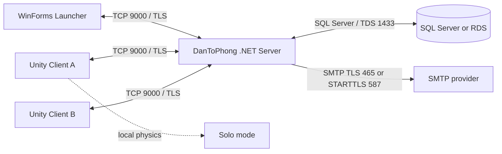

# DanToPhong architecture

## Implemented system boundary

**Primary network stack: custom TCP developed by the team. No third-party
networking library is used.** TCP 9000 carries account/OTP/data operations and
the current room/gameplay prototype. TLS is configured around the TCP stream.
The Unity solo mode remains local.

The room/gameplay implementation is an incomplete request/response prototype:
the client submits input and receives a room snapshot in that same response.
The server does not asynchronously broadcast snapshots. Server-side movement is
simplified kinematics, not the Unity track physics; collision/checkpoint
geometry, robust match lifecycle, spectator mode, reconnect/resume, and
authoritative rewards remain incomplete. See [protocol.md](protocol.md) for
message-level behavior and limitations.

## Components and trust boundaries

- **WinForms Launcher:** registration, login, OTP and account-facing GUI. It
  calls the TCP service and starts Unity. The session token is passed to the
  child process through its environment, not a command-line argument.
- **Unity client:** Solo simulation is local. Multiplayer room/input/state
  operations use the project's TCP protocol when the game path is invoked.
  Client-side rendering interpolates received snapshots; client state is not a
  trusted source for rewards or track-rule validation.
- **.NET server:** handles protocol sessions asynchronously; authentication,
  account data, OTP and selected game state are mediated by this service.
- **SQL Server/RDS:** stores account and security-sensitive persistent state.
  The current room/game simulation registry remains process-local memory.
- **SMTP provider:** used by the server to send OTP messages; credentials and
  certificate material must be supplied outside the repository.

## Flow

1. Launcher authenticates over TCP/TLS and receives a session token.
2. Launcher starts Unity with user/mode/endpoint arguments and the token in
   the child process environment.
3. Unity validates the token with the server and loads account data.
4. Solo mode enters local vehicle gameplay. The multiplayer prototype creates
   or joins a server-side in-memory room, starts with at least two players,
   then exchanges input and snapshots over TCP request/response.
5. On disconnect, the server cleans up the session and removes the player
   from room membership. Match resume is not implemented.

## State transport and future direction

There is currently one network transport: TCP. The game-state call site is
isolated behind `IStateChannel`, with a TCP implementation. That abstraction
does not imply a second transport exists. A future datagram channel could be
considered after the TCP implementation, correctness tests, and measurements
are complete; no datagram code is present.

For diagrams and flow details, see `docs/diagrams/architecture.drawio`,
`application-flow.drawio`, `gui-wireframe.drawio`, and `user-stories.drawio`.
