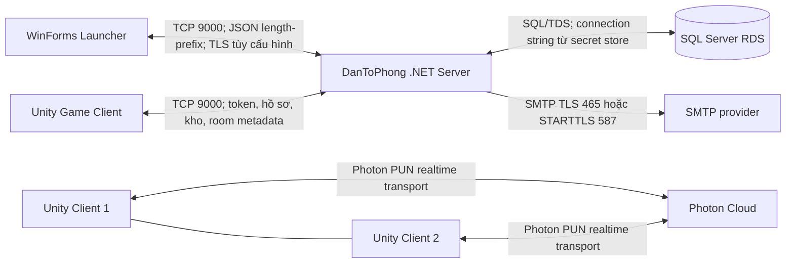

# Kiến trúc mạng DanToPhong

## Thành phần và ranh giới mạng

TCP 9000 là protocol riêng của dự án, dùng request/response JSON để xác thực,
OTP, hồ sơ, kho, giao dịch và metadata phòng/lời mời. Kênh này **không** mang
transform realtime của xe.

Photon PUN là dịch vụ realtime gameplay độc lập. `LobbyManager` dùng
`PhotonNetwork.ConnectUsingSettings`, `CreateRoom`/`JoinRoom`; xe được tạo bằng
`PhotonNetwork.Instantiate`. `SmoothNetworkTransform` triển khai
`IPunObservable`, gửi vị trí, hướng, vận tốc và vận tốc góc; bên nhận nội suy
snapshot và dự đoán trong khoảng ngắn. Tần suất được cấu hình trong manager
(mặc định SendRate 20 và SerializationRate 10).

## Luồng khởi chạy

1. Launcher gọi TCP Server để đăng nhập/đăng ký/OTP và lấy token.
2. Launcher khởi chạy Unity với user, token, endpoint TCP, cờ TLS và mode.
3. Scene `Boot` xác thực token qua `XACTHUCTOKEN`, tải hồ sơ/kho qua TCP rồi
   chuyển scene theo mode.
4. Chế độ nhiều người chơi kết nối Photon và vào/tạo Photon room. Chế độ solo
   tạo xe local khi không ở Photon room.
5. `RoomReporter` gửi metadata phòng từ Photon master client tới TCP Server
   (khi đổi hoặc định kỳ); room registry hỗ trợ danh sách/lời mời, không phải
   authority cho physics hoặc membership Photon.

## Danh tính và trust boundary

Unity đặt `PhotonNetwork.NickName` từ thông tin launcher, sau đó dùng cấu hình
Photon PUN. Trong code được rà soát không thấy token DanToPhong được dùng làm
Photon Custom Authentication; vì vậy không xem nickname Photon là bằng chứng
định danh đã xác thực bởi TCP Server. Cần tích hợp custom authentication/server
authorization nếu cần chống giả mạo danh tính hoặc gian lận gameplay.

Room registry TCP là RAM-only; phòng không được cập nhật trong 30 giây sẽ bị
xóa. Photon là nguồn trạng thái phòng gameplay. Kênh realtime và cổng mở cần
theo cấu hình Photon, không suy ra từ TCP 9000; firewall chỉ mở các đích/port
Photon thực sự cần theo cấu hình SDK.

## Vận hành an toàn

- Server bind mọi interface; security group/firewall cần giới hạn nguồn TCP
  9000 theo IP `/32` phù hợp, không mở `0.0.0.0/0`.
- Bật TLS đồng thời ở server và Launcher/Unity, xác thực certificate theo đúng
  DNS host; không dùng tài khoản thật khi server nhận plaintext.
- DB, SMTP, certificate/password phải nằm ngoài repo trong secret store hoặc
  môi trường chạy.
- Có thể xem [protocol.md](protocol.md) để biết framing, command và sequence;
  xem [security-notes.md](security-notes.md) cho các giới hạn bảo mật.
