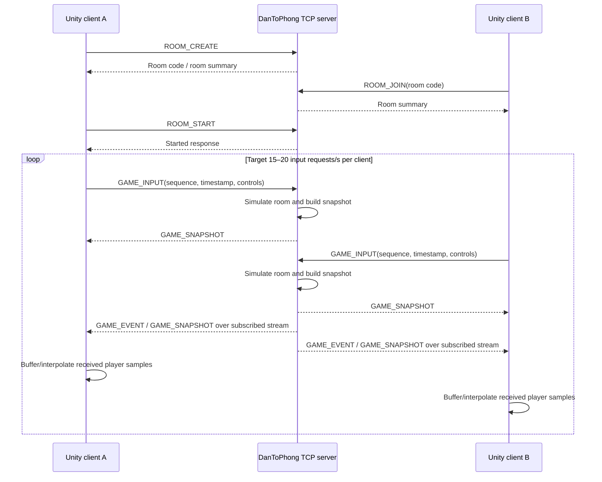

# DanToPhong TCP protocol

This specification describes the implemented TCP request/response protocol in
`UI/DanToPhong.Protocol/MessageFramer.cs`, `Packets.cs`, `Commands.cs`,
`UI/DanToPhong.Server/Program.cs`, `UI/DanToPhong.Server/TcpGameRoomRegistry.cs`,
`UI/UI/NetworkClientService.cs`, and `Assets/script/ServerClient.cs`.
Runtime/load-test claims are only made when backed by evidence in
`docs/evidence/`.

## 1. Transport and session

- Transport: TCP stream, default server port `9000`; clients can override the
  host and port through runtime configuration.
- TLS wraps the TCP stream before application framing and is enabled by
  default. The server fails closed if a valid certificate is unavailable;
  clients validate the certificate chain and hostname. Plaintext is an
  explicit isolated-test option only, and both ends must use matching
  settings.
- Application requests are processed sequentially per connection and receive
  one response. Gameplay opens a second authenticated TCP connection with
  `GAME_STREAM`; the server then sends separate ordered event frames and
  timestamped snapshots at a nominal 20 Hz.
- Server sessions use asynchronous I/O, a configured concurrent-session limit,
  per-session idle/read timeouts, and socket cleanup on EOF or error. Client
  timeout/heartbeat behavior is described in the deployment configuration and
  must be verified against the running build.
- The client sends game input at a target rate of 15–20 requests per second.
  Since each request waits for its response before the next request, actual
  update rate can fall below that target when latency is high.

## 2. Frame format

| Offset | Size | Description |
|---|---:|---|
| 0 | 4 bytes | Signed 32-bit body length, big-endian |
| 4 | N bytes | UTF-8 JSON object; no delimiter |

`1 <= N <= 65,536` bytes. TCP reads may split or combine frames, so receivers
read the full header and then the full body. Empty, negative, oversized,
truncated, or invalid JSON frames are rejected; malformed input closes the
session rather than returning a success-shaped response.

## 3. Packet envelope and limits

The request envelope is `RequestPacket`; `command` selects the operation and
the other fields are optional and command-specific. The response envelope is
`ResponsePacket`, including `success`, `code`, `command`, and `message`, with
optional DTOs and game-state fields. The authoritative field definitions are
the C# DTOs in `Packets.cs`.

Important fields include:

- Account/session: `username`, `password`, `verificationCode`, `token`,
  `requestId`.
- Room: `roomId`, `mapName`, `maxPlayers`, `playerCount`, `isRacing`.
- Input: `vehicleIndex`, `throttle`, `steer`, `brake`, `clientTick`,
  `clientTimestampMs`. The server chooses the spawn from its track catalog.
- Snapshot: `gamePlayers[]`; each player has `userId`, `username`,
  `vehicleIndex`, `sequence`, position/rotation/velocity, and
  `serverTimestampMs`.
- Events/chat: `gameEventType`, checkpoint fields, `chatMessage`,
  `afterMessageId`; response DTOs include ordered chat IDs and timestamps.

Per-field validation is command-specific. The generic frame limit does not
replace input validation. Game input requires finite throttle/steer values and
timestamps, rejects controls outside `[-1, 1]` and non-increasing client ticks,
and does not accept a client-selected position. Checkpoint order and chat
length/control characters are validated server-side.

## 4. Commands

### Account and application data

`DANGKY`, `DANGNHAP`, `YEUCAUMADANGKY`, `YEUCAUMADATLAI`, `DOIMATKHAU`,
`XACTHUCTOKEN`, `DANGXUAT`, `LAYTHONGTIN`, `LAYKHO`, `CAPNHATXU`,
`MUAHANG`, `TRANGBI`, `CHONMAP`, avatar/review/leaderboard commands,
`VAOPHONG`, room metadata/invite commands, and `PING` are defined in
`Commands.cs`.

### TCP room and game prototype

| Command | Direction | Implemented behavior |
|---|---|---|
| `ROOM_CREATE` | Client → server | Creates an in-memory room; response includes code and membership summary. |
| `ROOM_JOIN` | Client → server | Joins a waiting room if it exists and has capacity. |
| `ROOM_LEAVE` | Client → server | Removes the user's in-memory membership. |
| `ROOM_STATE` | Client → server | Returns current room summary and player state. |
| `ROOM_START` | Host → server | Starts a room when the host has at least one other player. |
| `GAME_INPUT` | Client → server | Sends controls, client tick and timestamp; the server uses its configured spawn and simulation state. |
| `GAME_STREAM` | Client → server | Authenticates a dedicated connection and subscribes it to ordered room events and snapshots. |
| `GAME_SNAPSHOT` | Server → subscribed clients | Pushed at a nominal 20 Hz over each client's dedicated TCP stream; includes initialized players and server sequence/timestamp. |
| `GAME_EVENT` | Client → server; server → subscribed clients | Client `ELIMINATE` requests are currently accepted. Checkpoint and finish events are generated by server-side configured gate crossings; client checkpoint/finish requests are rejected. Events are sent as separate ordered TCP frames. |
| `CHAT_SEND`, `CHAT_POLL` | Client ↔ server | Stores bounded in-memory room chat and returns messages after an ID; delivery is polling, not push. |

Server state is serialized under an in-process lock and room membership is
in-memory. There is no cross-process persistence or durable resume token for a
match. A disconnected racer is retained for a 120-second grace period and may
reconnect or be spectated; expiry or a server restart loses the room state.

## 5. Gameplay synchronization currently implemented

The Unity client samples controls and sends `GAME_INPUT` at a target 15–20 Hz
over its authenticated command connection. It opens a second TLS/TCP connection,
validates the session token, and subscribes with `GAME_STREAM`. The server
advances a simplified kinematic model on a nominal 20 Hz step, validates
bounded controls, and pushes timestamped `GAME_SNAPSHOT` frames to subscribed
room members.
Accepted room events are separate TCP frames with monotonic event IDs; TCP
preserves event/snapshot order on each stream. Unity buffers up to eight
snapshots, discards the oldest when full, rejects stale player sequences, and
renders remote players approximately 100 ms behind server time.

Important limits:

- Snapshot delivery is server-pushed over a dedicated per-client TCP stream;
  server room and match state are still process-local.
- The server uses a bounded mailbox per game-stream client: important events
  wait for queue capacity, while the one-slot snapshot queue drops stale state.
  The client also drops the oldest buffered snapshot when its eight-sample
  queue is full. A slow stream can delay its own event producer, but does not
  hold the room lock or share a queue with other clients. TCP backpressure can
  still delay delivery; latency/load bounds have not been measured.
- The server simulation is simplified kinematics, not the Unity track
  collision/vehicle physics. Spawn positions come from the server track
  catalog, and checkpoint/finish crossings are checked against configured
  gates, not Unity collision geometry.
- The server does not own the multiplayer timer yet. A client can request
  `ELIMINATE`, so elimination is not authoritative and a malicious client can
  submit that event early.
- Finish/checkpoint state and the bounded recent event history are held in
  memory. The stream retries while the primary authenticated session remains
  alive; losing all sessions or restarting the server does not restore room
  membership.
- Spectating, reconnect during the 120-second grace period, and server-side
  winner rewards exist in source but have not been verified in a live match.
  There is no durable scoreboard or server restart recovery. Solo remains
  local Unity gameplay.
- Unity holds the last sample when it has no later sample; bounded
  extrapolation is not implemented.

These are known development gaps. A successful build or a protocol smoke test
does not establish that multiplayer gameplay is complete or stable.

## 6. Error codes and connection closure

Application responses use codes such as `OK`, `ERR_INVALID_INPUT`,
`ERR_USER_EXISTS`, `ERR_AUTH_FAILED`, `ERR_UNAUTHORIZED`,
`ERR_INSUFFICIENT_COINS`, `ERR_SERVER_ERROR`, and
`ERR_ALREADY_REVIEWED`. Framing/JSON errors close the connection without a
normal application response. EOF/FIN and socket errors leave the session loop
and dispose the stream/socket. During a race the server marks the player
disconnected and retains room membership for the 120-second reconnect grace;
otherwise membership is removed.

## 7. Sequence diagrams

### Login and token handoff

```mermaid
sequenceDiagram
    participant L as WinForms Launcher
    participant S as TCP Server :9000
    participant D as SQL Server
    participant G as Unity client
    L->>S: DANGNHAP over TCP/TLS
    S->>D: Verify credentials and store token hash
    S-->>L: ResponsePacket + short-lived session token
    L->>G: Start child process; pass token in child environment
    G->>S: XACTHUCTOKEN
    S->>D: Validate token hash and expiry
    S-->>G: Authenticated response
```

### Create/join, start and exchange gameplay state



The server-push path is implemented in source; it does not imply
track-aware authoritative Unity physics or a live multiplayer test pass.

### Disconnect and cleanup

```mermaid
sequenceDiagram
    participant C as Client
    participant S as TCP Server
    C->>S: FIN / EOF or socket failure
    S->>S: Exit session receive loop and dispose socket
    alt Race is active
        S->>S: Mark disconnected; retain membership for 120 seconds
        opt Reconnect within grace period
            C->>S: GAME_RECONNECT
            S-->>C: Current in-memory match snapshot
        end
        S->>S: Remove player after grace expires
    else No active race
        S->>S: Remove user from room membership
    end
```

## 8. Future transport direction (not implemented)

The current transport remains TCP for all implemented network features. Any
future transport proposal is deferred until after the 2026-12-12 project
cutoff and would require a separate design, threat review, and measurements.
No UDP/datagram code, HMAC state channel, or transport fallback exists in this
project now.

## 9. Verification and capture guidance

The protocol smoke test can be run locally:

```powershell
dotnet run --project UI\DanToPhong.Protocol.Smoke\DanToPhong.Protocol.Smoke.csproj -c Release
```

It exercises framing in memory only; it is not a live-server, TLS, DB, SMTP,
load, or gameplay test. Record 10–50 client tests, slow/malformed clients,
two-client gameplay, TLS behavior and packet captures only after observing
them. Keep credentials and personal endpoints out of captures.

The optional scripts in `tools/` are restricted to loopback and use dummy/local
test configuration only. They are not remote load tools. For an owner-approved
Internet test, use separate GUI clients and a basic TCP reachability check;
do not direct malformed/slow-client traffic at a public endpoint.

For Wireshark on a locally controlled test server, use `tcp.port == 9000`.
Capture SYN/SYN-ACK/ACK and FIN for TCP lifecycle. With TLS enabled, record the
handshake and negotiated protocol/cipher and confirm application data is not
readable as JSON. Plaintext comparison is only for dummy data on an isolated
test environment. Do not commit raw captures unless sensitive payload and
addresses have been removed and the resulting file has been reviewed.
