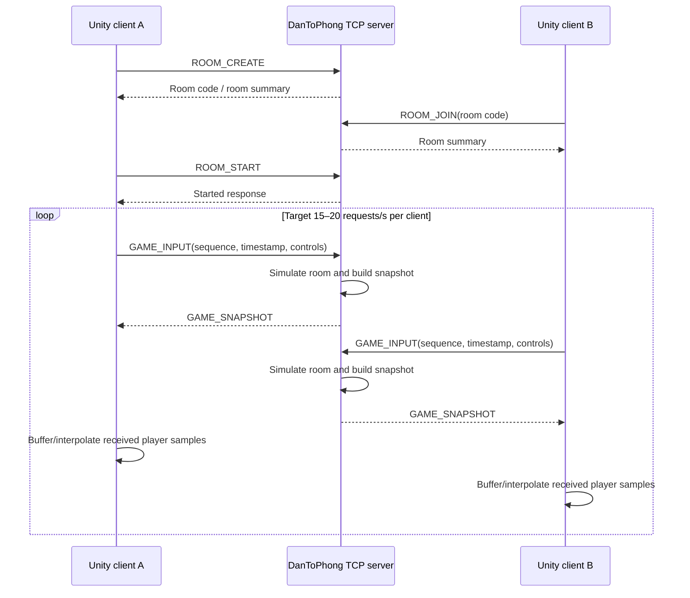
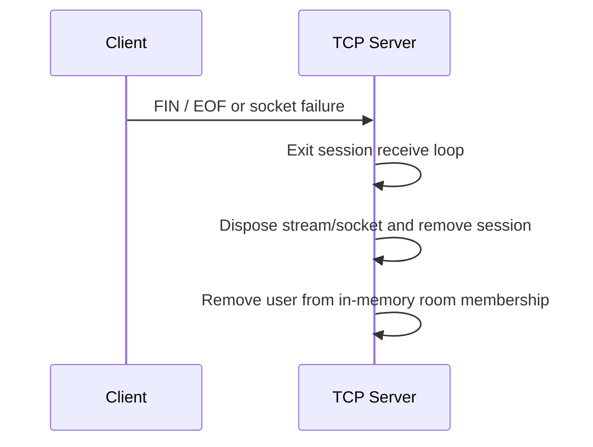

# DanToPhong TCP protocol

This specification describes the implemented TCP request/response protocol in
`UI/DanToPhong.Protocol/MessageFramer.cs`, `Packets.cs`, `Commands.cs`,
`UI/DanToPhong.Server/Program.cs`, `UI/DanToPhong.Server/TcpGameRoomRegistry.cs`,
`UI/UI/NetworkClientService.cs`, and `Assets/script/ServerClient.cs`.
Runtime/load-test claims are only made when backed by evidence in
`docs/evidence/`.

## 1. Transport and session

- Transport: TCP stream, default server port `9000`; clients can override the
  host and port through runtime configuration.
- TLS wraps the TCP stream before application framing. Runtime configuration
  must enable TLS on both ends and use a certificate trusted for the server
  hostname. The plaintext setting is an explicit isolated-test option only.
- Requests are processed sequentially per connection. Each request receives
  one response; the current gameplay path does not use a server-push channel.
- Server sessions use asynchronous I/O, a configured concurrent-session limit,
  per-session idle/read timeouts, and socket cleanup on EOF or error. Client
  timeout/heartbeat behavior is described in the deployment configuration and
  must be verified against the running build.
- The client sends game input at a target rate of 15–20 requests per second.
  Since each request waits for its response before the next request, actual
  update rate can fall below that target when latency is high.

## 2. Frame format

| Offset | Size | Description |
|---|---:|---|
| 0 | 4 bytes | Signed 32-bit body length, big-endian |
| 4 | N bytes | UTF-8 JSON object; no delimiter |

`1 <= N <= 65,536` bytes. TCP reads may split or combine frames, so receivers
read the full header and then the full body. Empty, negative, oversized,
truncated, or invalid JSON frames are rejected; malformed input closes the
session rather than returning a success-shaped response.

## 3. Packet envelope and limits

The request envelope is `RequestPacket`; `command` selects the operation and
the other fields are optional and command-specific. The response envelope is
`ResponsePacket`, including `success`, `code`, `command`, and `message`, with
optional DTOs and game-state fields. The authoritative field definitions are
the C# DTOs in `Packets.cs`.

Important fields include:

- Account/session: `username`, `password`, `verificationCode`, `token`,
  `requestId`.
- Room: `roomId`, `mapName`, `maxPlayers`, `playerCount`, `isRacing`.
- Input: `vehicleIndex`, `positionX/Y/Z`, `rotationY`, `throttle`, `steer`,
  `brake`, `clientTick`, `clientTimestampMs`.
- Snapshot: `gamePlayers[]`; each player has `userId`, `username`,
  `vehicleIndex`, `sequence`, position/rotation/velocity, and
  `serverTimestampMs`.
- Events/chat: `gameEventType`, checkpoint fields, `chatMessage`,
  `afterMessageId`; response DTOs include ordered chat IDs and timestamps.

Per-field validation is command-specific. The generic frame limit does not
replace input validation. Game input rejects non-finite/out-of-range initial
coordinates and non-increasing client ticks; throttle and steering are clamped
to `[-1, 1]`. Checkpoint sequence and chat length/control characters are
validated server-side.

## 4. Commands

### Account and application data

`DANGKY`, `DANGNHAP`, `YEUCAUMADANGKY`, `YEUCAUMADATLAI`, `DOIMATKHAU`,
`XACTHUCTOKEN`, `DANGXUAT`, `LAYTHONGTIN`, `LAYKHO`, `CAPNHATXU`,
`MUAHANG`, `TRANGBI`, `CHONMAP`, avatar/review/leaderboard commands,
`VAOPHONG`, room metadata/invite commands, and `PING` are defined in
`Commands.cs`.

### TCP room and game prototype

| Command | Direction | Implemented behavior |
|---|---|---|
| `ROOM_CREATE` | Client → server | Creates an in-memory room; response includes code and membership summary. |
| `ROOM_JOIN` | Client → server | Joins a waiting room if it exists and has capacity. |
| `ROOM_LEAVE` | Client → server | Removes the user's in-memory membership. |
| `ROOM_STATE` | Client → server | Returns current room summary and player state. |
| `ROOM_START` | Host → server | Starts a room when the host has at least one other player. |
| `GAME_INPUT` | Client → server | Sends input, sequence/tick, timestamp and initial spawn position. |
| `GAME_SNAPSHOT` | Server → requesting client | Returned as the response to a room-state/input request; includes initialized players. It is not pushed/broadcast asynchronously. |
| `GAME_EVENT` | Client → server | Accepts sequential checkpoint and finish event requests; spatial validation is not implemented. |
| `CHAT_SEND`, `CHAT_POLL` | Client ↔ server | Stores bounded in-memory room chat and returns messages after an ID; delivery is polling, not push. |

Server state is serialized under an in-process lock and room membership is
in-memory. There is no cross-process persistence or resume token for a match.
Disconnect cleanup removes a player from the room.

## 5. Gameplay synchronization currently implemented

The Unity client samples controls and sends `GAME_INPUT` at a target 15–20 Hz.
The server advances a simplified kinematic model on a nominal 20 Hz step, clamps
input, and returns a snapshot in that same request/response exchange. Snapshot
sequence and server timestamp are included. Unity buffers up to eight samples
and renders remote players approximately 100 ms behind server time.

Important limits:

- This is request/response polling, not a server broadcast. Each client sees
  the room snapshot only when it receives its own response.
- There is no per-client outbound snapshot queue, so stale-snapshot coalescing
  has not been implemented. The client sends no next request until the prior
  response completes, which bounds its own outstanding requests but reduces
  update rate under latency.
- The server simulation is simplified kinematics, not the Unity track
  collision/vehicle physics. It does not validate client spawn against track
  geometry, and it does not authoritatively verify that a checkpoint was
  physically crossed.
- Finish/checkpoint state is held in memory; winner state is not pushed to
  every room member. Reconnect does not restore prior membership.
- Spectating, authoritative rewards/coins/scoreboard, and full match lifecycle
  are incomplete. Solo remains local Unity gameplay.
- Unity holds the last sample when it has no later sample; bounded
  extrapolation is not implemented.

These are known development gaps. A successful build or a protocol smoke test
does not establish that multiplayer gameplay is complete or stable.

## 6. Error codes and connection closure

Application responses use codes such as `OK`, `ERR_INVALID_INPUT`,
`ERR_USER_EXISTS`, `ERR_AUTH_FAILED`, `ERR_UNAUTHORIZED`,
`ERR_INSUFFICIENT_COINS`, `ERR_SERVER_ERROR`, and
`ERR_ALREADY_REVIEWED`. Framing/JSON errors close the connection without a
normal application response. EOF/FIN and socket errors leave the session loop,
which disposes the stream/socket and removes session-owned room membership.

## 7. Sequence diagrams

### Login and token handoff

```mermaid
sequenceDiagram
    participant L as WinForms Launcher
    participant S as TCP Server :9000
    participant D as SQL Server
    participant G as Unity client
    L->>S: DANGNHAP over TCP/TLS
    S->>D: Verify credentials and store token hash
    S-->>L: ResponsePacket + short-lived session token
    L->>G: Start child process; pass token in child environment
    G->>S: XACTHUCTOKEN
    S->>D: Validate token hash and expiry
    S-->>G: Authenticated response
```

### Create/join, start and exchange gameplay state



This diagram shows the implemented request/response path. It does not imply
server-pushed broadcast or authoritative Unity physics.

### Disconnect and cleanup



## 8. Future transport direction (not implemented)

The current transport remains TCP for all implemented network features. A
future state channel could negotiate a separate datagram transport over the
authenticated TCP session, with monotonic sequence numbers, timestamps,
message authentication, replay protection, and fallback to TCP. No datagram
transport, HMAC state channel, or fallback implementation exists in this
project now.

## 9. Verification and capture guidance

The protocol smoke test can be run locally:

```powershell
dotnet run --project UI\DanToPhong.Protocol.Smoke\DanToPhong.Protocol.Smoke.csproj -c Release
```

It exercises framing in memory only; it is not a live-server, TLS, DB, SMTP,
load, or gameplay test. Record 10–50 client tests, slow/malformed clients,
two-client gameplay, TLS behavior and packet captures only after observing
them. Keep credentials and personal endpoints out of captures.

The optional scripts in `tools/` are restricted to loopback and use dummy/local
test configuration only. They are not remote load tools. For an owner-approved
Internet test, use separate GUI clients and a basic TCP reachability check;
do not direct malformed/slow-client traffic at a public endpoint.

For Wireshark on a locally controlled test server, use `tcp.port == 9000`.
Capture SYN/SYN-ACK/ACK and FIN for TCP lifecycle. With TLS enabled, record the
handshake and negotiated protocol/cipher and confirm application data is not
readable as JSON. Plaintext comparison is only for dummy data on an isolated
test environment. Do not commit raw captures unless sensitive payload and
addresses have been removed and the resulting file has been reviewed.
