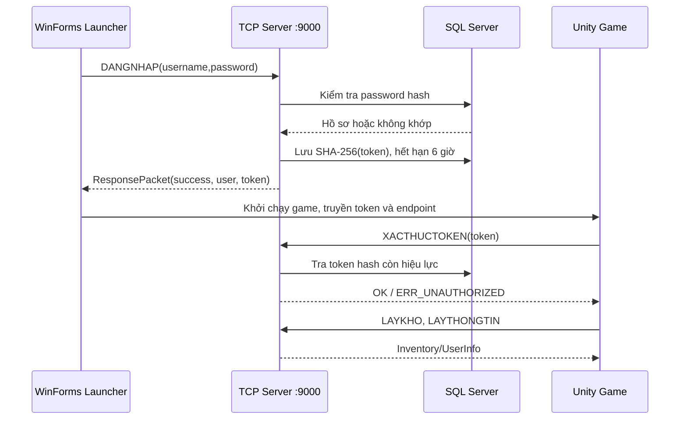
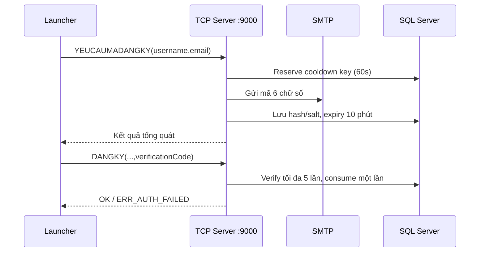
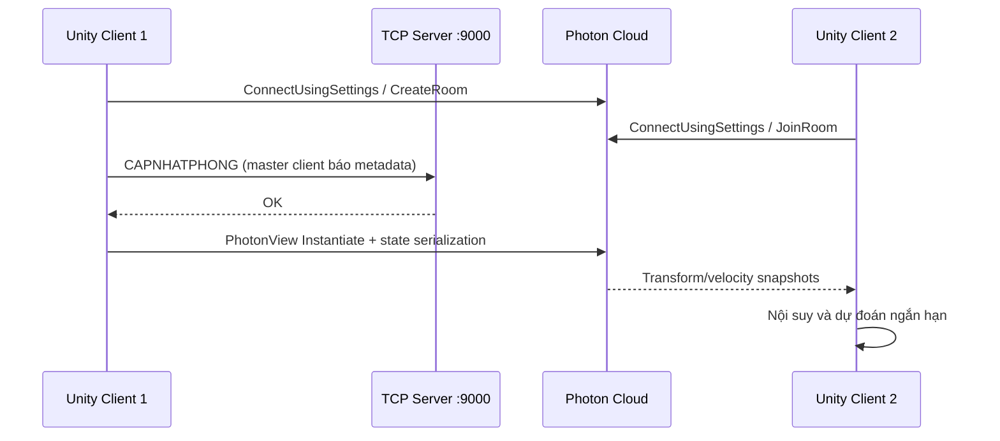
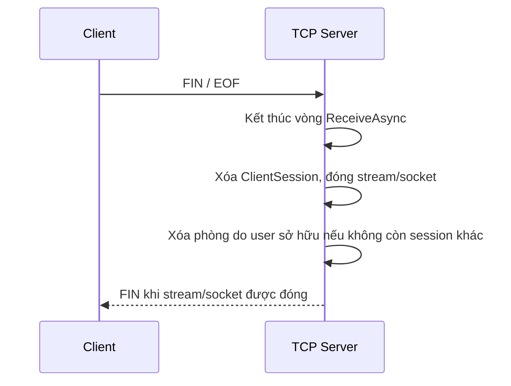

# Đặc tả giao thức DanToPhong

Tài liệu này được đối chiếu với `UI/DanToPhong.Protocol/MessageFramer.cs`,
`Packets.cs`, `Commands.cs`, `UI/DanToPhong.Server/Program.cs`,
`UI/UI/NetworkClientService.cs` và `Assets/script/ServerClient.cs`.

## 1. Transport và phiên kết nối

- Transport là TCP; cổng mặc định `9000`, có thể đổi bằng `DANTOPHONG_PORT`.
- Server bind `IPAddress.Any`; client kết nối tới host/port trong `server.json`
  hoặc biến môi trường.
- TLS là tùy chọn cấu hình, không được thương lượng tự động. Server và client
  phải cùng bật/tắt `DANTOPHONG_USE_TLS`. Server dùng TLS 1.2/1.3 và certificate
  PKCS#12 khi bật; TLS mặc định **tắt**.
- Client WinForms dùng timeout thao tác 12 giây; Unity dùng 8 giây. Server giới
  hạn TLS handshake 10 giây và chờ tối đa 2 phút cho một request tiếp theo trên
  mỗi kết nối.
- Mỗi kết nối xử lý lần lượt một request rồi một response. Client Unity khóa
  exchange bằng semaphore; server có một vòng đọc/dispatch/ghi tuần tự cho mỗi
  session. Không có heartbeat ứng dụng hoặc TCP keep-alive được cấu hình.
- Server dùng async I/O và giới hạn tối đa 128 session đồng thời; kết nối vượt
  giới hạn bị đóng. Khi Ctrl+C, listener dừng, socket phiên đang hoạt động bị
  đóng và server chờ session dọn dẹp xong.

## 2. Framing và biểu diễn bản tin

Mỗi frame có cấu trúc:

| Offset | Độ dài | Ý nghĩa |
|---|---:|---|
| 0 | 4 byte | Độ dài body, số nguyên signed 32-bit big-endian |
| 4 | N byte | JSON UTF-8, không có delimiter hoặc byte kết thúc |

- `1 <= N <= 65,536` byte. Giới hạn được áp dụng cho request và response ở
  `MessageFramer`; Unity client cũng áp dụng cùng giới hạn ở hai chiều.
- TCP là byte stream: một lần `Read`/`Write` không tương ứng một frame. Receiver
  đọc đủ 4 byte header rồi đọc đủ N byte body; nhiều frame có thể liền nhau.
- JSON dùng tên property camelCase. Server đọc JSON không phân biệt hoa/thường.
- Header bằng 0, âm hoặc vượt giới hạn bị từ chối. EOF trước header hoàn chỉnh
  được xem là đóng kết nối; EOF giữa body là frame lỗi. JSON sai/packet sai làm
  session đóng, không gửi response thành công giả.
- Lỗi framing không có frame lỗi riêng: server ghi log ngắn và đóng kết nối.
  Với request hợp lệ nhưng không hỗ trợ/không hợp lệ, server trả `ResponsePacket`.

## 3. Cấu trúc request/response

Request là object `RequestPacket`. Các field đều optional trừ `command`:

`command`, `userId`, `racerId`, `username`, `password`, `verificationCode`,
`requestId`, `fullName`, `email`, `birthday`, `gender`, `avatarPath`,
`coinsDelta`, `mode`, `roomId`, `token`, `category`, `itemIndex`, `price`,
`mapName`, `avatarBase64`, `stars`, `comment`, `playerCount`, `maxPlayers`,
`isRacing`, `targetId`.

Response là object `ResponsePacket`: `success`, `code`, `message`, `mode`,
`roomId`, `user`, `token`, `inventory`, `avatarBase64`, `reviewSummary`,
`leaderboard`, `rooms`, `invites`. Các DTO lồng nhau được định nghĩa trong
`Packets.cs`.

`requestId` được dùng để khử trùng lặp giao dịch `CAPNHATXU` và `MUAHANG`;
các lệnh khác không có correlation ID riêng. Trên một stream, thứ tự request và
response được giữ nguyên.

## 4. Command và mã kết quả

| Command | Chức năng |
|---|---|
| `DANGKY` | Tạo tài khoản, yêu cầu mã xác nhận hợp lệ |
| `DANGNHAP` | Đăng nhập, trả token phiên |
| `YEUCAUMADANGKY`, `YEUCAUMADATLAI` | Gửi OTP đăng ký/đặt lại mật khẩu |
| `DOIMATKHAU` | Đặt lại mật khẩu bằng OTP |
| `XACTHUCTOKEN`, `DANGXUAT` | Xác thực/thu hồi token |
| `LAYTHONGTIN`, `LAYKHO`, `LAYTRANGTHAI` | Đọc hồ sơ, kho và lời mời |
| `CAPNHATXU`, `MUAHANG`, `TRANGBI`, `CHONMAP` | Thao tác kho/tài sản |
| `TAIAVATAR`, `LAYAVATAR`, `DOIAVATAR` | Avatar |
| `GUIDANHGIA`, `LAYDANHGIA`, `BANGXEPHANG` | Đánh giá và bảng xếp hạng |
| `VAOPHONG` | Trả thông tin người chơi/phòng cho luồng launcher |
| `CAPNHATPHONG`, `XOAPHONG`, `DSPHONG` | Cập nhật, xóa, liệt kê metadata phòng |
| `MOIBAN`, `LAYLOIMOI` | Gửi/lấy lời mời |

Các mã chuẩn trong `ErrorCodes`: `OK`, `ERR_INVALID_INPUT`,
`ERR_USER_EXISTS`, `ERR_AUTH_FAILED`, `ERR_UNAUTHORIZED`,
`ERR_INSUFFICIENT_COINS`, `ERR_SERVER_ERROR`, `ERR_ALREADY_REVIEWED`.
Một số thao tác dùng `ERR_INVALID_INPUT` cho trạng thái từ chối nghiệp vụ.
Chi tiết command và validate nằm trong `Program.cs`; không phải mọi command đều
được Unity gọi trực tiếp.

## 5. Trình tự message

### Đăng nhập và xác thực game



### OTP đăng ký



### Vào phòng và đồng bộ gameplay



`VAOPHONG`, room list và invite qua TCP không phải kênh đồng bộ vị trí xe.
Thực tế join room/gameplay được điều phối bởi Photon PUN.

### Đóng kết nối



Đây là mô tả luồng đóng socket thông thường; reset/mất mạng đột ngột được xử lý
qua exception/EOF ở session và cần kiểm thử runtime riêng.

## 6. Kiểm chứng trong repo và lệnh test

`MessageFramer.ReceiveAsync` dùng vòng lặp đọc đủ byte; giới hạn packet được
kiểm tra trước khi cấp phát body. Smoke test không cần DB/SMTP:

```powershell
dotnet run --project UI\DanToPhong.Protocol.Smoke\DanToPhong.Protocol.Smoke.csproj -c Release
```

Test này kiểm tra đọc một byte/lần, hai frame nối liên tiếp, EOF sạch, frame
truncated, length quá lớn và payload gửi vượt giới hạn. Nó **không** mô phỏng
server thực, TLS, DB, 10–50 client hoặc tải mạng.

Server đọc mỗi request với idle timeout 2 phút; cấu hình mới giới hạn session
đồng thời 128. Cần chạy stress test trên môi trường có DB/runtime config thật,
ít nhất 10–50 client, slow sender, malformed header/body, abort và server restart
trước khi xác nhận ổn định.

## 7. Checklist capture Wireshark (chưa có capture trong repo)

Chỉ capture với server do nhóm quản lý và dữ liệu thử giả. Không dùng password,
OTP, token hoặc tài khoản thật trong ca plaintext.

| Ca | Display filter/gợi ý | File cần lưu |
|---|---|---|
| TCP handshake/close | `tcp.port == 9000`; SYN đầu: `tcp.flags.syn == 1 && tcp.flags.ack == 0`; FIN: `tcp.flags.fin == 1` | `TC11-tcp-9000.pcapng`, `TC11-tcp-9000.png` |
| TLS handshake | `tcp.port == 9000 && tls`; xem ClientHello, ServerHello, negotiated version/cipher | `TC12-tls-handshake.pcapng`, `TC12-tls-handshake.png` |
| Plaintext so sánh | Chỉ khi TLS tắt và dùng payload test vô hại; Follow TCP Stream để chỉ ra JSON đọc được | `TC12-plaintext-demo.pcapng`, `TC12-plaintext-demo.png` |
| TLS payload | Dùng cùng payload thử khi TLS bật; handshake hợp lệ và Application Data không đọc thành JSON | `TC12-tls-payload.pcapng`, `TC12-tls-payload.png` |

Mỗi ảnh cần caption ghi rõ handshake/đóng kết nối hay mã hóa payload đang được
chứng minh. Xóa/ẩn IP nguồn/đích và các metadata riêng trước khi commit; không
coi `.pcapng` có payload plaintext là đã redact chỉ vì ảnh đã che.

## 8. Hạn chế giao thức đã biết

- TLS mặc định tắt và hai đầu phải cấu hình đồng nhất; không có TLS negotiation
  hay downgrade protection ở tầng ứng dụng.
- Không có version field, heartbeat, server push hoặc request ID chung cho mọi
  command; đa số response được ghép theo thứ tự trên stream.
- Giới hạn 64 KiB là giới hạn frame, không thay thế giới hạn/validate nghiệp vụ
  cho từng field.
- Room registry và lời mời của TCP Server ở RAM; Photon Cloud mới giữ room
  gameplay. Restart server làm mất registry/invites.
- Chưa có capture `.pcapng` làm bằng chứng. Không tạo capture chứa tài khoản,
  OTP, token hoặc endpoint riêng; phải dùng tài khoản thử và redact trước khi
  commit.
