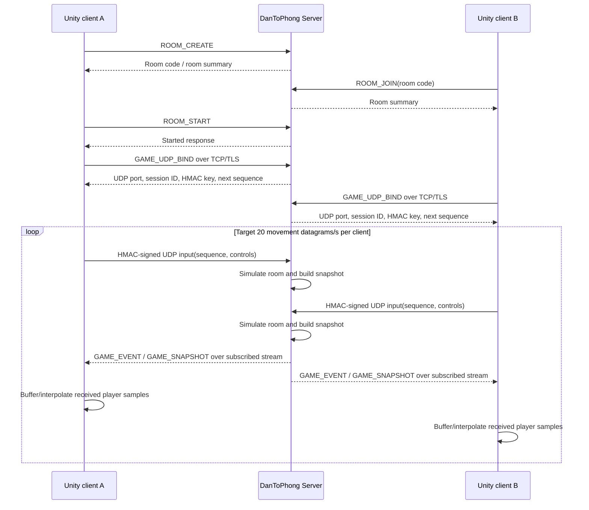

# DanToPhong hybrid TCP/TLS + UDP protocol

This specification describes the implemented TCP request/response protocol in
`UI/DanToPhong.Protocol/MessageFramer.cs`, `Packets.cs`, `Commands.cs`,
`UI/DanToPhong.Server/Program.cs`, `UI/DanToPhong.Server/TcpGameRoomRegistry.cs`,
`UI/UI/NetworkClientService.cs`, and `Assets/script/ServerClient.cs`.
Runtime/load-test claims are only made when backed by evidence in
`docs/evidence/`.

## 1. Transport and session

- Reliable transport: TCP stream, default server port `9000`; clients can
  override host and ports through runtime configuration.
- Realtime movement input: UDP datagrams, default port `9000`. A client first
  obtains a per-session random key through the authenticated TCP/TLS channel.
  UDP inputs are authenticated with HMAC-SHA-256 and strictly increasing
  sequence numbers; snapshots and game events remain on TCP/TLS.
- TLS wraps the TCP stream before application framing and is enabled by
  default. The server fails closed if a valid certificate is unavailable;
  Launcher and Unity require the exact SHA-256 certificate thumbprint from
  `server.json`, while SslStream hostname and certificate-time validation stay
  enabled. Only an otherwise-valid self-signed chain with `UntrustedRoot` is
  accepted when the pin matches. Plaintext is an explicit isolated-test option.
- `DANTOPHONG_SECONDARY_PORT` optionally enables a second listener with the
  same protocol and TLS certificate; it is disabled by default.
- Application requests are processed sequentially per connection and receive
  one response. Gameplay opens a second authenticated TCP connection with
  `GAME_STREAM`; the server then sends separate ordered event frames and
  timestamped snapshots at a nominal 20 Hz.
- Server sessions use asynchronous I/O, a configured concurrent-session limit,
  per-session idle/read timeouts, and socket cleanup on EOF or error. Client
  timeout/heartbeat behavior is described in the deployment configuration and
  must be verified against the running build.
- Unity sends UDP movement input at a target 20 datagrams per second. UDP does
  not retransmit missing input; the server drops duplicate/older sequences and
  brakes after its input timeout. Ordered events, room commands, chat, auth,
  OTP, and snapshots stay on TCP/TLS.

## 2. Frame format

| Offset | Size | Description |
|---|---:|---|
| 0 | 4 bytes | Signed 32-bit body length, big-endian |
| 4 | N bytes | UTF-8 JSON object; no delimiter |

`1 <= N <= 65,536` bytes. TCP reads may split or combine frames, so receivers
read the full header and then the full body. Empty, negative, oversized,
truncated, or invalid JSON frames are rejected; malformed input closes the
session rather than returning a success-shaped response.

## 3. Packet envelope and limits

The request envelope is `RequestPacket`; `command` selects the operation and
the other fields are optional and command-specific. The response envelope is
`ResponsePacket`, including `success`, `code`, `command`, and `message`, with
optional DTOs and game-state fields. The authoritative field definitions are
the C# DTOs in `Packets.cs`.

There is currently no explicit protocol-version field or version negotiation.
All deployed clients must therefore use a compatible protocol build.

Important fields include:

- Account/session: `username`, `password`, `verificationCode`, `token`,
  `requestId`.
- Room: `roomId`, `mapName`, `maxPlayers`, `playerCount`, `isRacing`.
- Input: `vehicleIndex`, `throttle`, `steer`, `brake`, `clientTick`,
  `clientTimestampMs`. The server chooses the spawn from its track catalog.
- UDP binding response: `udpPort`, `udpSessionId`, `udpKey`,
  `udpNextSequence`; delivered inside the authenticated TCP/TLS session and
  never persisted.
- Snapshot: `gamePlayers[]`; each player has `userId`, `username`,
  `vehicleIndex`, `sequence`, position/rotation/velocity, and
  `serverTimestampMs`.
- Events/chat: `gameEventType`, checkpoint fields, `chatMessage`,
  `afterMessageId`; response DTOs include ordered chat IDs and timestamps.

Per-field validation is command-specific. The generic frame limit does not
replace input validation. Game input requires finite throttle/steer values and
timestamps, rejects controls outside `[-1, 1]` and non-increasing client ticks,
and does not accept a client-selected position. Checkpoint order and chat
length/control characters are validated server-side. Shared account validation
limits email addresses to 100 characters and passwords to 8–128 characters;
registration, reset, profile update and login enforce the corresponding server
limits, and the launcher applies the same length limits to its controls.

## 4. Commands

### Account and application data

`DANGKY`, `DANGNHAP`, `YEUCAUMADANGKY`, `YEUCAUMADATLAI`, `DOIMATKHAU`,
`XACTHUCTOKEN`, `DANGXUAT`, `LAYTHONGTIN`, `LAYKHO`, `CAPNHATXU`,
`MUAHANG`, `TRANGBI`, `CHONMAP`, avatar/review/leaderboard commands,
`VAOPHONG`, room metadata/invite commands, and `PING` are defined in
`Commands.cs`.

### TCP room and game prototype

| Command | Direction | Implemented behavior |
|---|---|---|
| `ROOM_CREATE` | Client → server | Creates an in-memory room; response includes code and membership summary. |
| `ROOM_JOIN` | Client → server | Joins a waiting room if it exists and has capacity. |
| `ROOM_LEAVE` | Client → server | Removes the user's in-memory membership. |
| `ROOM_STATE` | Client → server | Returns current room summary and player state. |
| `ROOM_START` | Host → server | Starts a room when the host has at least one other player. |
| `GAME_INPUT` | Client → server | Compatibility/test command for bounded controls; the normal Unity movement path uses UDP after binding. |
| `GAME_UDP_BIND` | Authenticated client → server over TCP/TLS | Returns a random 16-byte session ID, a 32-byte HMAC key, UDP port and the next valid sequence for an active racer. |
| UDP movement datagram | Client → server over UDP 9000 | Carries controls and an increasing sequence with HMAC-SHA-256; server drops invalid, replayed, stale, out-of-range and rate-limited datagrams. |
| `GAME_STREAM` | Client → server | Authenticates a dedicated connection and subscribes it to ordered room events and snapshots. |
| `GAME_SNAPSHOT` | Server → subscribed clients | Pushed at a nominal 20 Hz over each client's dedicated TCP stream; includes initialized players and server sequence/timestamp. |
| `GAME_EVENT` | Client → server; server → subscribed clients | A client may request its own elimination, but this does not declare a winner or trigger a winner reward. The server records a winner only after a server-side finish-gate crossing. Checkpoint and finish events are generated by the server; client checkpoint/finish requests are rejected. Events are sent as separate ordered TCP frames. |
| `CHAT_SEND`, `CHAT_POLL` | Client ↔ server | Stores bounded in-memory room chat and returns messages after an ID; delivery is polling, not push. |

Server state is serialized under an in-process lock and room membership is
in-memory. There is no cross-process persistence or durable resume token for a
match. A disconnected racer is retained for a 120-second grace period and may
reconnect or be spectated; expiry or a server restart loses the room state.

## 5. Gameplay synchronization currently implemented

After the room starts, Unity sends `GAME_UDP_BIND` over its already
authenticated TCP/TLS connection. The server returns a random session ID/key
and starting sequence. Unity sends movement datagrams to UDP 9000 at a target
20 Hz. A datagram is exactly 74 bytes:

| Offset | Size | Description |
|---|---:|---|
| 0 | 4 | ASCII magic `DTP1` |
| 4 | 16 | Random per-binding session ID |
| 20 | 4 | Unsigned big-endian sequence |
| 24 | 8 | Client Unix timestamp in milliseconds |
| 32 | 4 | IEEE-754 throttle as big-endian integer bits |
| 36 | 4 | IEEE-754 steering as big-endian integer bits |
| 40 | 1 | Brake flag (`0` or `1`) |
| 41 | 1 | Vehicle index (`0`–`100`) |
| 42 | 32 | HMAC-SHA-256 over bytes 0–41 |

The server checks exact length/magic, session binding, HMAC in constant time,
increasing sequence, finite/ranged controls, vehicle/brake bounds and a
per-binding 5 ms rate limit. Missing or invalid datagrams are discarded; no
UDP acknowledgement or retransmission is sent. The sequence floor is returned
by the server so a reconnect cannot restart at an already-used tick. The client
timestamp is carried for diagnostics but is not currently validated for age.
The key is created in memory after TCP/TLS authentication and cleared when its
session closes, is rebound, or the server shuts down.

The server advances a simplified kinematic model and keeps authoritative
position/checkpoint/finish decisions; it pushes timestamped
`GAME_SNAPSHOT` frames and important events over the separate authenticated
TCP/TLS `GAME_STREAM`. Unity buffers up to eight snapshots and interpolates
remote players. The DB-backed harness verified four concurrent racers sending
signed UDP movement with all four positions appearing in TCP snapshots; this
is protocol-level loopback evidence, not a Unity GUI or Internet test.
Accepted room events are separate TCP frames with monotonic event IDs; TCP
preserves event/snapshot order on each stream. Unity buffers up to eight
snapshots, discards the oldest when full, rejects stale player sequences, and
renders remote players approximately 100 ms behind server time.

Important limits:

- Snapshot delivery is server-pushed over a dedicated per-client TCP stream;
  server room and match state are still process-local.
- The server uses a bounded mailbox per game-stream client: important events
  wait for queue capacity, while the one-slot snapshot queue drops stale state.
  The client also drops the oldest buffered snapshot when its eight-sample
  queue is full. A slow stream can delay its own event producer, but does not
  hold the room lock or share a queue with other clients. TCP backpressure can
  still delay delivery; latency/load bounds have not been measured.
- The server simulation is simplified kinematics, not the Unity track
  collision/vehicle physics. Spawn positions come from the server track
  catalog, and checkpoint/finish crossings are checked against configured
  gates, not Unity collision geometry.
- The server does not own the multiplayer timer or full vehicle physics yet.
  A client can request its own `ELIMINATE` (forfeit), so elimination itself is
  not physics-authoritative. The request cannot award a win; a winner is
  recorded only after the server detects the finish-gate crossing.
- Finish/checkpoint state and the bounded recent event history are held in
  memory. The stream retries while the primary authenticated session remains
  alive; losing all sessions or restarting the server does not restore room
  membership.
- Spectating, reconnect during the 120-second grace period, and server-side
  winner rewards exist in source but have not been verified in a live match.
  There is no durable scoreboard or server restart recovery. Solo remains
  local Unity gameplay.
- Unity holds the last sample when it has no later sample; bounded
  extrapolation is not implemented.

These are known development gaps. A successful build or a protocol smoke test
does not establish that multiplayer gameplay is complete or stable.

## 6. Error codes and connection closure

Application responses use codes such as `OK`, `ERR_INVALID_INPUT`,
`ERR_USER_EXISTS`, `ERR_AUTH_FAILED`, `ERR_UNAUTHORIZED`,
`ERR_INSUFFICIENT_COINS`, `ERR_SERVER_ERROR`, and
`ERR_ALREADY_REVIEWED`. Framing/JSON errors close the connection without a
normal application response. EOF/FIN and socket errors leave the session loop
and dispose the stream/socket. During a race the server marks the player
disconnected and retains room membership for the 120-second reconnect grace;
otherwise membership is removed.

## 7. Sequence diagrams

### Login and token handoff

```mermaid
sequenceDiagram
    participant L as WinForms Launcher
    participant S as TCP Server :9000
    participant D as SQL Server
    participant G as Unity client
    L->>S: DANGNHAP over TCP/TLS
    S->>D: Verify credentials and store token hash
    S-->>L: ResponsePacket + short-lived session token
    L->>G: Start child process; pass token in child environment
    G->>S: XACTHUCTOKEN
    S->>D: Validate token hash and expiry
    S-->>G: Authenticated response
```

### Create/join, start and exchange gameplay state



Control datagrams use UDP 9000; event/snapshot streams remain ordered TCP/TLS
on port 9000. The loopback harness observed four racers' UDP input reflected in
TCP snapshots; this does not imply track-aware Unity physics or a live GUI/
Internet test pass.

### Disconnect and cleanup

```mermaid
sequenceDiagram
    participant C as Client
    participant S as TCP Server
    C->>S: FIN / EOF or socket failure
    S->>S: Exit session receive loop and dispose socket
    alt Race is active
        S->>S: Mark disconnected; retain membership for 120 seconds
        opt Reconnect within grace period
            C->>S: GAME_RECONNECT
            S-->>C: Current in-memory match snapshot
        end
        S->>S: Remove player after grace expires
    else No active race
        S->>S: Remove user from room membership
    end
```

## 8. Transport analysis and future direction

TCP/TLS is retained for authentication, OTP, account updates, room management,
chat, snapshots and important ordered events: reliable ordered delivery and
TLS confidentiality simplify these operations. TCP head-of-line blocking can
delay fresh realtime data after loss. UDP is limited to frequent movement
controls, where an old update is less useful than a newer sequenced update.
UDP payloads are not encrypted; their HMAC provides integrity/authentication,
not confidentiality. The UDP key is delivered only over TLS.

The current implementation uses one UDP movement channel per authenticated
racer, not UDP broadcast discovery. Future work could add separate discovery or
evaluate loss/jitter/latency under impairment. Any extension requires design,
threat review, measurement and continued TCP/TLS for reliable operations.

## 9. Verification and capture guidance

The protocol smoke test can be run locally:

```powershell
dotnet run --project UI\DanToPhong.Protocol.Smoke\DanToPhong.Protocol.Smoke.csproj -c Release
```

It exercises framing, mailbox/account validation, and the bounded email queue
with an injected sender in memory; it is not a live-server, TLS, DB, SMTP
delivery, load, or gameplay test. Record 10–50 client tests, slow/malformed clients,
two-client gameplay, TLS behavior and packet captures only after observing
them. Keep credentials and personal endpoints out of captures.

The optional scripts in `tools/` are restricted to loopback and use dummy/local
test configuration only. They are not remote load tools. For an owner-approved
Internet test, use separate GUI clients and a basic TCP reachability check;
do not direct malformed/slow-client traffic at a public endpoint.

For Wireshark on a locally controlled test server, use `tcp.port == 9000`.
Capture SYN/SYN-ACK/ACK and FIN for TCP lifecycle. With TLS enabled, record the
handshake and negotiated protocol/cipher and confirm application data is not
readable as JSON. Plaintext comparison is only for dummy data on an isolated
test environment. Do not commit raw captures unless sensitive payload and
addresses have been removed and the resulting file has been reviewed.
